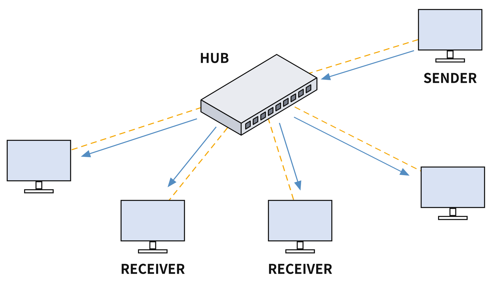
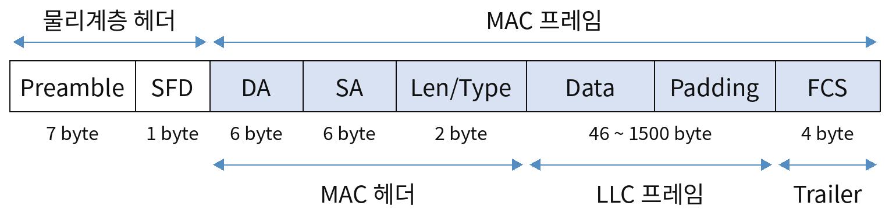
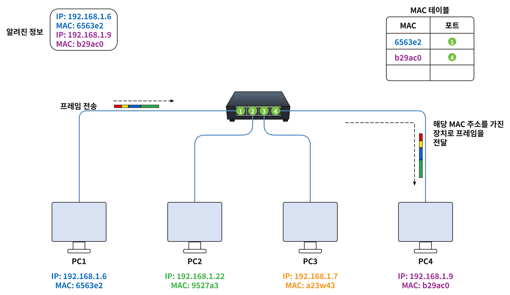
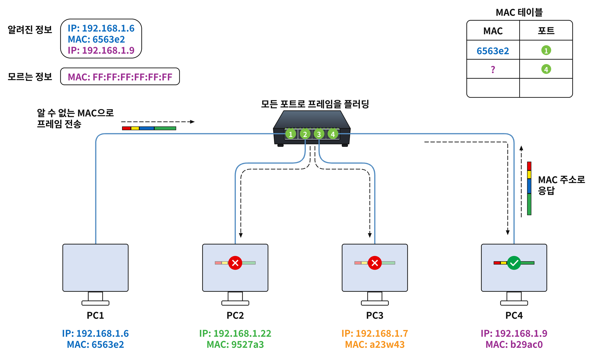
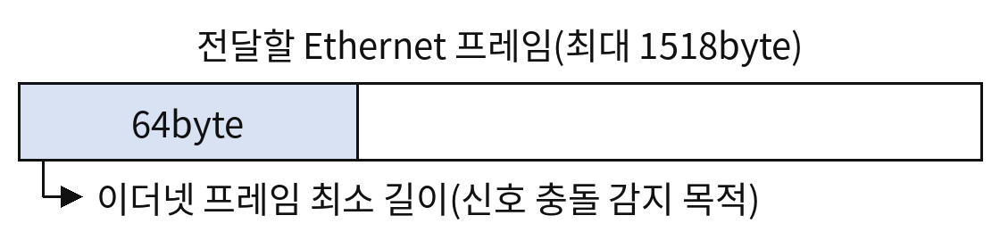
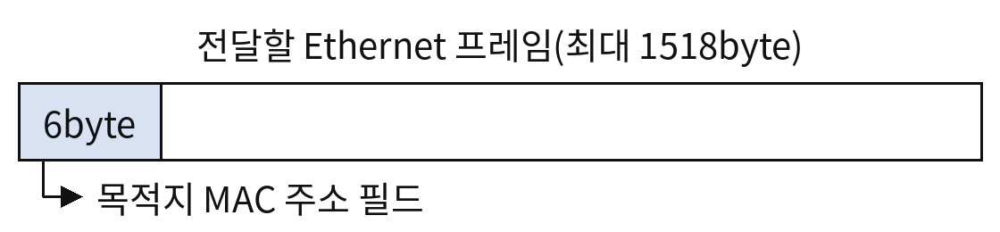
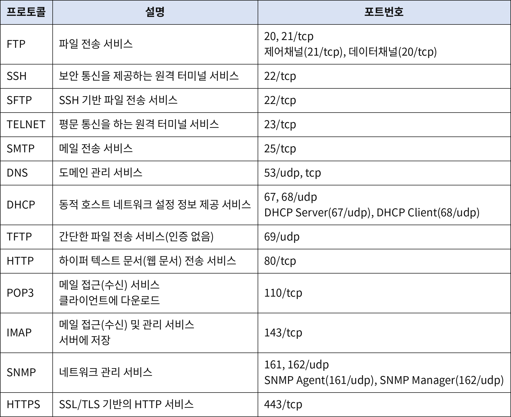
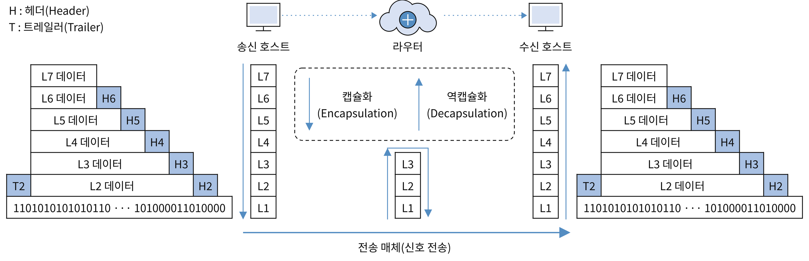
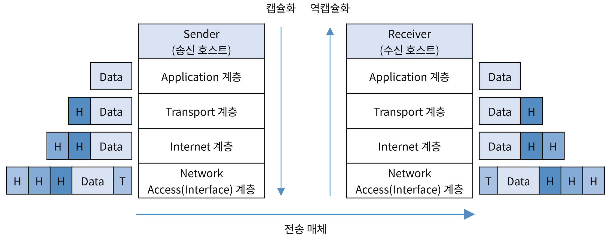
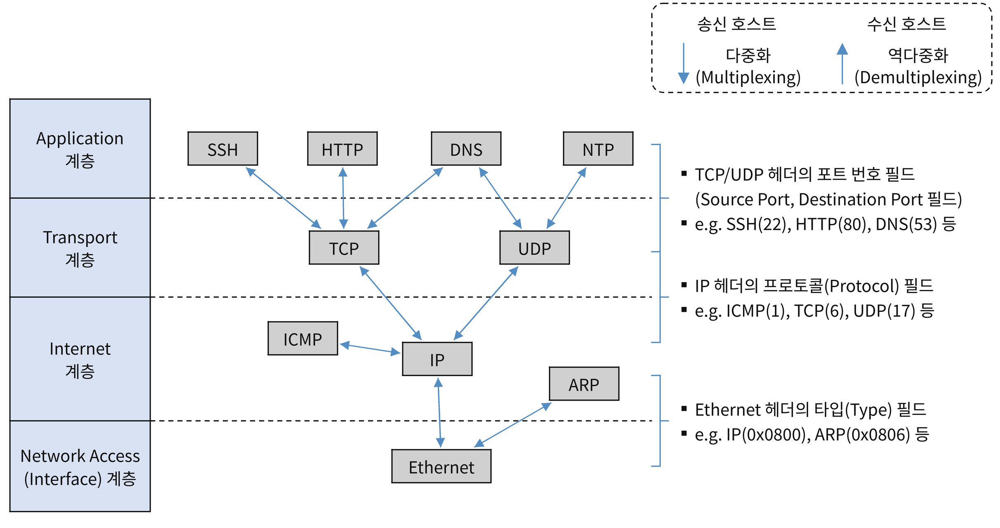

## OSI 7 Layer
- PDU(Protocol Data Unit) : 네트워크 각 계층에서 처리되는 데이터의 단위를 통칭. PCI와 SDU로 구성되어 있다.
	- PCI(Protocol Control Information) : 프로토콜 제어 정보(패킷의 헤더와 트레일러 부분)
	- SDU(Service Data Unit) : 전송 데이터(패킷의 페이로드 부분)
### L1 물리계층(Physical Layer)
##### 데이터 전송 단위(PDU)
- 비트(Bit)
##### 주요 네트워크 장비
- 허브(Hub)
	  
	- 유입된 신호를 장치가 연결된 <strong>모든 포트로 전달</strong>(Flooding) 해주는 네트워크 장비
	- 더미 허브(Dummy Hub) 라고도 함
	- 충돌 영역을 모든 포트가 공유
- 리피터(Repeater)
	- 전송 신호를 재생(증폭) 해주는 네트워크 장비
### L2 데이터링크 계층(Data Link Layer)
- 인접한 노드 간에 신뢰성 있는 데이터 전송을 담당하는 계층
- <strong>MAC 주소</strong> : 인접한 노드를 식별하기 위한 물리적 주소
	- 48비트 주소 체계
	- 네트워크 인터페이스 카드(NIC)에 설정된 변경할 수 없는 주소.
	- 상위 24비트는 제조사 식별 번호, 하위 24비트는 제조사에서 부여한 일련번호.
##### 데이터 전송 단위
- 프레임(Frame)
##### 주요 프로토콜
- LAN(Local Area Network) 프로토콜 : <strong>Ethernet</strong>, TokenRing, FDDI 등
- WAN(Wide Area Network) 프로토콜 : Frame Relay, PPP, SLIP 등
##### Ethernet Frame(=MAC Frame)

- <strong>Preamble</strong>: 수신 측에 프레임의 시작을 알리고 동기화
- <strong>SFD</strong>: 프레임의 시작을 나타냄
- <strong>DA</strong>(Destination Address) : 데이터를 받을 장치의 MAC 주소
- <strong>SA</strong>(Source Address) : 데이터를 보내는 장치의 MAC 주소
- <strong>Type</strong>: 상위 계층 프로토콜 종류 표시 (IPv4, IPv6 등)
- 데이터: 실제 전달할 데이터
- <strong>FCS</strong>(Frame Check Sequence): 오류 검출을 위한 값 (CRC 사용)
- LLC 프레임 : LLC 헤더를 추가하여 상위 계층 프로토콜을 구분하는 프레임
#### 주요 네트워크 장비
##### L2 Switch(스위치)
  
  
- MAC 주소 테이블(MAC Address Table)을 이용하여 <strong>유입된 프레임의 목적지 MAC 주소 장치가 연결된 포트로 프레임을 전달(Forwarding)하는 네트워크 장비</strong>
	- 포워딩(Forwarding) : 스위치와 같은 패킷 교환 장비에서 유입된 패킷을 목적지 주소의 장치가 연결된 포트로 전달하는 것
- <strong>목적지 MAC 주소를 찾을 수 없는 경우</strong> 스위치는 해당 프레임을 알 수 없는 유니캐스트 트래픽으로 처리하고 <strong>수신 포트를 제외한 동일 VLAN 내의 모든 포트로 플러딩</strong>
	- 플러딩(Flooding) : 장치가 연결된 모든 포트로 패킷을 전달하는 것
- 스위칭 허브(Switching Hub)라고도 함
- 충돌 영역 포트별 분리
##### Bridge(브리지)
- 물리적으로 떨어진 LAN을 연결해주는 네트워크 장비
#### <mark style="background:#fff88f">L2 Switch(스위치) 주요 기능 및 동작 방식</mark>
- <mark style="background:#fff88f">학습(Learning) 기능</mark>
	- 특정 포트로 유입된 프레임의 출발지 MAC 주소를 기반으로 MAC Address Table을 자동으로 갱신하는 기능
- <mark style="background:#fff88f">포워딩(forwarding) 기능</mark>
	- MAC Address Table을 검색하여 유입된 프레임의 목적지 MAC 주소 장치가 연결된 프레임 포트로 프레임을 전달하는 기능
- <mark style="background:#fff88f">플러딩(Flooding)기능</mark>
	- 장치가 연결된 모든 포트로 프레임을 전달하는 기능.
	- 프레임의 목적지 MAC 주소가 MAC 주소 테이블에 없는 경우나 브로드캐스트 프레임(FF:FF:FF:FF:FF:FF)인 경우 발생.
- <mark style="background:#fff88f">필터링(Filtering) 기능</mark>
	- 목적지 포트 외에는 프레임을 전달하지 않는 기능
	- 프레임이 유입된 포트로 다시 프레임을 전달하지 않는 기능(중복 프레임 방지 목적)
- <mark style="background:#fff88f">에이징(Aging) 기능</mark>
	- MAC 주소 테이블에 있는 학습한 MAC 주소로 일정 시간 동안 프레임이 유입되지 않으면 MAC 주소를 삭제하는 기능
#### <mark style="background:#fff88f"> L2 Switch(스위치) 프레임 전달 방식(LAN 스위칭 기법)</mark>
##### <mark style="background:#fff88f"> Store-and-Forward 방식</mark>

- 유입된 전체 프레임을 버퍼에 저장하고 프레임 오류 검사(CRC 검사)를 수행한 후 신호 충돌 여부를 감지하면서 목적지로 전송하는 방식
- 전체 프레임에 대한 오류 및 신호 충돌 검사를 수행하기 때문에 <strong>신뢰성이 높지만</strong>, 저장과 검사를 위한 <strong>지연시간이 발생</strong>한다.
##### <mark style="background:#fff88f">Fragment-Free 방식</mark>

- 유입된 프레임의 <strong>첫 64Byte를 확인한 후 충돌 여부를 감지하면서 목적지로 전송</strong>하는 방식
- 이더넷(Ethernet)의 경우 충돌을 감지하기 위해서는 최소 64Byte 크기의 프레임이 필요하다.
##### <mark style="background:#fff88f">Cut-Through 방식</mark>

- 유입된 프레임의 <strong>첫 6byte를 읽어 목적지 MAC 주소를 확인한 후 즉시 전송</strong>하는 방식
- <strong>지연 시간이 줄어</strong> 빠른 전송이 가능하지만, 프레임 오류 및 신호 충돌 검사를 하지 않기 때문에 <strong>신뢰성이 낮다.</strong>
### L3 네트워크 계층(Network Layer)
- End-to-end delivery. 종단 노드 간 데이터 전송을 담당하는 계층
- Host-to-host communication. 호스트 간 통신을 담당하는 계층
##### 호스트를 식별하기 위한 논리적인 주소
- IP 주소
##### 데이터 전송 단위(PDU)
- 패킷(Packet)
##### 주요 프로토콜
- <strong>IP</strong>(Internet Protocol) 프로토콜 : 신뢰성을 제공하지 않는 비연결형 프로토콜
- <strong>ICMP</strong>(Internet Control Message Protocol) 프로토콜 : 오류 보고 및 상태 진단 메세지 프로토콜
- <strong>IGMP</strong>(Internet Group Management Protocol) 프로토콜 : 멀티캐스트 그룹 관리용 프로토콜
- <strong>ARP</strong>(Address Resolution Protocol) 프로토콜 : 논리적인 IP 주소를 물리적인 MAC 주소로 변환해주는 프로토콜
- <strong>RARP</strong>(Reverse Address Resolution Protocol) 프로토콜: 물리적인 MAC 주소를 논리적인 IP 주소로 변환해주는 프로토콜
#### 주요 네트워크 장비
##### 라우터(Router)
- 서로 다른 네트워크(서로 다른 LAN, VLAN)를 연결하여 라우팅을 통해 IP 패킷을 목적지로 전달(포워딩)해주는 네트워크 장비.
- <strong>라우터의 기능 </strong>
	- 라우팅 및 포워딩
	- 데이터 링크 계층(L2)의 브로드 캐스트 및 멀티캐스트 프레임이 다른 네트워크로 전달되지 않도로 차단
	- 패킷 필터링 기능(ACL 기능) : IP 패킷에 대한 접근 통제 기능
	- QoS(Quality of Service, 서비스 품질) 기능 : 서비스별로 전송 우선순위(네트워크 대역폭, 전송속도)를 조절하는 기능
- <strong>라우팅 테이블(Routing table)</strong> : 라우팅을 위한 경로 정보를 담고 있는 테이블로 라우팅 정보 설정 방식에 따라 정적 라우팅과 동적 라우팅으로 구분할 수 있음.
	- 정적 라우팅(static routing) : 관리자가 직접 라우팅 정보를 설정하는 방식
	- 동적 라우팅(dynamic routing) : 다양한 라우팅 프로토콜(예: RIP, OSPF 등)을 이용하여 동적으로 라우팅 정보를 갱신하는 방식.
- <strong>라우팅(Routing)</strong> : 라우팅 테이블을 검색하여 IP 패킷을 목적지로 전달하기 위한 최적의 경로를 설정하는 것.
##### L3 스위치
- L2 스위치 기능과 L3 스위치 기능을 모두 가지고 있는 네트워크 장비
### L4 전송계층(Transport Layer)
- <strong>End-to-end reliable delivery</strong> 종단 노드 간 신뢰성 있는 데이터 전송을 담당하는 계층
- <strong>Process-to-Process communication</strong> 프로세스 간 통신을 담당하는 계층
##### 프로세스를 식별하기 위한 논리적인 식별자
- <strong>포트(Port) 번호</strong>
- 포트 번호는 상위 계층의 프로세스(서비스)를 식별하기 위한 16bit 식별자로 사용 목적과 사용 권한에 따라 포트 번호 범위를 구분할 수 있다.
- <strong>사용 목적에 따른 포트 번호 범위</strong>
	- 0-1023번
		- well known port. <strong>잘 알려진 포트</strong>
		- 예) DNS(53/udp, tcp), HTTP(80/tcp), HTTPS(433/tcp) 등
	- 1024-49151번
		- registered prot. 제조사가 관리기관에 용도를 등록해서 사용하는 <strong>등록된 포트</strong>
		- 예) SQL-Server(1433/tcp), Oracle(1521/tcp), MySQL(3306/tcp)
	- 49152-65535번
		- dynamic port. <strong>동적 포트</strong>. 일반적으로 클라이언트 포트로 사용.
- <strong>사용권한에 따른 포트 범위
</strong>
	- 0-1023번
		- privileged port.<strong> 특권 포트</strong>. 관리자(예) root, administrator) 권한으로 사용할 수 있는 포트.
	- 1024-65535번
		- unpivileged port. <strong>비특권포트</strong>. 관리자뿐만 아니라 일반 사용자 권한으로도 사용할 수 있는 포트
##### 주요 프로토콜
- <strong>TCP</strong> 프로토콜(Transmission Control Protocol)
	- <strong>신뢰성 있는 통신을 제공하는 연결지향</strong>(Connection oriented) 프로토콜
	- 전송 단위 : 세그먼트(Segment)
- <strong>UDP </strong>프로토콜 (User Datagram Protocol)
	- <strong>신뢰성을 제공하지 않는 비연결형</strong>(Connectionless) 프로토콜
	- 전송 단위 : 데이터그램(Datagram)
- <strong>SCTP</strong> 프로토콜(Stream Control Transfer Protocol) : TCP와 UDO 프로토콜의 특성을 조합한 프로토콜
##### 주요 네트워크 장비
- <strong>L4 스위치</strong> : IP 주소와 포트 번호를 기반으로 부하분산(Load Balancing) 및 장애 조치(Fail Over) 등의 기능을 제공하는 네트워크 장비
	- 부하분산(Load Balancing) : 여러 서버에 들어오는 트래픽을 적절히 분배하여 특정 서버에 부하가 집중되지 않도록 하는 기능
	- 장애조치(Fail Over) : 시스템에 장애가 발생했을 때 예비 시스템으로 자동 전환되는 기능.
### L5 세션 계층(Session Layer)
- 네트워크 어플리케이션 간 송수신 데이터 동기화 및 논리적인 연결 상태(세션) 생성, 관리 및 종료를 담당하는 계층
### L6 표현 계층(Presentation Layer)
- 네트워크 어플리케이션 간 <strong>송수신 데이터 표현 방식 변환을 담당</strong>하는 계층
- <strong>인코딩/디코딩, 압축/압축 해제, 암호화/복호화</strong> 등
### L7 응용 계층(Application Layer)
- 사용자가 네트워크에 접근할 수 있는 <strong>인터페이스를 담당</strong>하는 계층
- 네트워크 어플리케이션이 위치하는 계층으로 다양한 어플리케이션별로 프로토콜이 정의되어있다.
##### 데이터 전송 단위(PDU)
- 데이터(Data)
- 일반적으로 <strong>응용, 표현, 세션 계층 데이터 전송단위를 모두 데이터</strong>라고 한다.
##### <mark style="background:#fff88f">주요 프로토콜</mark>

- <strong>FTP</strong>(File Transfer Protocol)
	- 파일 전송 서비스. 
	- 포트번호 :<strong> 20,21/tcp</strong>
	- 제어채널(21/tcp), 데이터채널(20/tcp)
- <strong>SSH</strong>(Secure Shell)
	- 보안 통신을 제공하는 원격 터미널 서비스
	- 포트번호 : <strong>22/tcp</strong>
	- SFTP(Secure FTP, 22/tcp) : SSH 기반 파일 전송 서비스
- <strong>TELNET</strong>(Terminal Network)
	- <strong>평문 통신을 하는 원격 터미널 서비스</strong>
	- 포트번호 : <strong>23/tcp</strong>
- <strong>SMTP</strong>(Simple Mail Transfer Protocol)
	- <strong>메일 전송 서비스.</strong>
	- 포트번호 : <strong>25/tcp</strong>
- <strong>DNS</strong>(Domain Name System)
	- 도메인 관리 서비스
	- 포트번호 :<strong> 53/udp,tcp</strong>
- <strong>DHCP</strong>(Dynamic Host Configuration Protocol)
	- <strong>동적 호스트 네트워크 설정 정보 제공 서비스</strong>
	- 포트번호 : <strong>67,68/udp</strong>
	- DHCP Server(67/udp), DHCP Client(68/udp)
- <strong>TFTP</strong>(Trivial FTP)
	- <strong>간단한 파일 전송 서비스(인증없음)</strong>
	- 포트번호 : <strong>69/udp</strong>
- <strong>HTTP</strong>(Hyper Text Transfer Protocol)
	- 하이퍼 텍스트 문서(웹 문서) 전송 서비스
	- 포트번호 : <strong>80/tcp</strong>
- <strong>POP3</strong>(Post Office Protocol version 3)
	- <strong>메일 접근(수신) 서비스</strong> 클라이언트에 다운로드
	- 포트번호 :<strong> 110/tcp</strong>
- <strong>IMAP</strong>(Internet Message Access Protocol)
	- <strong>메일 접근(수신) 및 관리 서비스</strong> 서버에 저장
	- 포트번호 : <strong>143/tcp</strong>
- <strong>SNMP</strong>(Simple Network Management Protocol)
	- 네트워크 관리 서비스
	- 포트번호 : <strong>161,162/udp</strong>
	- SNMP Agent(161/udp), SNMP Manager(162/udp)
- <strong>HTTPS</strong>(HTTP over SSL/TLS)
	- SSL/TLS 기반의 HTTP 서비스
	- 포트번호 : <strong>443/tcp</strong>
##### 주요 네트워크 장비
- <strong>L7 스위치</strong> : 애플리케이션 데이터(URL, HTTP 헤더 등)를 기준으로 패킷을 교환(스위칭)해주는 네트워크 장비
	- 어플리케이션 데이터 콘텐츠 분석을 통한 탐지 및 차단
	- 어플리케이션 수준의 부하 분산 및 장애조치
	- SSL 오프로드(Offload) 가능
		- SSL(TLS) 서버를 대신해서 SSL 트래픽에 대한 모든 암복호화 처리를 수행하는 기능. 네트워크 보안장비에 SSL 트래픽에 대한 가시성을 제공하기 위해 주로 사용.
## OSI 계층 간 데이터 교환 방식
#### 캡슐화(Encapsulation)와 역 캡슐화(Decapsulation)

- 캡슐화(Encapsulation): <strong>송신</strong>, <strong>헤더 추가</strong>, 상위 계층에서 하위 계층으로.
- 역캡슐화(Encapsulation) : <strong>수신</strong>, <strong>헤더 제거</strong>, 하위 계층에서 상위 계층으로.
##### TCP/IP 계층 간 데이터 교환 방식(캡슐화/역캡슐화)

- <strong>캡슐화</strong> 
	- <strong>송신</strong> 측에서 각 계층이 필요한 헤더 등의 정보를 추가하여 데이터를 목적지까지 전달할 수 있도록 하는 과정
	- <strong>응용 계층</strong>: 웹사이트 요청 <strong>데이터 생성</strong>
	- <strong>전송 계층</strong>: 데이터를 전달할 응용 프로그램을 구분하기 위해 <strong>TCP/UDP 포트 번호 추가</strong>
	- <strong>인터넷 계층</strong>: 목적지까지 데이터를 전달하기 위해 <strong>IP 주소 추가</strong>
	- <strong>네트워크 접근 계층</strong>: 같은 네트워크 내에서 데이터를 전달하기 위해 <strong>MAC 주소와 트레일러 추가</strong>
		- FCS(Frame Check Sequence) : 트레일러에 포함되는 프레임에 오류가 있는지 확인하기 위한 정보
- <strong>역캡슐화</strong>
	- <strong>수신</strong> 측에서 각 계층의 헤더 등의 정보를 확인하고 처리하여 상위 계층으로 데이터를 전달하는 과정
	- <strong>네트워크 접근 계층</strong>: 프레임을 확인하고, MAC 주소를 확인하며 FCS를 이용해 오류 여부 검사
	- <strong>인터넷 계층</strong>: IP 주소 확인 및 IP 헤더 처리
	- <strong>전송 계층</strong>: 포트 번호 확인 및 TCP/UDP 헤더 처리 후 해당 응용 프로그램으로 전달
	- <strong>응용 계층</strong>: 웹 브라우저가 데이터를 처리
#### 다중화(Multiplexing)와 역다중화(Demultiplexing)

- 다중화(Multiplexing)
	- <strong>송신</strong> 측에서 수행
	- <strong>여러 개의 데이터 흐름을 하나의 통신 경로로 모아서 전송</strong>하는 과정
	- 통신 경로를 효율적으로 사용
	- 예) 컴퓨터에서 동시에 여러 작업을 할 때 유튜브 영상 데이터 + 웹사이트 데이터 + 온라인 게임 데이터 → 하나의 통신 경로로 모아 전송
- 역다중화(Demultiplexing)
	- <strong>수신</strong> 측에서 수행
	- <strong>하나의 통신 경로로 들어온 데이터를 원래의 목적지나 데이터 흐름별로 분리</strong>하는 과정
	- 예) 웹 브라우저 데이터 → 웹 브라우저로 전달, 이메일 데이터 → 이메일 프로그램으로 전달