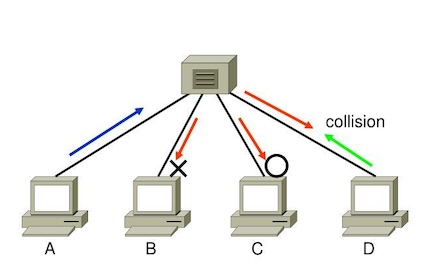
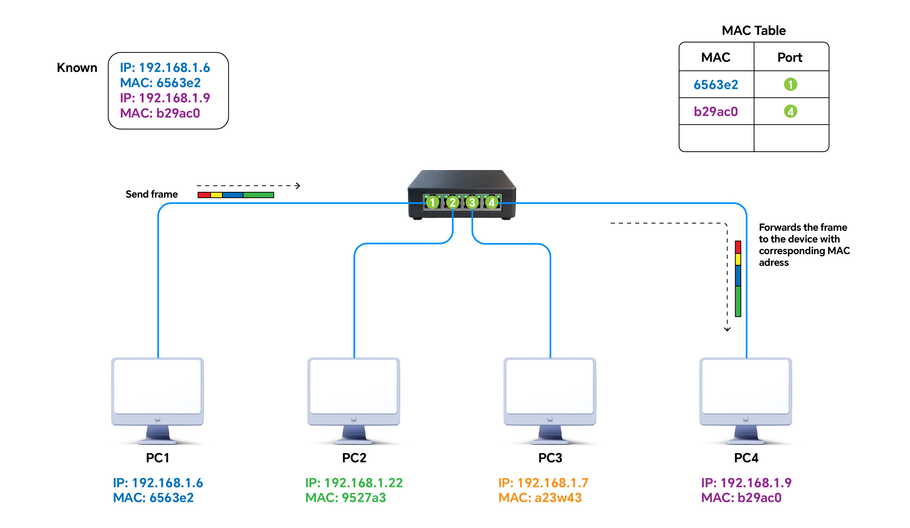
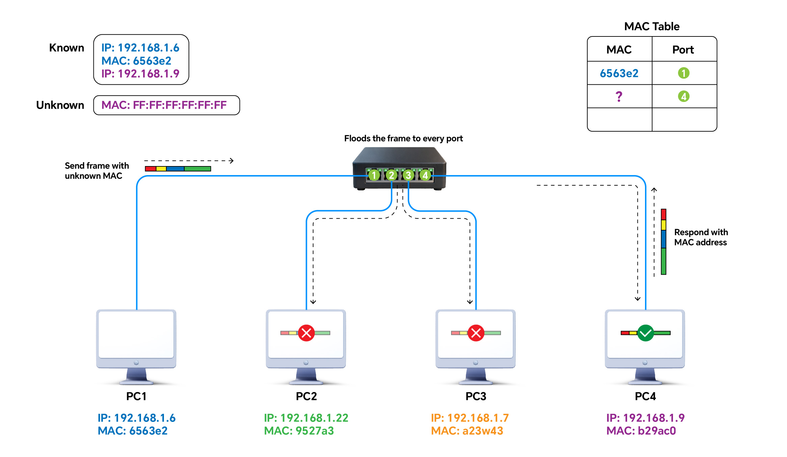

## OSI 7 Layer
- PDU(Protocol Data Unit) : 네트워크 각 계층에서 처리되는 데이터의 단위를 통칭
### L1 물리계층(Physical Layer)
##### 데이터 전송 단위(PDU)
- 비트(Bit)
##### 주요 네트워크 장비
- 허브(Hub)
  
	- 유입된 신호를 장치가 연결된 <strong>모든 포트로 전달</strong>(Flooding) 해주는 네트워크 장비
	- 더미 허브(Dummy Hub) 라고도 함
	- 충돌 영역을 모든 포트가 공유
- 리피터(Repeater)
	- 전송 신호를 재생(증폭) 해주는 네트워크 장비
### L2 데이터링크 계층(Data Link Layer)
- 인접한 노드 간에 신뢰성 있는 데이터 전송을 담당하는 계층
- <strong>MAC 주소</strong> : 인접한 노드를 식별하기 위한 물리적 주소
	- 48비트 주소 체계
	- 네트워크 인터페이스 카드(NIC)에 설정된 변경할 수 없는 주소.
	- 상위 24비트는 제조사 식별 번호, 하위 24비트는 제조사에서 부여한 일련번호.
##### 데이터 전송 단위
- 프레임(Frame)
##### 주요 프로토콜
- LAN(Local Area Network) 프로토콜 : <strong>Ethernet</strong>, TokenRing, FDDI 등
- 이더넷 추가 정리
- WAN(Wide Area Network) 프로토콜 : Frame Relay, PPP, SLIP 등
##### 주요 네트워크 장비
- L2 Switch(스위치)
	- MAC 주소 테이블(MAC Address Table)을 이용하여 유입된 프레임의 목적지 MAC 주소 장치가 연결된 포트로 프레임을 전달(Forwarding)하는 네트워크 장비
	- 포워딩(Forwarding) : 스위치와 같은 패킷 교환 장비에서 유입된 패킷을 목적지 주소의 장치가 연결된 포트로 전달하는 것
	  
	- 목적지 MAC 주소를 찾을 수 없는 경우 스위치는 해당 프레임을 알 수 없는 유니캐스트 트래픽으로 처리하고 수신 포트를 제외한 동일 VLAN 내의 모든 포트로 플러딩
	- 플러딩(Flooding) : 장치가 연결된 모든 포트로 패킷을 전달하는 것
	- 스위칭 허브(Switching Hub)라고도 함
	- 충돌 영역 포트별 분리
- Bridge(브리지) : 물리적으로 떨어진 LAN을 연결해주는 네트워크 장비
##### <mark style="background:#fff88f">L2 Switch(스위치) 주요 기능 및 동작 방식</mark>
- <mark style="background:#fff88f">학습(Learning) 기능</mark>
	- 특정 포트로 유입된 프레임의 출발지 MAC 주소를 기반으로 MAC Address Table을 자동으로 갱신하는 기능
- <mark style="background:#fff88f">포워딩(forwarding) 기능</mark>
	- MAC Address Table을 검색하여 유입된 프레임의 목적지 MAC 주소 장치가 연결된 프레임 포트로 프레임을 전달하는 기능
- <mark style="background:#fff88f">플러딩(Flooding)기능</mark>
	- 장치가 연결된 모든 포트로 프레임을 전달하는 기능.
	- 프레임의 목적지 MAC 주소가 MAC 주소 테이블에 없는 경우나 브로드캐스트 프레임(FF:FF:FF:FF:FF:FF)인 경우 발생.
- <mark style="background:#fff88f">필터링(Filtering) 기능</mark>
	- 목적지 포트 외에는 프레임을 전달하지 않는 기능
	- 프레임이 유입된 포트로 다시 프레임을 전달하지 않는 기능(중복 프레임 방지 목적)
- <mark style="background:#fff88f">에이징(Aging) 기능</mark>
	- MAC 주소 테이블에 있는 학습한 MAC 주소로 일정 시간 동안 프레임이 유입되지 않으면 MAC 주소를 삭제하는 기능
##### <mark style="background:#fff88f"> L2 Switch(스위치) 프레임 전달 방식(LAN 스위칭 기법)</mark>
- <mark style="background:#fff88f"> Store-and-Forward 방식</mark>
	- 유입된 전체 프레임을 버퍼에 저장하고 프레임 오류 검사(CRC 검사)를 수행한 후 신호 충돌 여부를 감지하면서 목적지로 전송하는 방식
	- 전체 프레임에 대한 오류 및 신호 충돌 검사를 수행하기 때문에 <strong>신뢰성이 높지만</strong>, 저장과 검사를 위한 <strong>지연시간이 발생</strong>한다.
- <mark style="background:#fff88f">Fragment-Free 방식</mark>
	- 유입된 프레임의 <strong>첫 64Byte를 확인한 후 충돌 여부를 감지하면서 목적지로 전송</strong>하는 방식
	- 이더넷(Ethernet)의 경우 충돌을 감지하기 위해서는 최소 64Byte 크기의 프레임이 필요하다.
	- 다시 정리
- <mark style="background:#fff88f">Cut-Through 방식</mark>
	- 유입된 프레임의 <strong>첫 6byte를 읽어 목적지 MAC 주소를 확인한 후 즉시 전송</strong>하는 방식
	- <strong>지연 시간이 줄어</strong> 빠른 전송이 가능하지만, 프레임 오류 및 신호 충돌 검사를 하지 않기 때문에 <strong>신뢰성이 낮다.</strong>