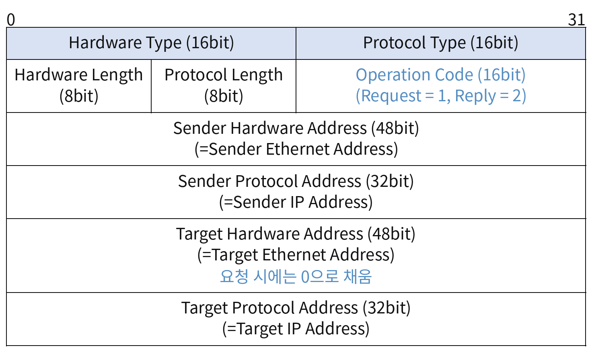

## ARP RARP 프로토콜
- ARP/RARP 프로토콜
	- 논리적인 IP 주소와 물리적인 MAC 주소 간 변환을 담당하는 네트워크 계층(L3) 프로토콜
	- 요청 메세지와 응답메세지로 구성
	- 네트워크 계층에서 IP 프로토콜 하위에 있는 프로토콜로 IP 프로토콜로 캡슐화 되지 않고 <strong>데이터 링크(L2) 계층 프로토콜로 캡슐화</strong> 된다.
	- 로컬 네트워크(자신이 속한 네트워크)에서 동작하도록 설계된 프로토콜로 다른 네트워크로 라우팅되지 않기 때문에 <strong>IP 프로토콜로 캡슐화 하지 않는다</strong>.
- ARP 프로토콜(Address Resolution Protocol)
	- IP 주소 → MAC 주소로 변환해주는 프로토콜
	- IP 라우팅을 통해 선정된 경유 노드(또는 최종 목적지 노드)의 IP 주소에 대한 MAC 주소를 알아내기 위해 사용
- RARP 프로토콜(Reverse Address Resolution Protocol)
	- MAC 주소 -> IP주소로 변환해주는 프로토콜
	- 일반적으로 IP 주소는 시스템의 하드디스크 내 설정 파일에 저장되어 있음. 그러나 하드 디스크가 없는 터미널(Dummy terminal)의 경우 초기 기동될 때 자신의 IP 주소를 알아내기 위해 네트워크 인터페이스에 설정된 물리적인 MAC 주소를 담은 RARP 요청 메세지를 보내고, RARP 서버로부터 IP 정보를 담은 RARP 응답 메세지를 받는다.
#### ARP 프로토콜 구조 

- <strong>Hardware Type(16bit)</strong> : ARP에서 사용하는 물리적 네트워크 유형을 나타내는 필드. Ethernet = `0x0001`
- <strong>Protocol Type(16bit)</strong> : 어떠한 유형의 프로토콜(IPv4, IPv6 등)을 사용하는가를 나타내는 필드. IPv4 = `0x0800`
- <strong>Hardware Length(8bit)</strong> : 물리적인 주소의 길이. Etherent = 6byte.
- <strong>Protocol Lentgth(8bit)</strong> : 논리적 주소의 길이. IPv4 = 4byte
- <strong>Operation(16bit)</strong> : 동작 모드
	- ARP Request = 1, ARP Reply = 2
	- RARP Request = 3, RARP Reply = 4
- <strong>Sender hardware address(48bit)</strong> : 송신자 호스트의 물리적인 주소
- <strong>Sender protocol address(32bit)</strong> :송신자 호스트의 물리적인 주소
- <strong>Target hardware address(48bit)</strong> : 대상 호스트의 물리적인 주소
	- ARP  요청 시에는 대상 호스트의 MAC 주소를 모르기 때문에 모든 비트를 0으로 채운다.
- <strong>Target protocol address(32bit)</strong> : 대상 호스트의 논리적인 주소.
#### ARP 동작 방식
- 요청자 호스트는 응답자 호스트의 MAC 주소를 모르기 때문에 ARP 요청 메세지를 생성하여 브로드캐스트(Broadcast) 방식으로 전송한다.
	- 브로드 캐스트 주소 = FF:FF:FF:FF:FF:FF
- 응답자 호스트는 ARP 응답 메세지를 생성하여 요청자 호스트에게 전송한다. 응답 메세지는 응답자 호스트의 MAC 주소 정보가 담겨있으며, 주신한 요청 메세지를 통해 요청자 호스트의 MAC 주소를 알고 있으므로 유니캐스트(Unicast) 방식으로 전송한다.
	- 유니캐스트 : 1:1로 패킷을 전송하는 통신 방식.
- 요청자 호스트와 응답자 호스트 모두 자신의 ARP 캐시 테이블(ARP Cache Table)에 상대방의 MAC 주소 정보를 일정 시간 유지하고 이를 참조함으로써 중복된 ARP 요청/응답 통신 발생을 최소화한다.
#### APR 캐시 테이블(ARP Cache Table) 관리
- ARP 캐시 테이블에 저장된 정보는 동적 정보와 정적 정보로 구분된다.
	- 동적(Dynamic) 정보 : ARP 요청/응답 메세지를 통해 설정된 정보로 일정 시간 동안 유지된 후 삭제된다.
	- 정적(Static) 정보 : 관리자가 직접 설정하며, 시스템 종료 전까지 유지되고 ARP 메시지에 의해 갱신되지 않는 정보.
- 명령어
	- ARP 캐시 정보 확인하기 arp -a
	- ARP 캐시 정보 삭제하기 arp -d
	- ARP 캐시 정적 설정하기 arp -s