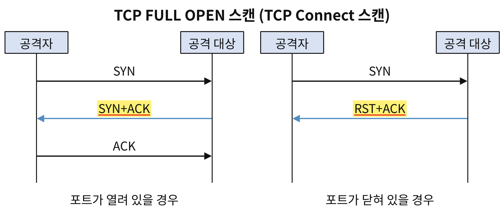
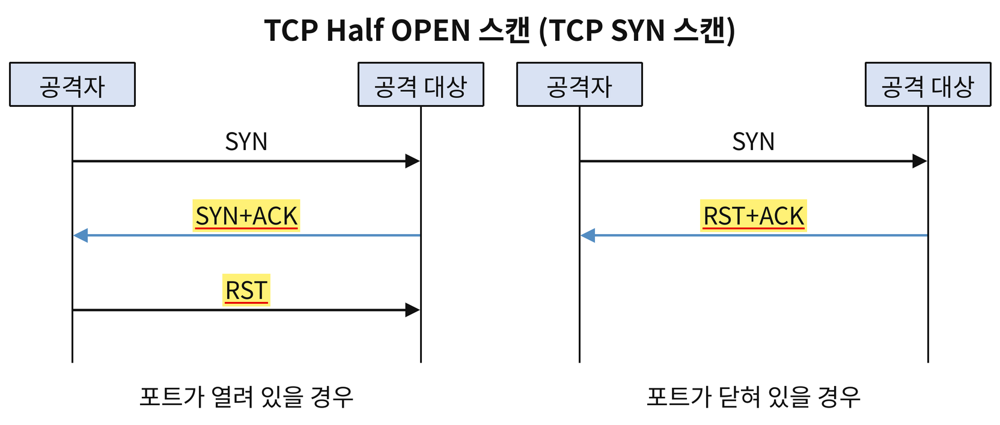
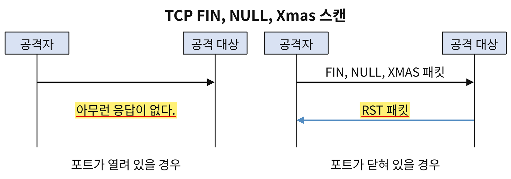
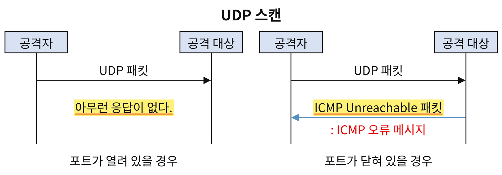
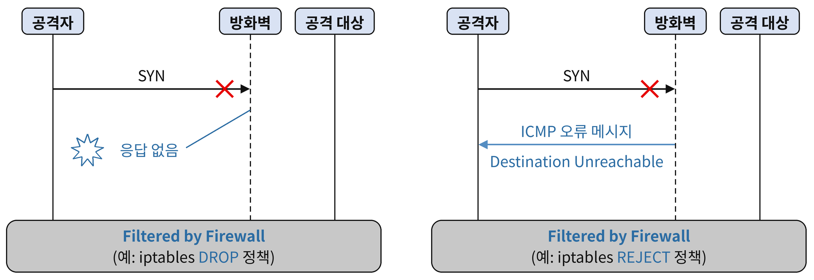
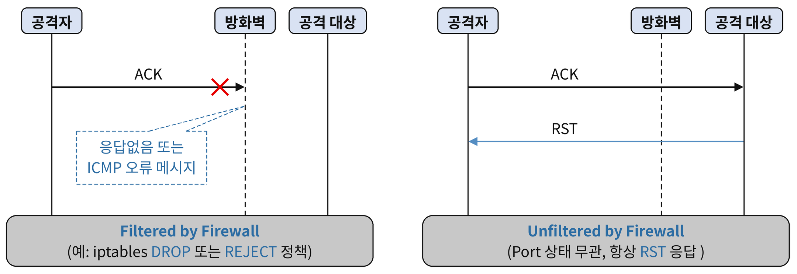
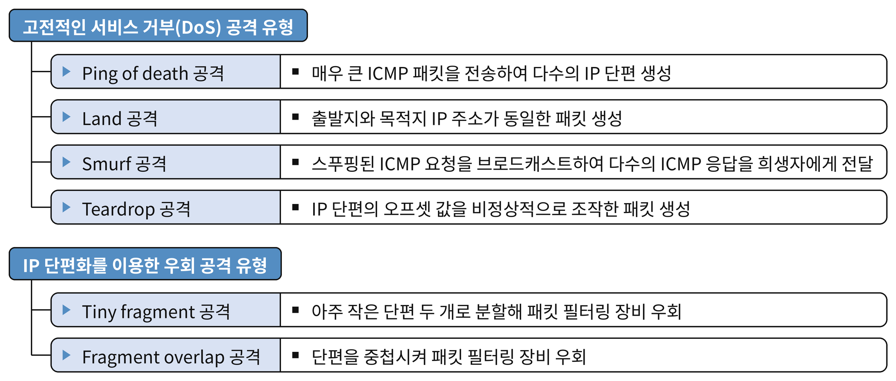
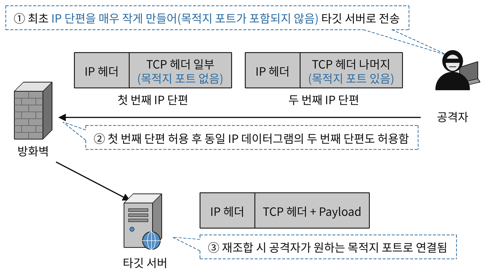
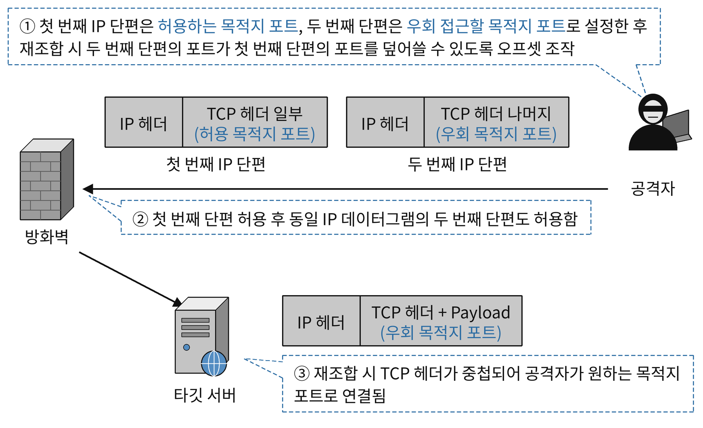

#### 스니핑
- 허브 환경에서 스니핑
	- 허브에 장치를 연결한 후 NIC의 동작 모드를 무차별 모드(Promiscuous Mode)로 설정.
	- 무차별 모드(Promiscuous Mode) : 유입된 프레임의 목적지 MAC 주소와 상관 없이 모든 프레임을 수신하는 동작 모드.
- 스위치(L2 스위치 환경에서 스니핑)
	- <strong>스위치 재밍(Switch Jamming) = 맥 플러딩(Mac Flooding)</strong>
		- 위조된 출발지 MAC 주소 대량 전송 → MAC 주소 테이블 포화(오버플로우)→ 허브처럼 동작 → 스니핑 가능
	- <mark style="background:#fff88f"><strong>ARP 스푸핑 공격 = ARP Cache Poisoning 공격</strong></mark>
		- 공격자가 특정 호스트의 MAC 주소를 자신의 MAC 주소로 위조한 ARP Reply 메세지를 생성하여 희생자의 호스트에 지속해서 전송하면 희생자의 호스트 ARP Cache Table에 특정 호스트의 MAC 주소가 공격자의 MAC 주소로 조작된다. 이를 통해 희생자 호스트가 특정 호스트로 전송하는 프레임이 공격자 쪽으로 전달되도록 하는 스니핑 기법.
		- 지속해서 위조한 ARP Reply 메세지를 전송하는 이유 : 동적 ARP 정보는 일정 시간 후 삭제되므로 조작된 정보를 유지하기 위해
	- 대응 방안
		- 중요 시스템에 대해서는 ARP Cache Table에 MAC 주소 정보를 정적(Static)으로 설정하여 ARP Reply 메세지를 수신해도 ARP 캐시 정보가 갱신되지 않도록 한다.
		- 네트워크 상의 ARP 트래픽을 실시간으로 모니터링하는 프로그램(Arpwatch 등)을 이용하여 IP 주소에 대한 MAC 주소 변경 여부를 감시한다.
	- <strong>ARP 리다이렉트(Redirect) 공격을 이용한 스니핑 기법</strong>
		- ARP 스푸핑 공격과 유사하게 공격자가 자신이 게이트웨이(라우터)인 것처럼 MAC 주소를 위조한 ARP Reply 메세지를 생성하여 지속해서 브로트캐스트하면 로컬 네트워크에 있는 모든 호스트의 ARP Cache Table에 게이트웨이(라우터)의 MAC 주소가 공격자의 MAC 주소로 조작된다. 이를 통해 모든 호스트가 게이트웨이(라우터)로 전송하는 프레임이 공격자로 전달되도록 하는 스니핑 기법이다.
	- <strong>ICMP 리다이렉트(Redirect) 공격을 이용한 스니핑 기법</strong>
		- 라우터로 가장한 공격자가 특정 IP 또는 IP 대역으로 나가는 패킷의 라우팅 경로를 자신에게 라우팅 되도록 위조한 ICMP Redirection 메시지(Type 5)를 전송하여 희생자의 <strong>라우팅 테이블을 조작</strong>하고, 패킷을 경유시켜 스니핑하는 공격.
		- <strong>ICMP Redirection 메시지(Type 5)</strong> : 라우터가 호스트에게 더 적절한 라우팅 경로를 알려주는 메시지.
			- 공격자가 이를 악용하여 특정 IP 또는 IP 대역으로 나가는 패킷의 라우팅 경로를 공격자 주소로 위조한 ICMP Redirection 메시지를 생성한 후 라우터로 가장하여(IP 스푸핑) 희생자 호스트에 전송함으로써 희생자 호스트의 라우팅 테이블을 조작할 수 있다.
			* 라우터로 가장하기 위해 IP 스푸핑을 하는 이유 : ICMP Redirection 메시지는 라우터가 보내는 메시지이므로 라우터가 아닌 호스트가 보낸 메세지는 무시된다. 따라서 공격자는 라우터가 보낸 메세지 처럼 보이도록 출발지 IP 주소를 라우터의 IP 주소로 위조(IP 스푸핑)하여 ICMP Redirection 메시지를 희생자 호스트에 전송한다
		* 대응 방안
			* 운영체제(커널) 설정을 통해 ICMP Redirection 메세지에 의한 라우팅 정보 변경을 허용하지 않도록 설정
			* 방화벽 기능을 통해 ICMP Redirection 메세지를 차단하도록 설정
##### <mark style="background:#fff88f">네트워크 스니핑 공격 대응 방안 </mark>
- 22/24.1, 기사
- 네트워크 스니핑을 통해 통신 내용을 알 수 없도록 암호화(보안) 프로토콜 또는 프로그램을 사용하여 통신에 사용되는 모든 데이터를 암호화한다. 
- 주요 암호화 기법
	* 웹 환경에서의 HTTPS 사용
	* 이메일 환경에서의 PGP, S/MIME 등 사용
	* 원격 터미널 접속을 위한 SSH 사용
	* 공중망을 통해 사설망 수준의 보안 서비스를 제공하는 VPN(SSL/TLS, IPsec 등) 사용
- 허브(더미 허브) 장비에 비해 상대적으로 네트워크 스니핑 공격에 안전한 스위치(스위칭 허브) 장비를 이용한다.
- 스니핑(스니퍼) 탐지 도구를 이용하여 악의적인 스니핑이 발생하는지 지속해서 점검한다.
#### 포트 스캔(Port Scan) 기법
- 공격자가 침입 전에 대상 호스트에 어떤 포트(서비스)가 활성화 되어있는지 확인하는 기법
- Nmap : 대표적인 포트스캐너
#### TCP FULL OPEN 스캔(TCP Connect 스캔)

- 대상 시스템에 스캔 로그가 남을 수 있다.
#### TCP HALF OPEN 스캔(TCP SYN 스캔)

- RST : 연결 강제 종료 패킷
- 서버에 로그를 남기지 않음
- <strong>스텔스 스캔</strong> : TCP 연결을 생성하지 않고 스캔
#### TCP FIN, NULL, Xmas 스캔

- TCP FIN, NULL, Xmas 스캔에서 사용하는 패킷에 대해 닫힌 포트에서는 RST 패킷으로 응답하고, 열린 포트에서는 응답하지 않는다.
- <strong>스텔스 스캔</strong> : TCP 연결을 생성하지 않고 스캔
- TCP 패킷 헤더의 제어 플래그를 비정상적으로 설정하여 스캔.
#### UDP 스캔

- 닫힌 UDP 포트로 패킷을 전송하면 ICMP 오류 메세지(Type 3 Destination Unreachable, Code 3: Port Unreachable)로 응답하는 특성을 이용.
#### Filtered 상태

- 방화벽에 의해 서비스 포트가 차단된 경우, <strong>방화벽 정책에 따라 응답이 없거나 ICMP 오류 메시지(Destination Unreachable)를 수신</strong>할 수 있다.
- 일반적으로 방화벽은 응답하지 않도록 설정된다.
- iptable 방화벽의 경우
	- DROP 차단 정책 : 패킷을 폐기하고 아무런 응답을 하지 않음
	- REJECT 차단 정책 : 패킷을 폐기한 후 설정된 ICMP 오류 메세지를 응답.
#### TCP ACK 스캔

 - 대상 호스트의 <strong>방화벽 룰셋(필터링 정책)을 파악하기 위한 스캔 방식</strong>
- 대상 호스트의 지정된 포트로 ACK 제어 플래그만 설정한 패킷을 전송.
- 차단된(Filtered) 상태 : 응답이 없거나 ICMP 오류 메세지(Destination Unreachable)을 수신
- 허용된(Unfiltered) 상태 : 대상 호스트로부터 RST 응답을 수신.
#### Decoy 스캔
- 다양한 포트 스캔을 수행할 때 사용할 수 있는 옵션으로 실제 스캐너 주소 외에 여러 개의 가짜 IP 주소를 함께 사용하여 스캔하는 방식.
- 이로 인해 스캔을 당하는 호스트 관리자 입장에서는 스캔을 수행한 실제 스캐너 주소를 식별하기 어려움.
### 서비스 거부(DoS : Denial Of Service) 공격
- 비정상적인 트래픽을 발생시켜 네트워크 대역폭이나 시스템 자원을 고갈시키거나 오류를 유발하여 정상적인 서비스 제공을 방해하는 공격. 서비스 가용성을 저하시켜 정상 사용자의 요청을 처리하지 못하게 함.

#### Ping of death 공격
- ping 명령을 이용하여 매우 큰 ICMP Echo Request 패킷을 전송함으로써 대상 시스템에 과부하나 오류를 유발하는 서비스 거부 공격.
- <strong>공격 원리</strong> : 비정상적으로 큰 ICMP 패킷 전송 → MTU 초과로 IP 단편화 발생 → 다수의 IP 단편을 재조합 과정에서 과부하 또는 버퍼 오류에 의한 서비스 거부 발생 가능
- <strong>대응책</strong> : 비정상적으로 큰 ICMP 패킷 탐지 및 차단, 시스템 패치 적용
### Land 공격
- 출발지 IP 주소와 목적지 IP 주소를 동일하게 위조한 패킷을 전송하여, 대상 시스템이 자기 자신에게 응답하도록 유도해 무한 루프 또는 과도한 자원 소모를 일으키는 서비스 거부 공격.
- IP 스푸핑(Spoofing) 기법을 사용하며, 단일 패킷만으로도 취약한 시스템의 자원을 소모시키거나 마비시킬 수 있는 특징이 있다.
	- IP 스푸핑(IP Spoofing): 공격자가 자신의 IP 주소를 다른 호스트의 IP 주소로 위조하여 신뢰 관계를 악용하거나 공격 출처를 숨기는 공격 기법.
- <strong>대응책</strong> : 출발지와 목적지 IP 주소가 동일한 패킷 탐지 및 차단, 시스템 패치 적용
#### <mark style="background:#fff88f"><strong>Smurf 공격</strong></mark>
- 출발지 IP 주소를 공격 대상 IP 주소로 위조하여 증폭 네트워크의 Directed Broadcast 주소로 ICMP Echo Request를 전송하고, 네트워크 내 모든 호스트가 피해자에게 ICMP Echo Reply를 보내도록 유도해 네트워크 대역폭을 소진시키는 서비스 거부 공격.
	- 다이렉트 브로트캐스트 : 특정 원격 네트워크(서브넷)에 속한 모든 호스트에게 동시에 데이터를 전송하는 방식. 
- <strong>주요 특징</strong> : IP 스푸핑, Directed Broadcast 및 증폭/반사 네트워크 사용.
- <strong>대응책</strong> : Directed Broadcast 패킷 차단, Directed Broadcast ICMP 응답 비활성화, 비정상적으로 많은 ICMP Echo Reply 패킷 탐지 및 차단
#### Teardrop 공격
- IP 단편의 오프셋 값을 비정상적으로 조작한 패킷을 전송하여, 대상 시스템의 IP 단편 재조합 과정에서 오류를 유발하는 서비스 거부 공격.
- 중첩되거나 비연속적인 오프셋 값을 가진 IP 단편을 전송하여 재조합 모듈에서 버퍼 오버플로우 등 시스템 오류를 발생시킴.
- 대응책 : 비정상 IP 단편 탐지 및 차단, 시스템 패치 적용.
### IP 단편화(Fragmentation) 취약점을 이용한 우회 공격
- IP 단편화 과정에서 발생할 수 있는 취약점을 악용하여 패킷 필터링 장비(방화벽, IDS/IPS 등)를 우회
- 패킷 필터링 장비의 검사기능을 우회하여 원래 허용되지 않는 대상 시스템의 서비스에 접근하기 위한 공격.
#### Tiny fragment 공격(작은 단편 공격)

- TCP/UDP 헤더가 두 개의 IP 단편으로 나뉘도록 첫번째 단편을 매우 작은 크기로 생성하여 패킷필터링 장비를 우회하는 공격.
- <strong>공격 원리</strong>
	- 공격자는 TCP/UDP 헤더가 두 개의 IP 단편으로 나뉘도록 패킷을 아주 작은 단편으로 쪼개어 전송. 두 번째 포트에만 목적지 포트 정보를 포함한다.
	- 취약한 패킷 필터링 장비는 첫 번째 단편에서 검사해야 할 정보(예: 목적지 포트)가 없으므로 이를 허용하고, 두 번째 단편은 이미 첫번째 단편이 허용되었다는 이유로 그대로 통과시킨다.
	- 대상 시스템에서는 두 단편이 재조합되어 결과적으로 공격자가 의도한 포트로 연결이 이루어진다.
#### Fragment overlap 공격(단편 중첩 공격)

- IP 단편의 오프셋 값을 조작하여, 두 번째 단편이 첫 번째 단편의 일부를 덮어쓰도록 만들어 패킷 필터링 장비를 우회하는 공격 기법.
- <strong>공격 원리</strong>
	- 공격자는 두 개의 IP 단편을 생성하여, 첫 번재 단편에는 패킷 필터링 장비가 허용하는 포트 정보(예: 433/tcp)를 포함시킨다.
	- 두 번째 단편에는 공격자가 실제로 접근하려는 차단 대상 포트 번호(예:22/tcp)를 포함시키고, 이 단편이 첫 번째 단편의 목적지 포트 필터를 덮어쓰도록 오프셋 값을 조작한다.
	- 취약한 패킷 필터링 장비는 첫 번째 단편에 포함된 허용 포트 번호(예: 443/tcp)만을 검사하고 허용한 뒤, 같은 흐름의 두 번째 단편 역시 통과시킨다.
	- 대상 시스템에서는 두 단편이 재조합되어 결과적으로 공격자가 의도한 포트(22/tcp)로 연결이 이루어진다.
- <strong>대응책</strong>
	- 패킷 필터링 장비(방화벽, IDS/IPS 등)가 IP 단편을 재조합하여 검사(reassembly based inspection)할 수 있도록 설정하거나, 비정상적으로 단편화된 패킷을 탐지 및 차단할 수 있는 패킷 필터링 장비를 적용한다.