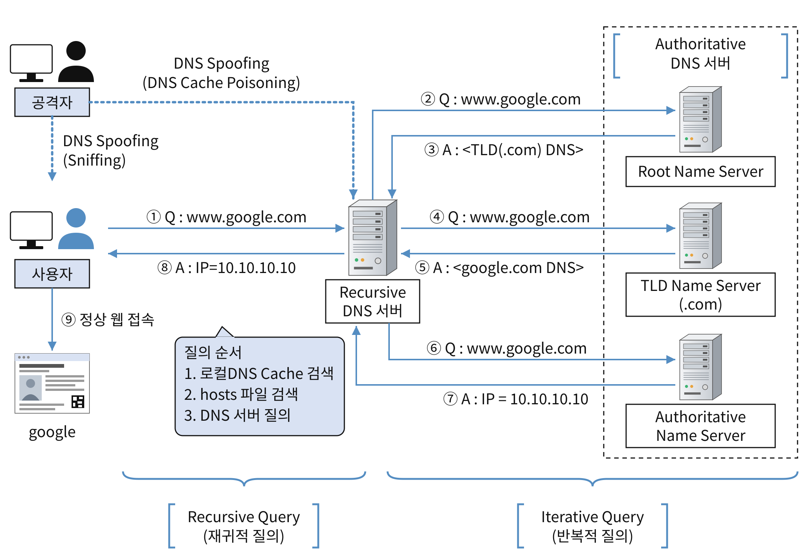
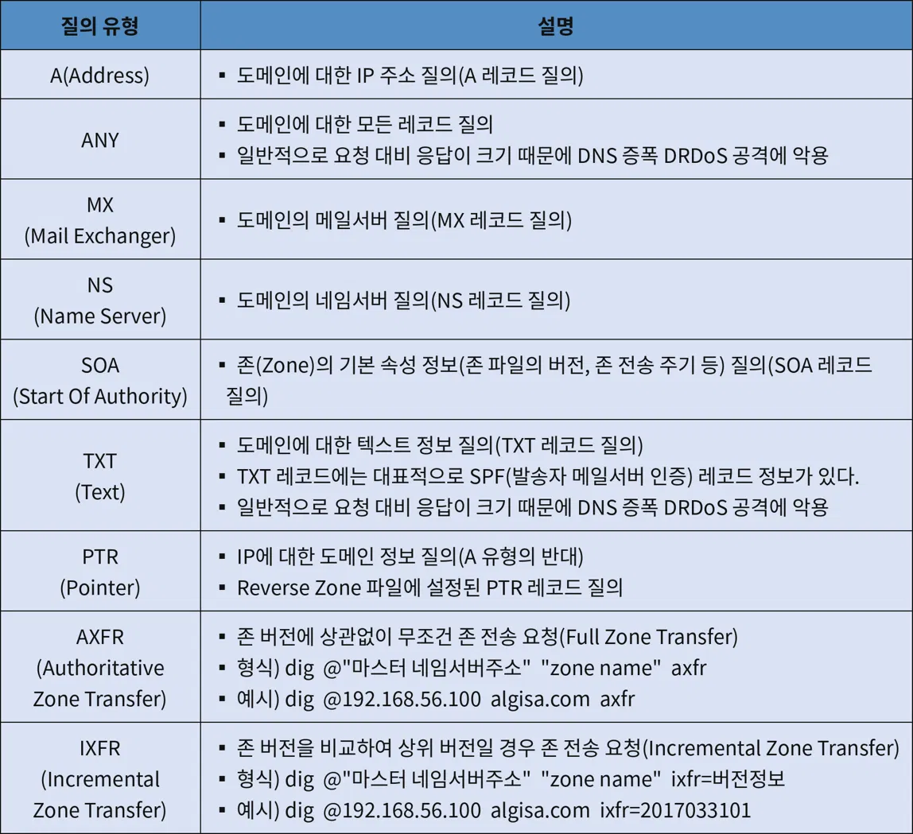
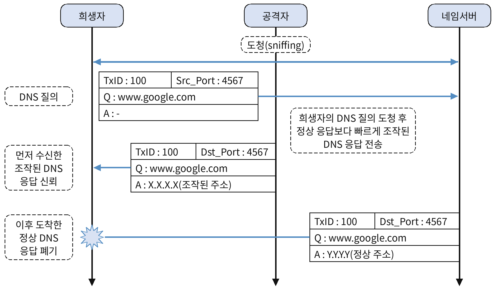
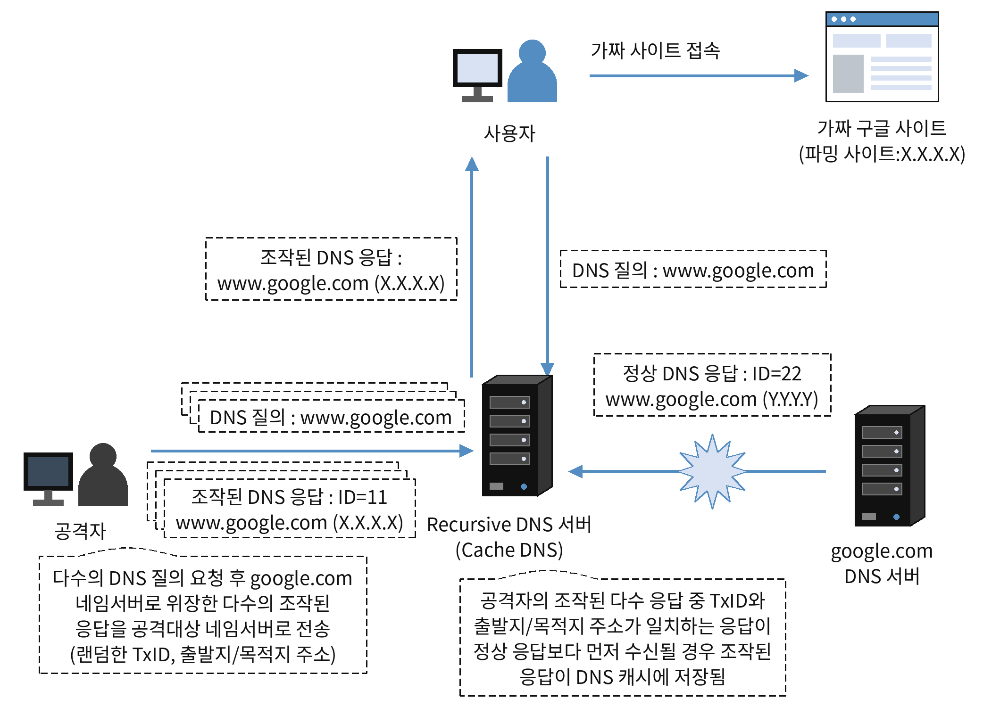
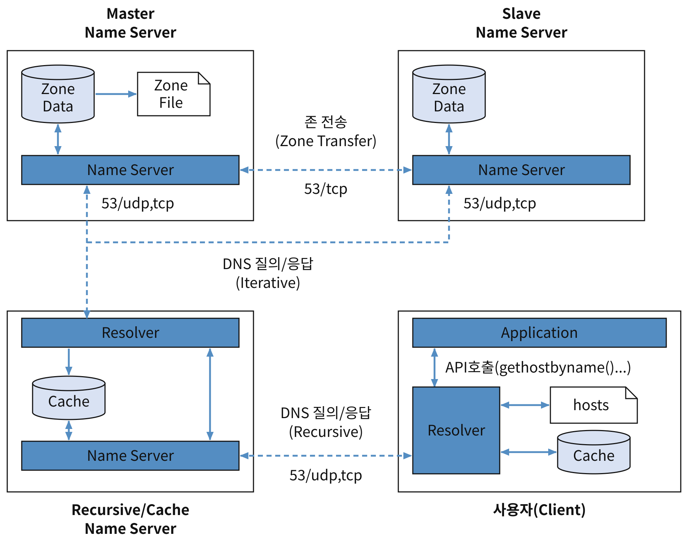
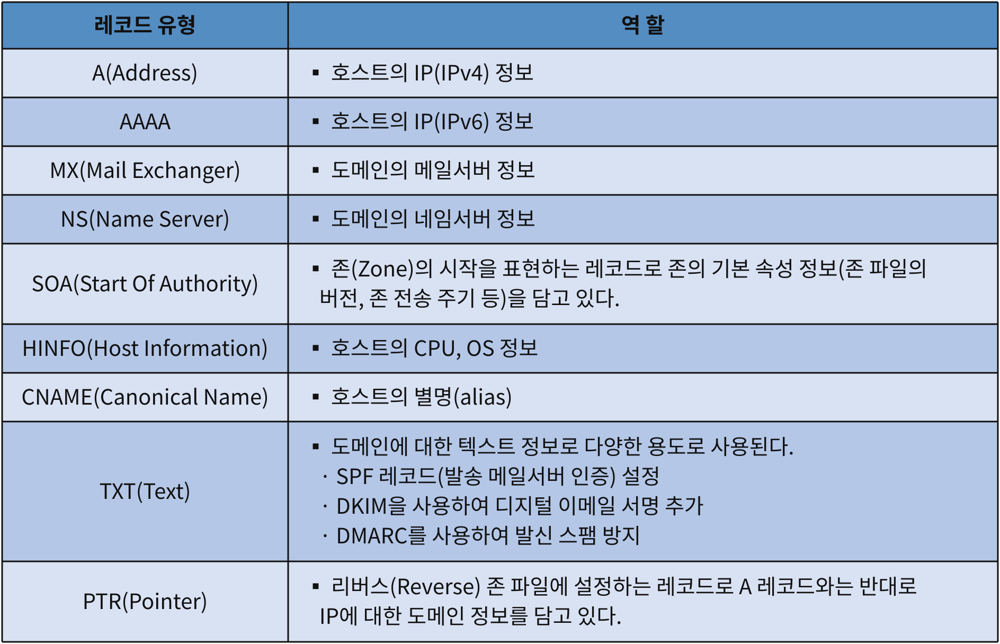

## DNS
- <strong>DNS</strong> : 도메인 이름(예: google.com)을 IP 주소(예: 142.250.x.x)로 바꿔 주는 시스템
- <strong>DNS 서버(네임서버)</strong> : 도메인 이름에 대응하는 IP 주소 정보를 저장하고, 질의가 오면 그 IP를 알려 주는 서버
- <strong>Recursive/Cache DNS서버</strong>
	* Recursive(재귀적) : 동일한 작업을 조건이 만족될 때까지 반복적으로 처리
	* <strong>관리하거나 위임받은 도메인 없이</strong> 사용자 질의를 받아, <strong>캐시 정보 또는 반복적 질의(Iterative Query)를 통해 DNS 정보를 찾아 응답</strong>하는 네임서버.
	* 일반적으로 ISP 업체(인터넷 서비스 제공업체)가 제공해 주는 DNS 서버가 해당. (예: KT: kns.kornet.net/168.126.63.1)
- <strong>Authoritative DNS서버</strong>
	* <strong>관리하거나 위임받은 도메인의 DNS 정보를 관리하고, 해당 도메인에 대한 질의에 권한 있는 응답을 제공</strong>하는 네임서버.
	* <font color="#ff0000">존(Zone)</font>: 네임서버가 관리하는 도메인 영역
	- <font color="#ff0000">존 파일(Zone File)</font>: 관리 도메인에 대한 정보를 담은 파일로, 네임서버는 이를 읽어 존 데이터(Zone Data)를 구성하고 이를 이용하여 질의에 응답한다.
	* 각 회사/사이트별로 자신의 도메인을 관리하는 DNS 서버가 해당. (예: Google : ns1.google.com/216.239.32.10)
- <strong>재귀적 질의(Recursive Query)</strong>
	* 사용자 호스트 → Recursive 네임서버 (최종 결과를 요청)
	* 사용자 호스트가 Recursive 네임서버에 DNS 정보를 찾아 응답해 달라고 요청하는 질의 방식.
	- Recursive 네임서버는 캐시를 조회하고, 정보가 없으면 Root 네임서버부터 대상 도메인 네임서버까지 반복적 질의를 수행하여 결과를 사용자 호스트에 반환한다.
- <strong>반복적 질의(Iterative Query)</strong>
	- Recursive 네임서버 → 각 DNS 서버 (다음 질의 대상 정보를 받아 직접 찾아감)
	- Recursive 네임서버가 Root 네임서버부터 각 네임서버에 순차적으로 DNS 정보를 질의하는 방식.
	- 각 네임서버는 최종 정보 대신 다음에 질의할 네임서버 정보를 응답하며, 이를 따라 대상 도메인의 DNS 정보를 찾는다.
#### 동작 방식

- DNS 질의(Query): 사용자 호스트가 Recursive 네임서버에 접속할 도메인의 IP 주소를 질의한다.
- 네임서버는 자신의 캐시를 조회한다.
    - 캐시에 정보가 있으면 사용자 호스트에 응답한다.
    - 캐시에 정보가 없으면 Root 네임서버부터 대상 도메인의 네임서버까지 반복적 질의를 수행하여 IP 주소를 찾는다.
- DNS 응답(Response): IP 주소를 획득한 네임서버가 사용자 호스트에 응답한다.
- 사용자 호스트는 응답받은 IP 주소를 일정 시간 동안 DNS 캐시에 저장하고 해당 사이트에 접속한다
#### 운영체제별 DNS 관련 설정 파일
##### Windows
- 질의에 대한 <font color="#ff0000">검색 순서: 로컬 DNS 캐시 → hosts.ics → hosts 파일 → 시스템에 설정된 네임서버</font>
- `hosts.ics`: Windows 인터넷 연결 공유(ICS) 기능과 관련된 파일로, 클라이언트 IP 주소를 지정하며 hosts 파일보다 우선 검색된다. 악성 코드에 의해 변조되면 파밍 사이트 접속을 유도할 수 있다.
##### Linux/Unix
- <strong>/etc/resolv.conf</strong> : 시스템 기본 네임서버 설정 정보를 담고 있다.
- <font color="#ff0000">/etc/hosts</font> : 도메인/호스트명과 IP 주소의 매핑 정보를 담고있고, DNS 질의 전에 참조되는 파일. 파밍 공격에 악용되어 변조된 IP 주소로 접속할 수 있으므로 관리에 주의.
- <strong>/etc/hosts.conf</strong> : DNS 질의 순서를 지정하는 파일로 order 절에 명시된 순서로 질의를 수행
- <font color="#ff0000">hosts 파일</font> : 리눅스/유닉스, 윈도우, 맥 등 운영체제마다 디렉토리 경로는 다르지만 공통의 이름을 사용. 윈도우 7 이상의 버전에서는 관리자 외에 수정할 수 없음.
#### 네임서버 질의/응답 패킷 분석
- 응답 데이터가 512 바이트 이하일 경우(일반적인 경우) UDP(53번 포트) 사용
- 응답 데이터가 512 바이트 초과일 경우 TCP(53번 포트 사용)
### DNS Cache 관련 명령어
- ipconfig /displaydns : 로컬 DNS 캐시 정보 조회하기
- ipconfig /flushdns : 로컬 DNS 캐시 정보 삭제하기
#### DNS Lookup(질의) 명령어
- 순방향 룩업 : 도메인명 → IP주소를 알아내는 질의
- 역방향 룩업 : IP 주소 → 도메인명을 알아내는 질의
- <strong>nslookup</strong> : 명령 실행 후 대화형 모드로 질의
	- `nslookup [도메인] [네임서버]`: 질의할 도메인을 지정한 네임서버로 질의
- <strong>dig</strong> : nslookup을 대체하기 위한 목적으로 만들어진 명령어. 리눅시/유닉스 계열 OS는 기본 설치.
	- `dig [@네임서버] 도메인 [질의유형] [질의옵션]`
	- @네임서버 : 사용할 네임 서버 지정. 생략 시 기본 네임서버.
	- 질의 유형 : 생략 시 A 유형(도메인에 대한 IP 주소 질의) 질의.
	-  질의 옵션
		- +norecurse : authoritative 네임서버에 반복적 질의를 수행하여 정상 응답 여부 점검
		- +tcp : 53/tcp 허용 여부를 점검
		- +trace : 계층적 위임설정 상태 점검. DNS 서버가 도메인 정보를 상위 DNS 서버에서 하위 DNS 서버로 올바르게 위임했는지 확인한다는 뜻
- <strong>whois</strong> : whois 서버를 통해서 해당 도메인의 등록 정보, 네트워크 할당 정보 등을 조회하기 위한 명령어. 해당 도메인이 다른 사람에 의해 사용중인지를 점검하는 용도로 많이 사용.
### DNS 스푸핑 공격
- <strong>공격 대상에게 전달되는 DNS 응답(IP주소)을 조작하거나 DNS 서버의 캐시 정보를 조작하여 희생자가 의도하지 않은 주소로 접속하게 만드는 공격.</strong>
- DNS 질의/응답에 사용하는 UDP 프로토콜의 비연결 특성 취약점을 이용한 공격. 클라이언트는 DNS 서버와 연결 상태를 유지하지 않기 때문에 DNS 질의/응답을 식별하기 위한 Transaction ID, 출발지/목적지 주소만 일치하면 먼저 수신한 응답을 신뢰하고, 이후에 수신한 응답을 모두 폐기하는 특성을 이용한 공격
##### 스니핑(Sniffing) 기반의 DNS Spoofing 공격

- 공격 대상이 DNS 질의를 수행하면 공격자가 이를 스니핑하고 있다가 정상 <strong>응답보다 빠르게 희생자에게 조작된 웹사이트 IP 정보를 담은 DNS 응답을 보내</strong> 정상 주소를 입력해도 조작된 주소로 접속하게 만드는 공격 기법
- 조작된 응답 이후에 도착하는 정상 응답은 먼저 수신한 응답을 신뢰하는 특성으로 인해 폐기..
- <strong>대응책</strong> : 스니핑 탐지 및 차단, 중요한 사이트 IP 주소는 DNS 우선 순위가 높은 hosts 파일에 등록하여 관리
##### <mark style="background:#fff88f"><strong><font color="#ff0000">DNS Cache Poisoning 공격</font></strong></mark>
- DNS 서버의 캐시 정보를 조작하여 사용자가 악성 사이트의 IP 주소로 접속하도록 유도하는 공격.
- DNS 서버는 반복적인 질의로 인한 부하를 줄이기 위해 DNS 정보를 <font color="#ff0000">캐시(Cache)</font>에 저장하고 <font color="#ff0000">TTL(Time to Live)</font> 동안 유지한다.
- 캐시가 조작되면 해당 정보가 유지되는 동안 해당 서버에 접근하는 다수의 사용자에게 조작된 DNS 응답을 제공할 수 있다.
##### 공격방식

- 공격자는 공격대상 DNS 서버에 조작할 도메인 질의를 다수 보낸다.
- (스니핑이 불가능한 상황을 가정)공격자는 DNS 서버가 반복적 질의 시 사용하는 사용하는 Transaction ID와 출발지 Port를 모르므로 여러 값을 무작위로 만들어 다수의 조작된 DNS 응답을 보낸다.
	- <strong>생일 공격(Birthday Attack)</strong> : 공격자가 랜덤한 Transaction ID를 다수 생성해서 DNS Cache Poisoning 공격을 하는 것. 우리가 예상하는 확률이 실제 확률보다 높다는 이론에 기반.
- 공격자의 조작된 응답 중 정상 응답보다 먼저 일치하는 응답이 있으면 조작된 주소 정보가 공격 대상 DNS 서버의 캐시에 저장되고 이를 질의하는 사용자는 조작된 주소의 사이트로 접속하게 됨.
##### 대응책
- DNS 서버 소프트웨어(예: Bind DNS) 최신 버전 유지 및 보안 패치 적용 → 알려진 취약점을 이용한 공격 방지.
- 도메인 관리용 DNS 서버(Authoritative 네임 서버)는 재귀적 질의를 허용하지 않도록 설정하고, 제한된 사용자가 사용하는 Recursive DNS 서버라면 해당 사용자로 제한해서 허용하도록 한다.
- <font color="#245bdb">DNSSEC(DNS Security Extension)</font> 기술 활용
	- 데이터 위변조 공격에 취약한 DNS의 문제점을 근본적으로 보안 개선하기 위해 IETF에 의해 2005년 완성된 국제표준 기술
	- DNSSEC은 DNS를 대체하는 것이 아니라, <font color="#245bdb">기존의 DNS에 공개키 암호화 방식의 보안 기능을 추가</font> 부여하여 DNS 보안성을 대폭 강화하는 역할을 함.
### DNS 서버(Bind DNS) 보안
#### 마스터/슬레이브 네임서버

- 마스터 네임 서버 : 원본 존 데이터를 관리
- 슬레이브 네임 서버 : 마스터 네임 서버를 동기화해서 사용
- 존 데이터 : 관리하는 도메인 영역(Zone) 정보로 다양한 레코드 유형에 따른 데이터를 가지고 있음. 일반적으로 관리자가 설정한 존 파일을 읽어들여 존 데이터를 구성.
- <font color="#ff0000">존 전송(Zone Transfer)</font> : 마스터에 있는 원본 존 데이터를 슬레이브가 동기화 하는 과정
- 마스터와 슬레이브 네임서버는 서로 동일한 기능을 수행하며 부하분산을 통해 안정성을 높이는 기능을 한다.
- 리졸버(Resolver) : 네임서버로 질의를 수행하여 그 결과를 응용 프로그램에 변환해주는 소프트웨어 모듈/라이브러리
#### 존 파일(Zone File)
```
name.conf 파일

zone "google.com" IN{
	type master;
	file 'google.com.db"
}

zone '126.168.192.in-addr.arpa' IN{
	type master;"
	file "google.com.db.rev"
}
```
- <strong>name.conf 파일</strong>
- 네임서버 설정 파일(named.conf)에 네임서버가 관리하는 도메인 영역인 존(Zone)설정.
	- file 'google.com.db'는 관리하는 도메인의 <font color="#ff0000">리소스 레코드 정보</font>를 담고 있는 존 파일(Zone File)명을 의미.
	- 리소스 레코드 : 도메인 이름에 어떤 정보가 연결되어 있는지 기록한 데이터
- 126.168.192.in-addr.arpa 도메인은 <font color="#ff0000">리버스 도메인(reverse domian)</font> reverse lookup(IP 주소 → 도메인명을 알아내는 질의)을 위한 특수한 도메인.
	- 리버스 존 파일(Reverse Zone File) : 리버스 도메인에 대한 존 파일
- <strong>options의 directory 항목</strong> : 존 파일이 위치한 경로를 나타냄.
- 존 파일은 네임서버 설정 시 가장 중요한 도메인 데이터베이스 파일로 <strong>네임 서버 기동 시 에 존 파일을 읽어들여 존 데이터를 구성.</strong>
- <strong>존 파일의 리소스 레코드 형식</strong>
	- `host_name [TTL] class record_type data`
	- class : 인터넷 클래스를 의미하는 IN 지정
	- record_type : 레코드 유형 지정
	- data : 레코드 유형에 따른 데이터 설정
- 리버스 존 파일을 살펴보면 <strong>PTR 레코드 유형</strong>을 이용하여 IP 주소에 대한 도메인명을 설정하고 있다.
- <strong>존 파일의 주요 리소스 레코드 유형 및 역할</strong>
#### 재귀적 질의(Recursive Query)에 대한 제한
- <strong> 재귀적 질의 접근 제어 설정(/etc/named.conf)</strong>
	```
	options{
		recursion no;
		allow-recursion {none;};
		allow-resursion {127.0.0.1;};
		allow-recursion {internal;}
	}
	```
	- 악의적인 공격자에 의해 과도한 재귀적 질의 요청이 발생하게 되면 DoS 형태의 공격으로 악용될 수 있으며 DNS Cache Poisoning 공격에 노출 될 수 있음.
	- DNS 서버 기본 설정은 모든 IP에 대해서 재귀적 질의를 허용.
	- <strong>allow-recursion을 none으로 설정하거나 recursion no 로 설정</strong>하면 재귀적 질의를 허용하지 않는다.
	- allow-resursion에 재귀적 질의를 허용할 IP 또는 IP 대역을 명시하여 제한적으로 질의를 허용한다.
	- 별도의 acl(access control list)을 정의하고 allow-resursion에 acl명을 명시하여 제한적으로 질의를 허용.
	- 재귀적 질의 제한 시 질의한 도메인을 찾을 수 없다는 응답이 반환
#### <mark style="background:#fff88f"><strong><font color="#ff0000">존 전송(Zone Trasfer)에 대한 제한</font></strong></mark>
- 존 전송에 제한이 없으면 악의적인 공격자에 의해 DoS 공격으로 악용될 수 있음. 또한, Zone 데이터에 저장된 해당 도메인의 서버 정보가 그대로 노출될 수 있음.
- Master DNS 서버만을 운영 : 존 전송 허용 X
- Master/Slave DNS 서버를 운영 : 지정한 Slave에서만 존 전송을 요청하도록 설정
```
allow-transfer {none;};
allow-transfer {슬레이브 IP;};
```
- 존 전송을 허용하지 않을 경우 :  named.conf 파일의 <font color="#ff0000">allow-transfer를 none으로 설정</font>.
- 존 전송을 Slave만 허용할 경우 : named.conf 파일의 <font color="#ff0000">allow-transfer에 Slave의 주소 정보를 설정</font>.