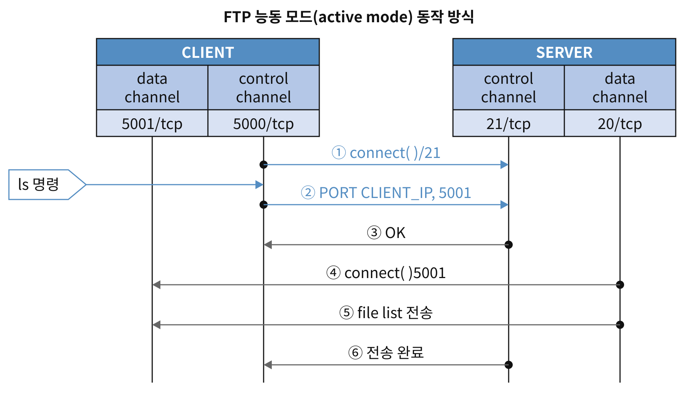
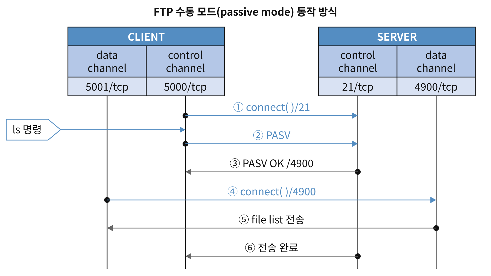
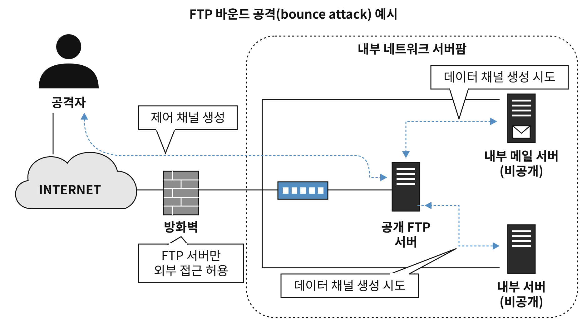

## FTP
- TCP/IP 기반 파일 전송 프로토콜
- FTP 서비스는 아이디 및 패스워드가 암호화 되지 않은 채로 전송되므로 반드시 필요한 경우를 제외하고는 사용을 제한
- <strong>암호화된 통신을 수행하는 FTP 서비스</strong>
	- SFTP(SSH File Transfer Protocol) : 22/tcp. SSH 기반의 파일 전송 프로토콜.
	- FTPS(FTP over SSL/TLS) : 990/tcp. SSL/TLS 기반의 파일 전송 프로토콜.
- <strong>FTP 서비스 동작모드</strong> : 능동 모드(active mode), 수동 모드(passive mode)
	- **능동 모드**: 클라이언트가 `PORT` 명령으로 자기 IP와 포트를 알려주면, **서버(20/tcp)가 클라이언트로 접속**해서 데이터 채널을 만듬.
	- **수동 모드**: 클라이언트가 `PASV` 명령을 보내면 서버가 사용할 포트를 알려주고, **클라이언트가 서버로 접속**해서 데이터 채널을 만듬.
- <strong>FTP Bound 공격</strong> : 제어 채널과 데이터 채널이 분리되고, 데이터 전송 목적지(IP, Port)를 임의로 지정할 수 있는 FTP의 구조적 취약점을 이용한 공격.
- <strong>TFTP(Trival FTP) 공격</strong> : 보안 기능이 없는(인증 과정이 없는) TFTP의 취약점을 이용하여 공격자가 TFTP 서버에 있는 파일에 접근하거나 악의적인 파일을 생성하는 공격
- <strong>Anonymous FTP Attack</strong> : 비밀번호를 요구하지 않는 익명 FTP 서비스의 취약점을 이용하여 공격자가 FTP 서버에 있는 파일에 접근하거나 악의적인 파일을 생성하는 공격.
	- <strong>Anonymous FTP 서비스</strong> : ID가 'anonymous(대소문자구분없음)'이고 비밀번호가 없는(또는 아무 비밀번호나 입력 가능) 익명 계정으로 FTP 접속이 가능한 서비스. 비밀번호 인증 없이 원격에서 서버의 파일에 접근이 가능하므로 보안상 심각한 문제가 발생할 수 있음.
#### 동작 모드
- **능동 모드**: 클라이언트가 `PORT` 명령으로 자기 IP와 포트를 알려주면, **서버(20/tcp)가 클라이언트로 접속**해서 데이터 채널을 만듬.
- **수동 모드**: 클라이언트가 `PASV` 명령을 보내면 서버가 사용할 포트를 알려주고, **클라이언트가 서버로 접속**해서 데이터 채널을 만듬.
##### FTP 능동모드(active mode)
- FTP 클라이언트의 기본 동작 모드.
- <strong>제어 채널</strong> : FTP 명령을 전달하기 위한 채널. 클라이언트에서 서버의 21/tcp 포트로 접속하여 제어 채널을 생성한 후 명령을 전달.
- <strong>데이터 채널</strong> : 데이터를 전달하기 위한 채널. 서버(20/tcp 포트 사용)에서 클라이언트의 1024/tcp 이상 포트로 접속하여 데이터 채널을 생성한 후 데이터를 전달.
- <strong>동작 방식</strong>

	- FTP 클라이언트는 FTP 서버의 21/tcp 포트로 접속하여 제어채널을 생성.
	- 사용자가 파일 목록 조회(`ls`)를 요청하면, FTP 클라이언트는 데이터 채널 연결에 사용할 임시포트(1024/tcp 이상 포트)를 결정한 후, FTP 서버에 PORT 명령을 이용하여 클라이언트 IP와 임시포트를 전달.
	- FTP 서버는 FTP 클라이언트가 알려준 IP와 포트로 접속하여 데이터 채널을 생성.
	- 데이터 채널을 통해 데이터를 전송한 후 데이터 채널을 종료.
- <strong>문제점 및 해결방안</strong>
	- <strong>문제점</strong> : 클라이언트 방화벽이 원격 FTP 서버에서 클라이언트로의 접속을 허용하지 않으면, 제어 채널은 연결되지만 데이터 채널 연결이 불가능하여 데이터 전송에 실패할 수 있음.
	- <strong>해결 방안</strong>
		- 클라이언트 방화벽에 원격 FTP 서버(20/tcp 포트)에서 클라이언트로의 접속을 허용하도록 설정. 
		- 클라이언트에서 수동 모드로 원격 FTP 서버에 접속
##### FTP 수동 모드(passive mode)
- <strong>제어 채널</strong> : FTP 명령을 전달하기 위한 채널. 클라이언트에서 서버의 21/tcp 포트에 접속하여 제어채널을 생성한 후 명령을 전달.
- <strong>데이터 채널</strong> : 데이터를 전달하기 위한 채널. 클라이언트에서 서버의 1024/tcp 이상 포트로 접속하여 데이터 채널을 생헝한 후 데이터를 전달.
- <strong>동작 방식</strong>
	- FTP 클라이언트는 FTP 서버의 21/tcp 포트로 접속하여 제어 채널을 생성.
	- 사용자가 파일 목록 조회(`ls`)를 요청하면, FTP 클라이언트는 수동 모드로 연결하기 위해 PASV 명령을 전송. 이 명령을 받은 FTP 서버는 사용할 임시포트(1024/tcp 이상 포트)를 결정한 후 FTP 클라이언트에게 알려준다.
	- FTP 클라이언트는 FTP 서버가 알려준 포트로 접속하여 데이터 채널을 생성한다.
	- 데이터 채널을 통해 데이터를 전송한 후 데이터 채널을 종료한다.
- <strong>문제점 및 해결방안</strong>
	- <strong>문제점</strong> : FTP 서버는 데이터 채널 생성을 위해 인바운드(inbound) 트래픽에 대한 방화벽의 1024/tcp 이상 포트를 모두 허용해야 하는 문제점
		- <strong>인바운드(inbound) 트래픽</strong> : 외부 네트워크에서 내부 네트워크로 유입되는 트래픽
		- <strong>아웃바운드(outbound) 트래픽</strong> : 내부 네트워크에서 외부 네트워크로 나가는 트래픽
	- <strong>해결방안</strong> : 방화벽의 상태 검사(stateful inspection) 기능을 통해 연결 상태를 추적하여 데이터 채널을 허용하도록 설정한다.
		- <strong>상태검사(stateful inspection)</strong> : 방화벽을 통과하는 모든 트래픽에 대해 프로토콜별 연결 상태를 추적하여 패킷 필터링을 수행하는 방화벽 기능.
#### FTP 보안 취약점을 이용한 공격
##### FTP 바운스 공격(FTP Bound Attack)
- 제어 채널과 데이터 채널이 분리되어 있고 데이터를 생성할 때 임의의 목적지 IP 와 Port 번호를 설정할 수 있는(목적지를 확인하지 않는) FTP 설계의 구조적 취약점을 이용하여 네트워크를 스캔하거나 공격자가 원하는 서버로 데이터를 전송하는 형태의 공격.
- <strong>공격 방식</strong>
	- 주로 익명의 FTP 서버를 이용하며 PORT 명령의 목적지 IP와 Port 번호를 조작하여 FTP 서버가 공격자가 원하는 목적지 호스트와 데이터 채널을 연결하도록 시도.
	- 이를 통해 공격자는 FTP 서버를 거쳐 외부에서 접근할 수 없는 내부 네트워크를 스캔하거나 공격자가 원하는 내부 서버로 데이터를 전송하는 등의 악의적인 행위를 할 수 있다.
##### TFTP(Trival FTP) 공격
- 보안 기능이 없는(인증 과정이 없는) TFTP의 취약점을 이용하여 공격자가 TFTP 서버에 있는 파일에 접근하거나 악의적인 파일을 생성하는 공격
- <strong>TFTP</strong> : <strong>69/udp 포트</strong>를 사용하는 매우 단순하고 간단한 파일 송수신 프로토콜. <strong>별도의 인증 과정 없이</strong> 지정한 디렉터리에 접근하여 파일을 송수신 할 수 있는 보안상 취약점이 존재.
- <strong>대응책</strong>
	- <strong>TFTP 서비스가 불필요한 경우</strong>
		- <strong>inetd 환경</strong> : <strong>TFTP 서비스를 주석(#)처리</strong>하여 서비스를 비활성화한 후 <strong>inetd 데몬을 재시작</strong>. 
		- <strong>xinetd 환경</strong> : <strong>TFTP 설정 파일의 disable 속성을 yes</strong>로 설정하여 서비스를 비활성화한 후 <strong>xinetd 데몬을 재시작</strong>
	- <strong>TFTP 서비스가 필요한 경우</strong> : secure mode로 운영. secure mode는 chroot 기능을 이용하는 것으로 지정한 디렉터리를 최상위 디렉터리로 지정하여 지정한 디렉터리의 상위 디렉터리로 접근하지 못하도록 제한하는 방식.
##### Anonymous FTP Attack
- <strong> Anonymous FTP Attack</strong> : 비밀번호를 요구하지 않는 익명 FTP 서비스의 취약점을 이용하여 공격자가 FTP 서버에 있는 파일에 접근하거나 악의적인 파일을 생성하는 공격.
- <strong>Anonymous FTP 서비스</strong> : ID가 'anonymous(대소문자구분없음)'이고 비밀번호가 없는(또는 아무 비밀번호나 입력 가능) 익명 계정으로 FTP 접속이 가능한 서비스.
- 익명 계정을 허용하면 원격에서 비밀번호 인증 없이 서버의 파일에 접근할 수 있으므로 보안상 심각한 문제가 발생할 수 있음. 
- <strong>대응책</strong>
	- 익명 FTP 서비스는 반드시 사용해야하는 경우가 아니라면 허용X
	- vsFTP 서버 설정 파일(vsftpd.conf)에서 <strong>anonymous_enable = NO</strong>로 설정
##### FTP 서버 취약점 공격
- 최신 FTP 서버 프로그램 사용 및 주기적인 보안 패치 작업 필요.
#### FTP 접근 제어 설정
##### 설정 파일을 이용한 계정별 접근제어
- FTP 서브스는 기본적으로 평문 송수신을 하므로, <strong>중요계정(예)root 계정)에 대해서는 FTP 접속을 제한</strong>
- <strong>ftpusers </strong>파일 : 접속을 제한할 계정 정보를 담고 있는 설정 파일
- vsFTP 서버의 경우 ftpusers 파일 뿐만 아니라 user_list 파일을 이용해서 계정별 FTP 접속 제한을 설정할 수 있음.