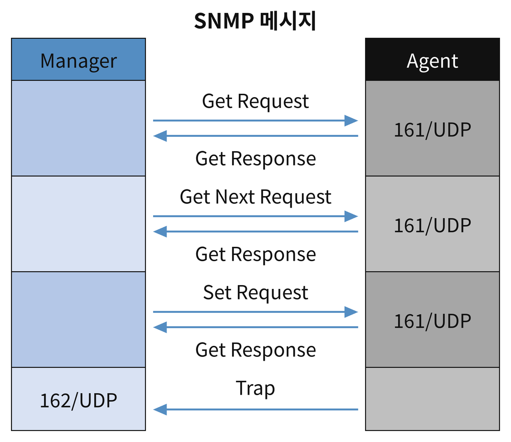
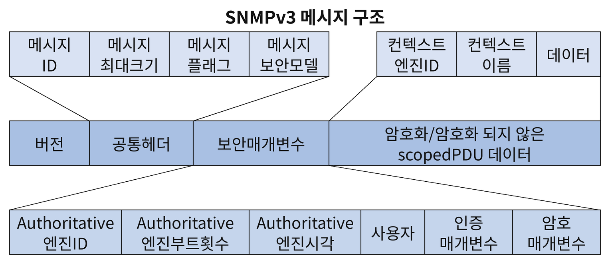
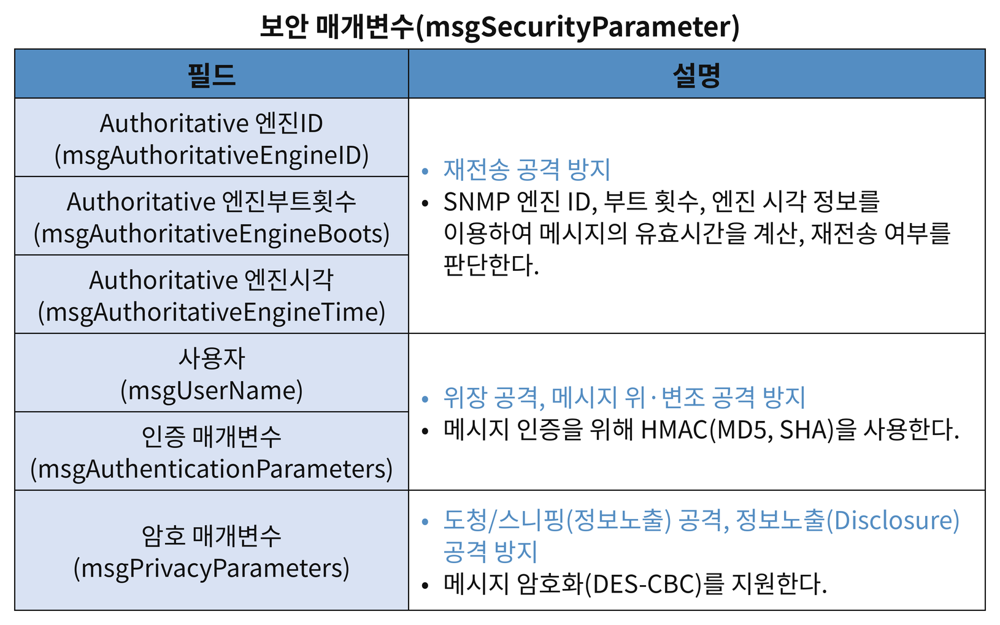

## SNMP(Simple Network Management Protocl)
- Application 프로토콜(L7). <strong>네트워크에 연결된 장비를 원격으로 관리하고 상태를 확인하기 위한 프로토콜.</strong>
- <strong>UDP 프로토콜 사용.</strong>
- 관리의 편의성을 주지만 여러 취약점이 존재하여 DoS 공격, 버퍼 오버플로우, 비인가 접속 등 여러 문제점이 발생할 수 있음.
#### 동작 방식

- <strong>Manager(관리자)</strong> : 162/udp 포트 사용. Agent에 필요한 정보를 요청(Get)하거나 설정 변경을 지시(Set)하고, Agent가 보낸 Trap을 수신.
- <strong>Agent(대행자)</strong> : 161/udp 포트 사용. Agent가 설치된 시스템의 정보나 네트워크 정보 등을 수집하여 MIB 형태로 보관. Manager가 요청한 정보를 Get Response로 전달하고, 이상 상황 발생 시 Trap으로 Manager에게 먼저 알림.
	- <strong>MIB</strong>(Management Information Base): 관리 대상 장비의 관리 정보를 계층적으로 구성한 데이터베이스.
	- <strong>SMI</strong>(Structure Management Information) : MIB를 정의하기 위한 일반적인 구조
- <strong> SNMP 데이터 수집 방식</strong>
	- Polling 방식 : Manager가 Agent에 정보를 요청하면 응답해주는 방식. Agent가 161/udp 포트를 사용.
	- Event Reporting 방식 : Agent가 이벤트 발생 시 이를 Manager에게 알리는 방식(Trap 메세지). Manager가 162/udp포트를 사용.
- 관리자 대행자 간 통신을 위해 SNMP 버전, Community String, PDU가 일치해야한다.
- <strong>MRTG</strong>(Multiple Router Traffic Grapher) : SNMP 기반의 장비 모니터링 프로그램으로, 주 용도는 네트워크 트래픽 사용량 모니터링이지만, 벤더에서 제공하는 SNMP MIB 값을 사용하여 다양한 정보를 수집할 수 있다. 
#### SNMP 접근 제한 설정
- SNMP는 트래픽 정보 뿐만 아니라 각종 하드웨어 정보까지 제공하므로 보안에 주의해야함
- SNMP에 대한 읽기, 쓰기 권한이 있으면 설정 파일을 열람하거나 직접 네트워크 설정을 변경할 수 있음
##### SNMP 버전별 특징
- SNMPv1
	- 보안기능이 없으며(암호화 및 인증기능이 없음) community string만 일치하면 모든 정보를 얻을 수 있음
- SNMPv2
	- 암호화(DES)와 해시(MD5)를 추가했으나 여전히 송신처 인증기능이 없음
- SNMPv3
	- 데이터 인증, 암호 기능 및 재사용 방지, 세분화된 접근통제 등 개선된 보안 서비스를 제공함으로써 이전 SNMP 버전에서 제공되지 않았던 안전한 통신망 관리를 위한 기반 기술 제공
##### comunity string
- <strong>community string</strong>
	- SNMP 데몬(서버)과 클라이언트가 데이터를 교환하기 전에 인증을 위해 사용하는 일종의 패스워드. 
	- 초기값 : <strong>public 또는 private</strong>
	- <strong>추측하기 어렵고 의미가 없는 문자열로 community string을 변경해야함.</strong>
- SNMP에서는 <strong>RO(ReadOnly)와 RW(ReadWrite) 모드를 제공</strong>. <strong>쓰기 권한이 있으면 중요 설정을 수정할 수 있는 등 심각한 보안 문제를 유발</strong>할 수 있으므로 가급적 사용자제.
#### SNMPv3 보안 서비스
##### SNMPv3 메세지 구조

##### 보안 매개변수(msgSecurity Parameter)

- SNMPv3부터 다양한 공격 위협으로부터 방어하기 위한 보안 매개변수 필드들을 사용
#### NMS(Network Management System)
- 네트워크 상의 자원들을 모니터링하고 제어하기 위한 도구
- Manager-Agent 구조
##### 네트워크 모니터링 방식
- <strong>Polling 방식</strong>
	- 요청/응답 방식. Manager가 원하는 정보를 Agent에게 요청하면 Agent가 MIB로부터 정보를 추출하여 응답하는 방식
- <strong>Event Reporting 방식</strong>
	- Agent가 자신의 상태를 주기적으로 Manager에게 알리는 방식