## HTTP
- 웹 상에서 클라이언트와 서버 간에 통신을 위해 개발된 프로토콜(80/tcp)
- HTTP 통신은 클라이언트 요청과 서버 응답으로 이루어져있다.
- <strong>비연결형, 무상태(Stateless) 프로토콜</strong>
- 클라이언트 상태정보 유지 기술 : 클라이언트 - 쿠키(Cookie), 서버 - 세션(Session)
- <strong>쿠키(Cookie)</strong> : 개별 클라이언트의 상태 정보를 클라이언트에 저장하고, HTTP 요청·응답 헤더를 통해 전달하는 기술
	- 보안 취약점 : 클라이언트 해킹이나 스니핑 공격에 의한 정보 노출·변조에 취약
- <strong>세션(Session)</strong> : 개별 클라이언트의 상태 정보를 서버에 저장하는 기술(쿠키보다 안전하게 상태 정보 유지)
	- HTTP 세션 하이재킹(Session Hijacking) 공격 : HTTP의 세션 관리 취약점을 이용한 공격으로 인증된 <strong>사용자의 HTTP 세션 ID를 탈취하여 인증된 사용자로 위장</strong>하여 서버에 접근하는 공격
- 중요 정보를 저장할 경우에는 서버에 상태정보를 저장하는 세션 방식이 안전하며, 쿠키를 사용해야할 경우에는 암호화를 적용해야한다.
- <strong>쿠키 관련 보안 속성</strong>
	- HttpOnly : <strong>클라이언트에서 스크립트를 통해 해당 쿠키에 접근하는 것을 차단해주는 속성</strong>. 
		- Set-Cookie 응답 헤더에 설정하는 속성. 
		- 세션 ID를 저장하고 있는 세션 쿠키를 탈취하기 위한 XSS(Cross Site Script) 공격에 대응하기 위해 사용.
	- secure : <strong>클라이언트에서 HTTPS(SSL/TLS) 통신일 경우에만 해당 쿠키를 전송</strong>하는 속성. 
		- Set-Cookie 응답 헤더에 설정하는 속성. 
		- 기밀성 보장. 전송 중에 평문 쿠키가 노출되는 것을 방지함.
	- expires : <strong>쿠키의 유효시간을 설정하는 속성.</strong>
		- 유효시간을 최소한으로 설정하여 쿠키 정보가 클라이언트에 지속해서 남아 공격자에게 노출되는 위험을 방지할 수 있음.
- <strong>HTTP 요청 메세드</strong>
	- <strong>HEAD</strong> : GET 메서드와 동일한 요청을 수행하지만, <strong>응답 본문을 제외한 헤더 정보만 반환.</strong>
	- <strong>OPTIONS</strong> : <strong>서버가 지원하는 HTTP 메서드(요청 방식)를 확인.</strong> Allow 응답 헤더를 통해 웹 서버에서 지원하는 메서드 정보를 전달한다.

#### 비연결형 프로토콜
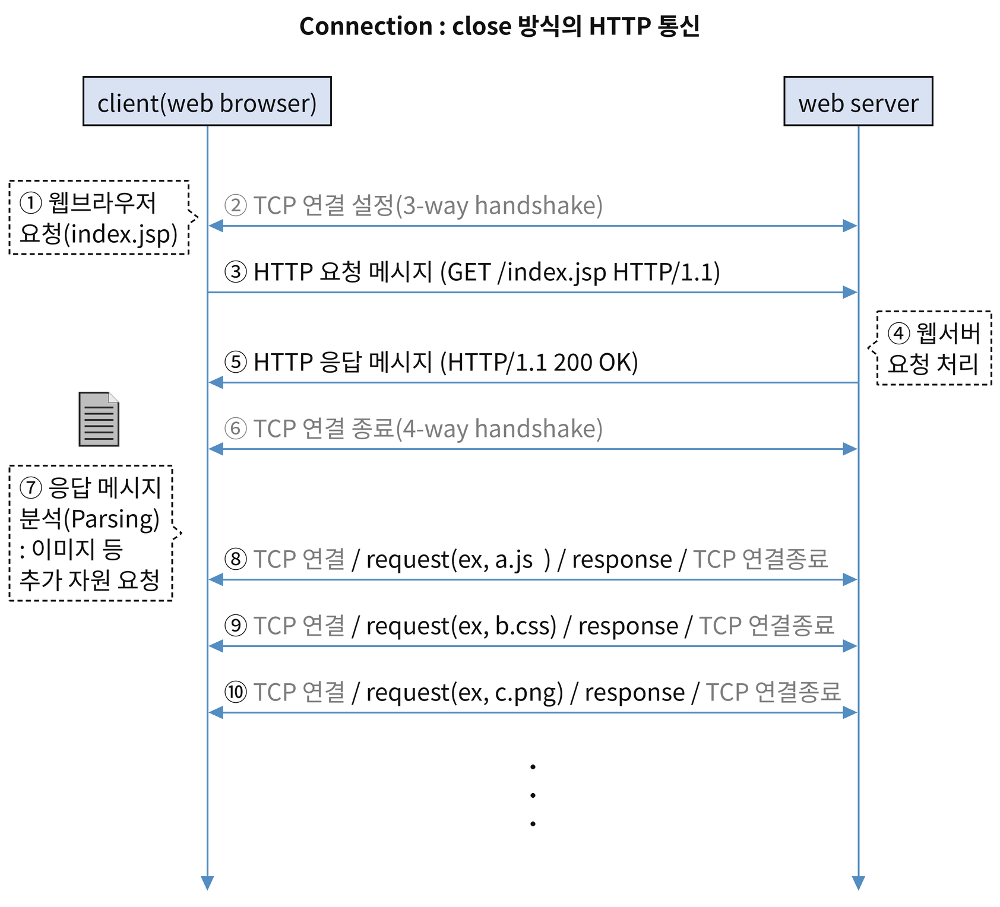
- HTTP/1.0 버전 : 클라이언트의 HTTP 요청에 대한 서버의 HTTP 응답 이후에 TCP 연결을 바로 종료.
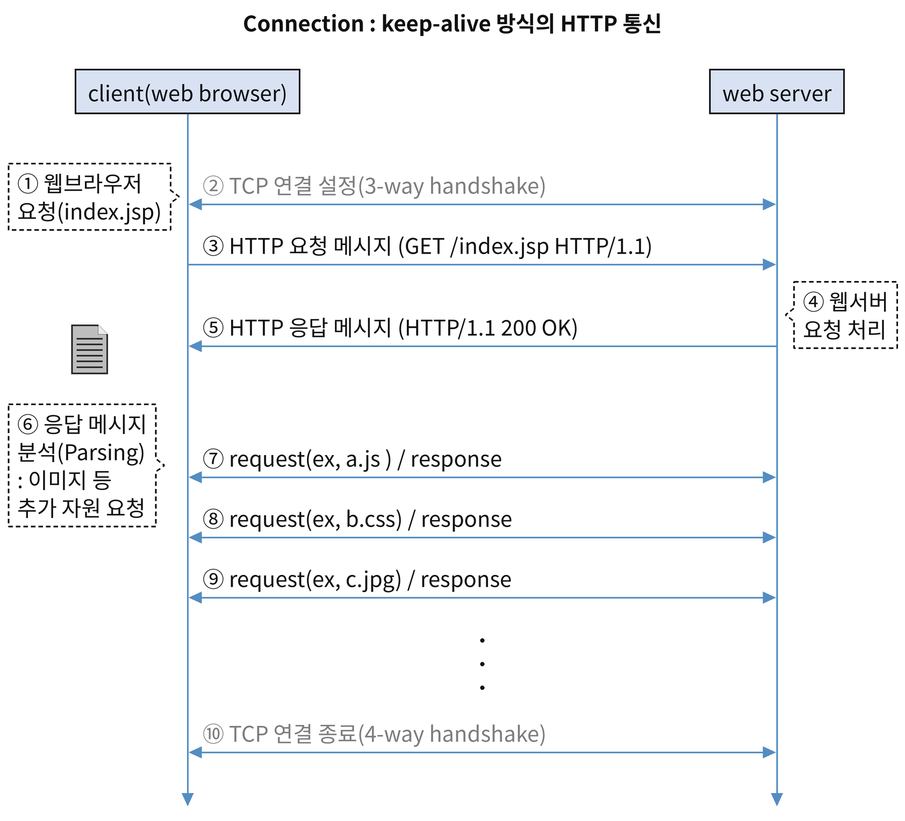
- HTTP/1.1 버전 : Connection 헤더에 Keep-Alive 옵션이 추가. TCP 연결 상태를 웹 서버 설저에 따라 일정시간 지속 시키는 옵션으로 한 번의 연결 이후에 요청/응답을 반복할 수 있음.
#### 상태 정보를 유지하지 않는(Stateless) 프로토콜
- 현재 연결에 대한 클라이언트의 어떠한 상태 정보도 유지 하지 않음. 따라서 동일 클라이언트의 현재 요청과 이전 요청을 식별하지 못함. 
- 클라이언트 상태정보 유지 기술 : 클라이언트 - 쿠키(Cookie), 서버 - 세션(Session)
##### 쿠키(Cookie) 방식
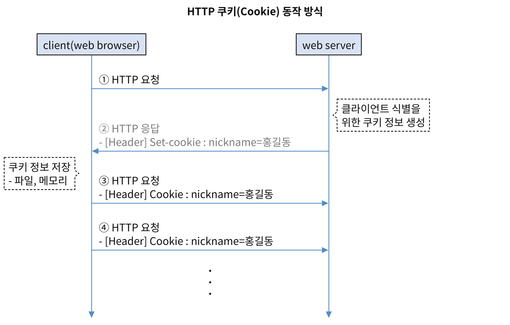
- 쿠키(Cookie) : 개별 클라이언트의 상태 정보를 클라이언트에 저장하고, HTTP 요청·응답 헤더를 통해 전달하는 기술
- 서버에서 Set-Cookie 응답헤더를 통해 쿠키를 설정하여 클라이언트로 전달하면, 클라이언트는 Cookie 요청헤더를 이용해 지속해서 쿠키를 전달하는 형태로 동작
	- Set-Cookie 응답 헤더: 서버가 클라이언트에게 쿠키를 저장하도록 전달하는 HTTP 응답 헤더.
- 쿠키는 지속 시간에 따라 영속 쿠키(Persistent Cookie)와 세션 쿠키(Session Cokie)로 구분
	- 영속 쿠키 : 클라이언트에 파일 형태로 저장되어 설정된 만료 기간까지 유지되는 쿠키. 해당 쿠키의 적용 범위에 해당하는 사이트에 HTTP 요청을 보낼 때마다 Cookie 요청 헤더에 쿠키 정보를 담아 전달한다.
	- 세션 쿠키 : 클라이언트 메모리상에 세션이 유지되는 동안 존재하는 쿠키.
- 보안 취약점 : 클라이언트 해킹이나 스니핑에 의한 정보 노출·변조에 취약
- 중요 정보를 저장할 경우에는 서버에 상태정보를 저장하는 세션 방식이 안전하며, 쿠키를 사용해야할 경우에는 암호화를 적용해야한다.
##### 세션(Session) 방식
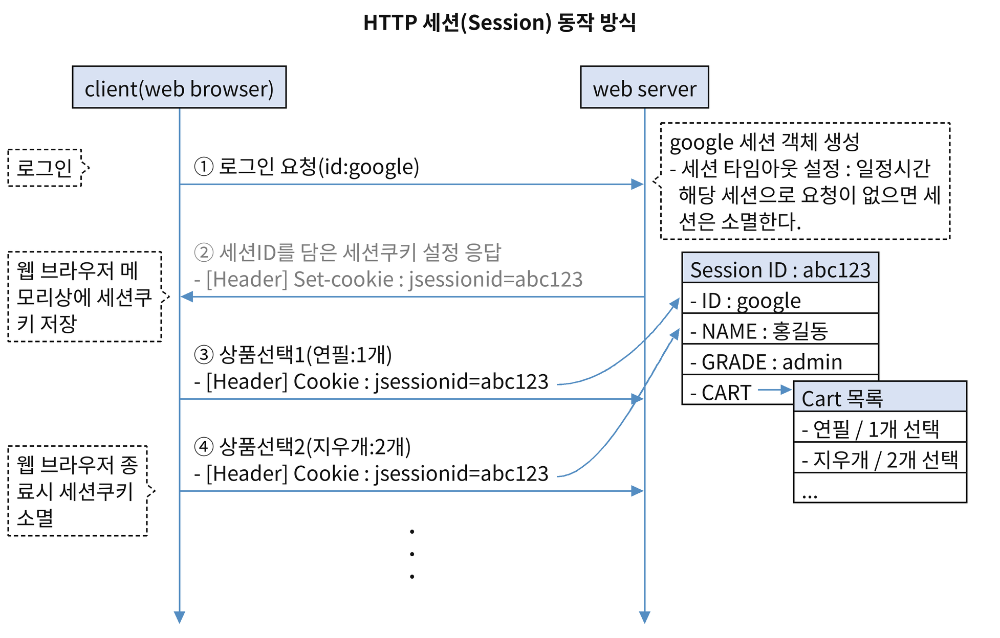
- 세션(Session) : 개별 클라이언트의 상태 정보를 서버에 저장하는 기술(쿠키보다 안전하게 상태 정보 유지)
- 서버는 개별 클라이언트 세션을 식별하기 위해 세션 ID를 부여하고, 세션 ID는 세션 쿠키를 이용하여 클라이언트와 서버 간에 주고 받는다.
- HTTP 세션 하이재킹(Session Hijacking) 공격 : HTTP의 세션 관리 취약점을 이용한 공격으로 인증된 <strong>사용자의 HTTP 세션 ID를 탈취하여 인증된 사용자로 위장</strong>하여 서버에 접근하는 공격
#### HTTP 쿠키 관련 보안 속성
##### HttpOnly 속성
- Set-Cookie 응답 헤더에 설정하는 속성으로, 클라이언트에서 스크립트를 통해 해당 쿠키에 접근하는 것을 차단해주는 속성
- 세션 ID를 저장하고 있는 세션 쿠키를 탈취하기 위한 XSS(Cross Site Script) 공격에 대응하기 위해 사용.
##### secure 속성
- Set-Cookie 응답 헤더에 설정하는 속성으로, 클<strong>라이언트에서 HTTPS(SSL/TLS) 통신일 경우에만 해당 쿠키를 전송</strong>하는 속성.
- 기밀성 보장. 전송 중에 평문 쿠키가 노출되는 것을 방지함.
##### expires 속성
- 쿠키의 유효시간(만료기간)을 설정하는 속성.
- 유효시간을 최소한으로 설정하여 쿠키 정보가 클라이언트에 지속해서 남아 공격자에게 노출되는 위험을 방지할 수 있음.
#### HTTP 요청 메세지 구조
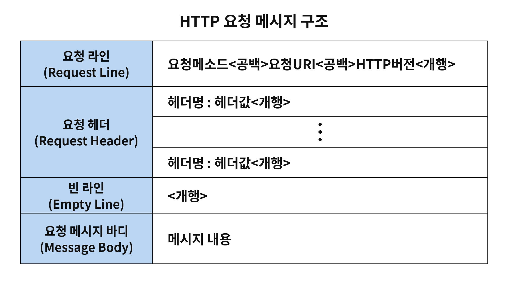
- <strong>요청 라인(Request Line)</strong> : 한 행. 요청 메세드, 요청 URI, HTTP 버전 정보.
- <strong>요청 헤더(Request Header)</strong> : 여러 헤더로 구성. 
	- <strong>주요 요청 헤더 정보</strong>
	- <strong>Host </strong>: 요청의 대상이 되는 서버의 도메인명/호스트명과 포트정보
	- <strong>User-Agent</strong> : 요청 클라이언트의 애플리케이션/OS 정보
	- <strong>Referer</strong> : 현재 요청을 발생시킨 이전 페이지의 URL 정보.
- <strong>빈라인(Empty Line)</strong> : 헤더의 끝을 의미하는 개행.
- <strong>요청 메세지 바디(Request Message Body)</strong> : 클라이언트에서 서버로 전송하는 데이터를 담는 부분.
##### 주요 요청 메세지
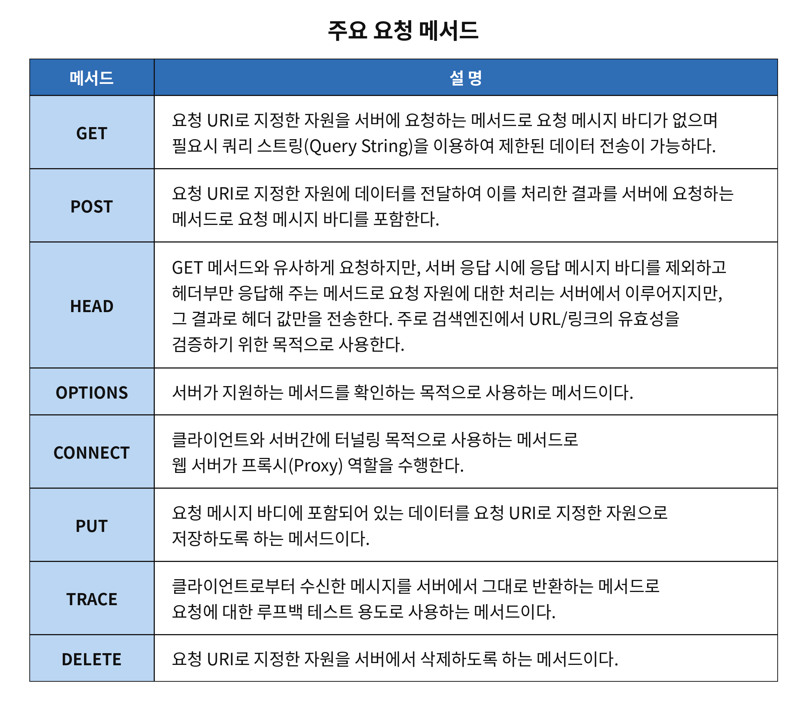
- HEAD : GET 메서드와 동일한 요청을 수행하지만, 응답 본문을 제외한 헤더 정보만 반환한다.
- OPTIONS : 서버가 지원하는 HTTP 메서드(요청 방식)를 확인한다.
#####  <mark style="background:#fff88f"><strong>HEAD/OPTIONS 메서드 사용 예</strong></mark>
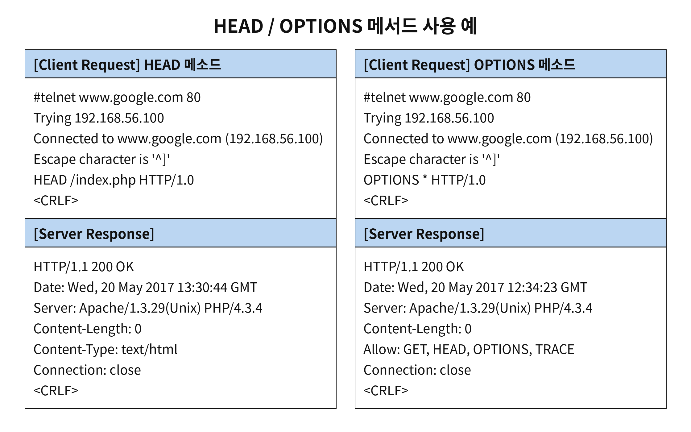
- <strong>HEAD 메서드</strong>의 경우 GET 메서드와 동일한 요청을 수행하지만, 응답 본문을 제외한 <strong>헤더 정보만 반환</strong>한다.
- <strong>OPTIONS 메서드</strong>의 경우 <strong>Allow 응답 헤더</strong>를 통해 웹 서버에서 지원하는 메서드 정보를 전달한다.
##### Query String(요청 문자열)
- 구문 형식 
	- ? : 쿼리 스트링 식별자
	- param= value : 파라미터명 = 파라미터 값
	- & : 각 파라미터 구분자
- GET 방식의 쿼리 스트링으로 전달하는 데이터는 요청 URI 끝에 추가해서 전달하기 때문에 주소창에 정보가 쉽게 노출되고 서버 엑세스 로그 상에 그대로 남아있다. 따라서 중요정보는 POST 방식으로 전달하는 것을 권장한다.
#### HTTP 응답 메세지 구조
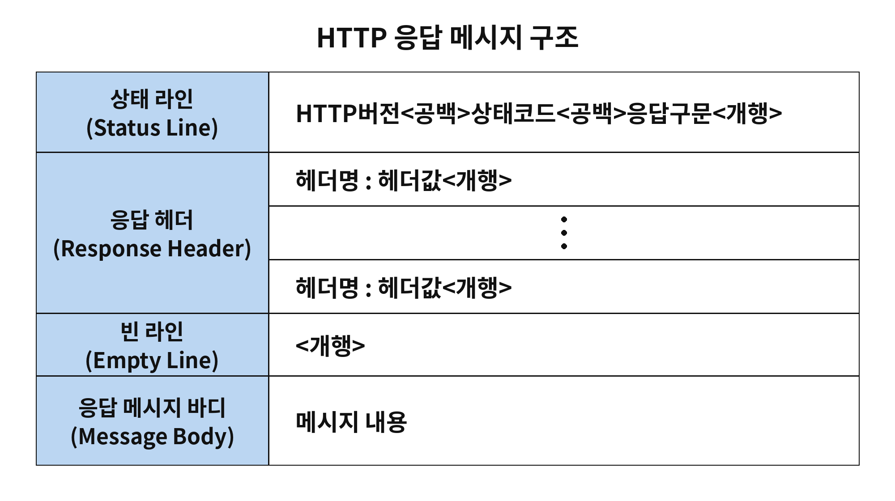
- <strong>주요 응답 헤더 정보</strong>
	- <strong>Content-Type</strong> : 메세지 바디의 데이터 형식을 설정
	- <strong>Content-Length</strong> : 메세지 바디의 전체 크기를 설정(단위:바이트)
##### 주요 상태 코드
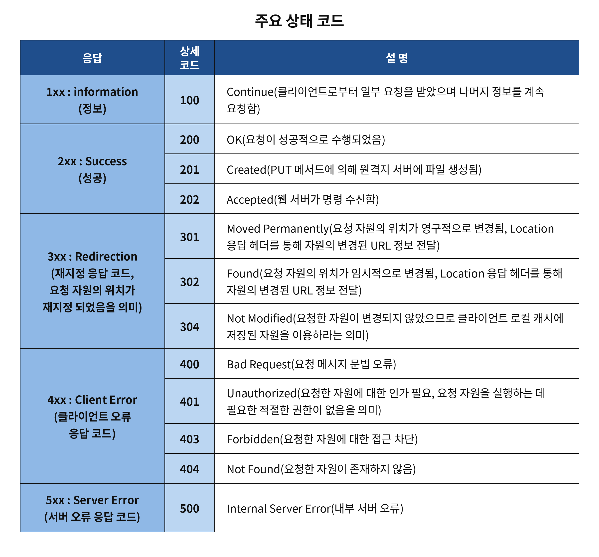
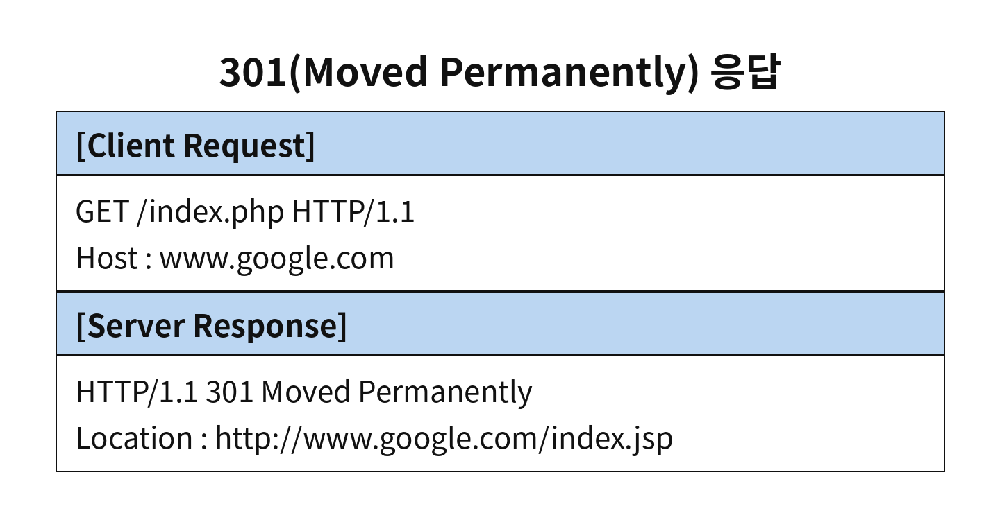
- 301(Move permanently) 응답
	- /index.php 요청 자원이 영구적으로 /index.js로 이동/변경되었음을 의미. 클라이언트는 Location 헤더에 있는 URL로 재요청을 수행.
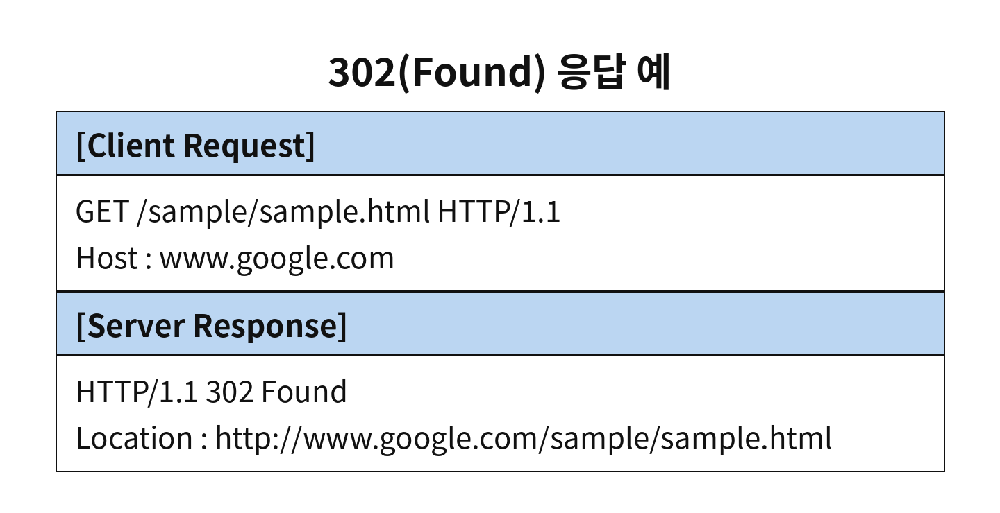
- 302(Found) 
	- 요청 자원의 위치가 임시적으로 변경되었기 때문에 Location 헤더에 있는 URL로 재요청을 수행
