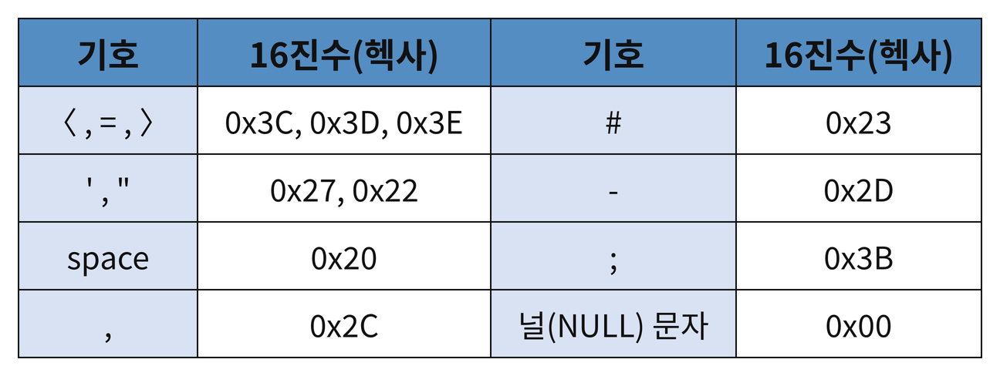

## SQL Injection 취약점
- <strong>정상적인 SQL 질의를 변조하거나 악의적인 SQL 구문을 삽입</strong>하여 불법 로그인, DB 데이터 열람, 시스템 멸령 실행 등을 수행하는 공격 기법.
	- DB에 악성 스크립트를 삽입하여 접근하는 사용자를 피싱 사이트 또는 악성코드 유포 사이트로 유도
	- Stored Procedure(저장된 프로시저)를 통한 OS 명령 실행
	- DB에 있는 개인 정보 획득
- 무료 SQL Injection 취약점 스캐너
	- Nikto : 리눅스 기반 GNU 기반 오픈 소스. 웹 서버 및 SQL Injection에 대한 취약점 점검.
	- SQLMap : 블라인드 SQL Injection을 자동으로 수행하는 도구. python에서 개발.
	- Absinthe : GUI 기반 도구. 블라인드 SQL Injection 취약점에 이용. 데이터 베이스 스키마 목록을 자동화 과정으로 다운로드.
- 블라인드 SQL Injection : SQL Injection 공격이 가능하지만, SQL 질의 결과가 화면에 직접 표시되지 않는 경우 사용하는 공격 기법. 결과가 직접 나타나지 않으므로, 조건(참·거짓)에 따른 응답 차이를 통해 DB 정보를 추측함.
- <strong>URL 인코딩</strong> : URL 상에서 영문자, 숫자, 일부 특수문자를 제외하고 사용할 수 없는 문자를 URL 상에서 안전하게 표현하기 위한 인코딩 방식을 말하며 Percent Encoding 방식을 사용한다.
	- Percent Encoding : 대상 문자를 바이트 단위로`[%xx]` 형식으로 표현. xx는 바이트의 16진수 표기를 말함
- <strong>SQL Injection 분석을 위해 필요한 주요 ASCII 코드 16진수 값</strong>
	- 공백의 경우 %20 또는 플러스 기호(+)로 인코딩

### 공격방식에 의한 분류
#### <mark style="background:#fff88f"><strong> Form SQL Injection</strong></mark>
- HTML Form 기반 인증 애플리케이션의 SQL Injection 취약점을 이용해 <strong>사용자 인증을 위한 질의문의 조건을 임의로 조작하여 인증을 우회</strong>하는 기법.
- 질의문의 조건절(where 절)이 항상 참이 되도록 질의문 조작
- 공격이 성공하는 경우, 반환되는 레코드 셋의 첫 번째 레코드에 해당하는 사용자 권한을 획득하게 된다.
##### 취약한 사이트 예시
- HTML Form 기반 로그인 페이지에서 <strong>SQL 질의문에 사용되는 특수문자("," 등) 입력 시 오류 메시지가 발생</strong>하는 경우, 입력값에 대한 검증이 이루어지지 않았다는 뜻으로 SQL Injection에 취약함.
- <strong>사용자 입력값에 대한 적절한 검증 없이 질의문을 실행</strong>하는 경우 
- <strong>아이디($id)에 악의적인 입력값 삽입 및 인증 우회가 가능할 경우</strong>
	- 공격자는 id 파라미터로 `' or 1=1#`, `' or '1'='1'#` ,`' or 'a'='a#` 등 조건절을 무조건 참으로 만드는 입력값을 삽입.
	- 이를 통해 조건절이 항상 참이되게 만들어 모든 레코드가 select 될 수 있으며, `#`을 통해 그 이하 구문을 주석 처리하여 비밀번호 조건을 무력화할 수 있다.
	- MYSQL 주석 처리 : `#` 주석내용
	- MS-SQL, Oracle 주석 처리 : -- 주석내용
##### SQL 인젝션 방지 방법
- <strong>mysql_real_escape_string() 함수</strong>를 통해 특수문자를 이스케이프로 처리하여 SQL Injection 공격을 방지할 수 있음.
	- mysql_real_escape_string($Id)와 같이 사용.
- <mark style="background:#fff88f"><strong>Prepared Statement(선처리 질의문)</strong></mark>을 이용한 SQL Injection 방지
	- <strong>일반 질의문(Statement)</strong>
		- DB에 요청할 때마다 질의를 컴파일(구문 분석 및 최적화)하여 생성한 후 실행하는 방식. 
		- 성능 문제 및 입력값 조작으로 의도치 않은 질의 실행 가능
		- 예) 매번 `SELECT * FROM users WHERE id = 'kim'`, `... id = 'lee'` 처럼 완성된 문장을 보냄
	- <mark style="background:#fff88f"><strong>선처리 질의문(Prepared Statement)</strong></mark>
		- 외부로부터의 입력값을 제외한 질의 부분을 미리 컴파일하여 생성한 후 반복적으로 입력값만을 매개변수로 전달하여 질의문을 실행.
		- 사전에 컴파일된 질의문을 이용하므로 이후 입력되는 사용자 입력(매개변수)은 질의문 자체를 변경할 수 없고 별도의 매개변수로 전달되어(바인딩되어) 실행되기 때문에, 공격자가 악의적인 입력값을 삽입하더라도 SQL 질의문 자체에 영향을 미치지 않아 SQL 인젝션 공격에 효과적으로 대응할 수 있음.
		- 예)`SELECT * FROM users WHERE id = ?and password = ?` 처럼 틀을 먼저 보내서 한 번만 컴파일해 두고, 이후에는 `?` 자리에 값만 끼워 넣어 실행. 그래서 컴파일 결과를 재사용할 수 있음.
- 파라미터 필터링을 통한 SQL Injection 방지
	- 문자열을 필터링할 수 있는 사용자 정의 함수를 생성
#### Union SQL Injection
- union select 질의를 이용하여, 질의 결과를 다른 질의와 결합하여 공격하는 기법
- union문은 2개 이상의 select문을 결합하고자 할 때 사용하며, 이때 주의할 점은 각각의 select문의 필드 개수가 같아야 하며 필드 타입이 호환될 수 있어야 한다.
#### Stored Procedure SQL Injection
- 저장 프로시저(Stored Procedure) : 일련의 질의를 마치 하나의 함수처럼 실행하기 위한 질의의 집합
#### Mass SQL Injection
- 한 번의 공격으로 대량(Mass)의 DB 값이 변조되어 홈페이지에 치명적인 영향을 미치는 공격
- DB 값 변조 시 악성 스크립트를 삽입하여, 사용자가 변조된 사이트에 방문 시 감염되거나 악성 Bot이 설치됨
- 악성 스크립트는 보통 js, swf, exe 파일 이용
#### <mark style="background:#fff88f"><strong> SQL Injection 대응방안</strong></mark>
- 데이터베이스와 연동되는 스크립트의 모든 파라미터를 점검하여 사용자 입력값에 SQL 질의문에 이용되는 특수문자(', ", ₩, ;, :, %, space, --, # 등)및 select, update, insert, delete, union 등 SQL 관련 문자열을 필터링 한다.
- <mark style="background:#fff88f"><strong>선처리 질의문(Prepared Statement)</strong></mark> : 사전에 컴파일된 질의문을 이용하는 방식으로 이후 입력되는 사용자 입력값(매개변수)은 질의문 자체를 변경할 수 없고 별도의 매개변수로 전달되어 실행되기 때문에 공격자가 악의적인 입력값을 삽입하더라도 SQL 질의문 자체에 영향을 미치지 않는다.
- 입력되는 문자열의 길이 제한. 숫자일 경우 숫자인지 체크하는 함수 사용.
- MS-SQL의 경우 master. .xp_cmdshell, xp_startmail, xp_sendmail 과 같은 확장 프로시저는 운영체제 명령 실행, SQL 인젝션 등에 이용되기 때문에 제거하는 것이 안전
- 웹 애플리케이션이 사용하는 데이터베이스 사용자 권한을 제거
### 공격 유형에 따른 분류
#### Error-Based SQL Injection
- DB 질의에 대한 에러값을 기반으로 한 단계씩 점진적으로 DB 정보를 획득하는 방법. 클라이언트에서 조작할 수 있는 파라미터에 SQL 질의 관련 특수문자를 삽입하여 SQL 에러가 발생한다면 해당 취약점이 있다고 판단할 수 있음.
- DB 질의에 대한 에러가 외부로 노출되는 취약점을 이용한 공격
#### Bilnd SQL Injection
- 질의 결과의 참과 거짓을 통해 의도하지 않은 SQL을 실행함으로써 데이터 베이스를 비정상적으로 공격하는 기법
- 오류 메세지를 자세하게 반환하지 않게 설정해놓았다면 Error-Based SQL Injection은 피할 수 있지만 Blind SQL Injection에는 취약.
- 질의 결과가 참인지 거짓인지에 따른 서버의 응답 형태를 먼저 파악해야 함. 많은 비교과정을 거치지 때문에 취약점 발견 시 자동화 도구를 이용하는 것이 일반적