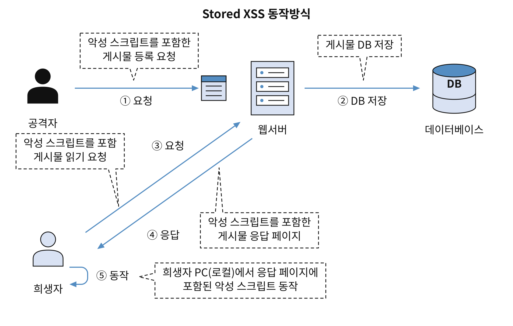
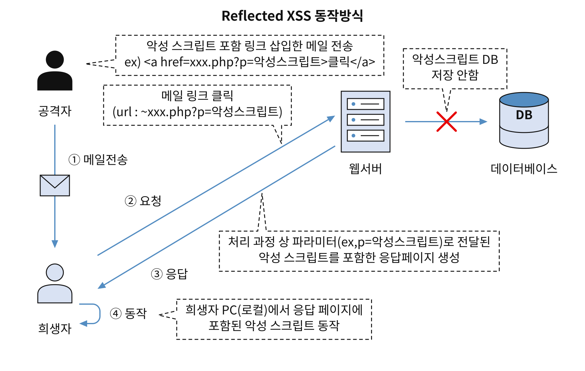
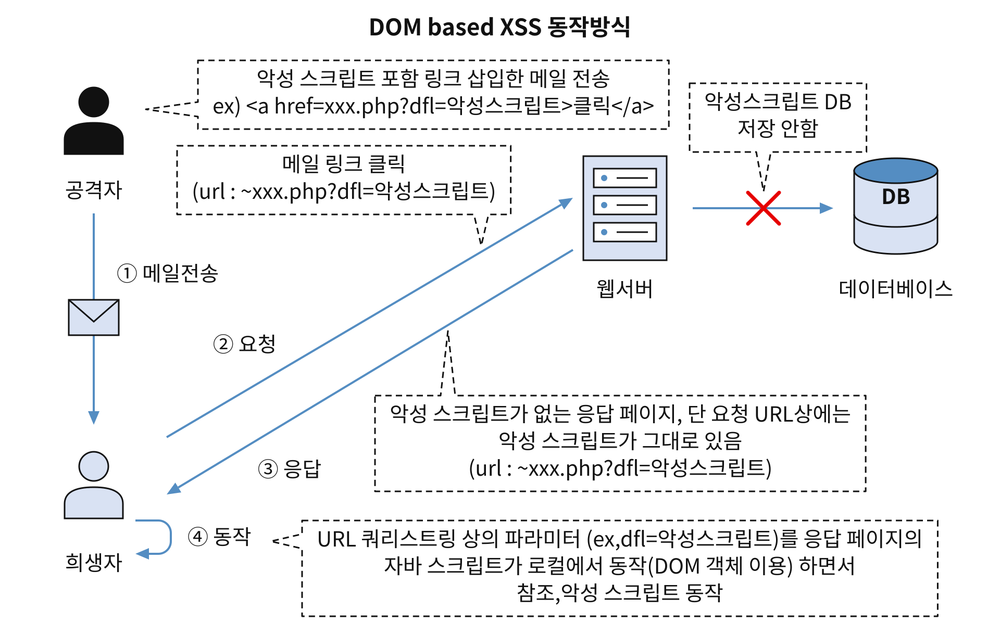

## <strong>크로스 사이트 스크립트(XSS:Cross Site Script) 취약점</strong>

- 웹 애플리케이션이 사용자 입력값을 제대로 필터링하지 않을 때, 공격자가 입력이 가능한 폼에 악의적인 스크립트를 삽입하고, 이 스크립트가 다른 사용자(희생자)에서 동작하도록 하여 악의적인 행위를 수행하는 취약점.
- 공격자는 취약점을 이용하여 사용자의 개인정보 및 쿠키정보 탈취, 악성코드 감염, 웹 페이지 변조 등의 공격을 수행.
- <strong>크로스 사이트 스크립트 유형</strong>
    - <strong>Stored XSS</strong>(저장형 XSS)
    - <strong>Reflected XSS</strong>(반사형(XSS)
    - <strong>Dom based XSS</strong>(DOM 기반 XSS)

#### Stored XSS

- 공격자가 취약한 <strong>웹서버에 악성 스크립트를 서버(DB)에 저장</strong>해놓으면 해당 자료를 요청할 때 악성 스크립트가 삽입된 응답 페이지가 전달되어 클라이언트 측에서 동작하는 방식
- iframe 태그 : 웹문서 중간에 다른 웹문서나 메모장 같은 내용을 원하는 크기로 불러들여 보여주는 태그. iframe 태그를 통해 웹 문서 내에 몰래 악성 스크립트를 포함한 문서를 포함시키거나 악성 스크립트를 실행시키는 용도로 활용되는 경우가 많아 보안상 사용 권장 X
- XSS 공격이 의도하지 않은 HTML/스크립트 태그들을 사용하기 때문에 이를 제거하거나(strip_tags() 함수) 치환해주는(htmlspecialchars() 함수)를 사용하면 효과적으로 차단할 수 있음

#### Reflected XSS

- 외부에 있는 악성 스크립트가 희생자의 액션에 의해 취약한 웹 서버로 전달되고, 웹 서버의 응답 페이지에 해당 악성 스크립트가 삽입되어(DB에 저장되는 것은 아님) 희생자 측에서 동작하는 방식
- 해당 공격을 통해 쿠키 정보 탈취가 가능한 취약점이 있는지를 판단하기 위해 점검자는 ``와 같은 자바스크립트를 사용해 점검해볼 수 있다.

#### Dom based XSS

- DOM(Document Object Model) : 문서 객체 모델로 웹페이지 내에 있는 모든 객체를 조작, 관리할 수 있는 계층 구조 형태의 모델을 말함. DOM을 통해서 HTML 문서를 계층적으로 보면서 컨텐츠를 동적으로 변경할 수 있음
- 피해자의 웹 브라우저에서 응답 페이지에 포함된 자바스크립트가 실행되며 DOM(Document Object Model)을 처리할 때, URL 등에 포함된 악성 스크립트가 함께 실행되는 방식
- 악성 스크립트가 서버 응답에 포함되어 전송되는 것이 아니라, 서버 응답과는 무관하게 클라이언트(웹 브라우저) 측에서 발생

#### 취약점 판단 기준

- XSS 취약점이 발생할 수 있는 입력 가능한 폼, URL 파라미터 드엥 스크립트를 삽입하여 해당 스크립트가 동작하면 XXS에 취약하다고 판단.
- ``

#### 대응책

- 사용자 입력값에 대한 검증은 반드시 서버에서.
- 클라이언트 단에서 검증을 수행하더라도(자바스크립트 등을 이용한 입력값 검증) 이는 공격자가 웹 프록시(Web Proxy) 도구 등을 이용해 쉽게 우회할 수 있으므로 서버 단에서 추가적인 검증이 반드시 필요
    - <strong>웹 프록시(Web Proxy)</strong> : 웹을 이용한 해킹 공격에 가장 활발히 사용되는 도구. <strong>클라이언트가 요청한 HTTP 요청/응답 정보를 중간에서 가로채</strong> 필터링을 우회하거나 서버에 전송되는 데이터를 조작해 허가되지 않은 곳의 정보를 훔쳐보거나 변경, 삽입을 가능하게 한다. 대표적인 도구에는 파로스(Paros),  버프(Burp)등이 있다.
- 사용자 입력 문자열에서 HTML 코드로 인식될 수 있는 특수 문자를 일반문자로 처리한다.
- HTML 태그를 허용해야만하는 경우라면 HTML 태그 화이트리스트를 선정한 후 해당 태그만 허용하는 방식을 적용한다.
