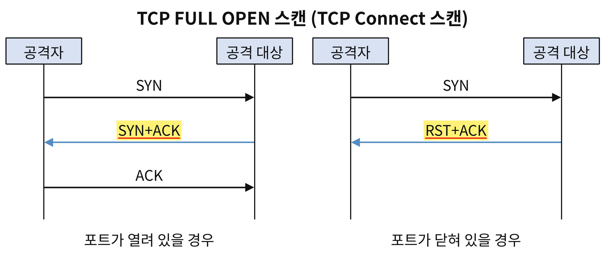
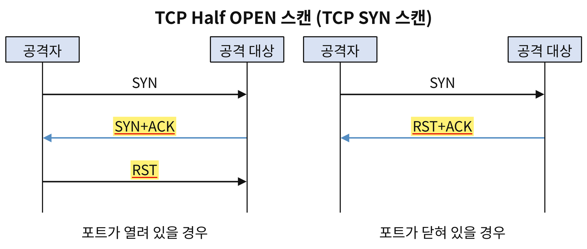
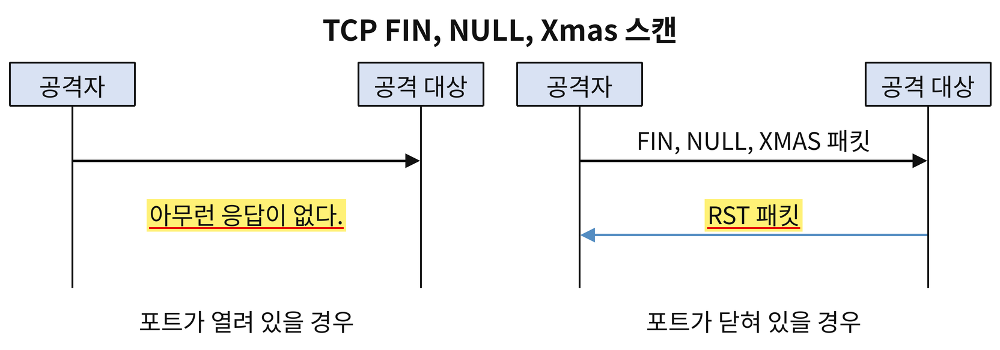
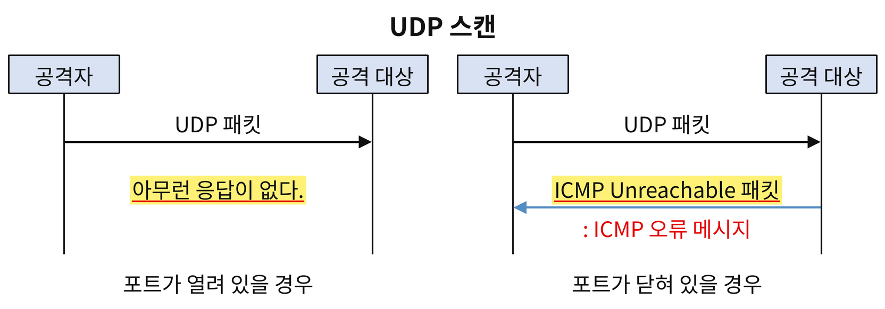
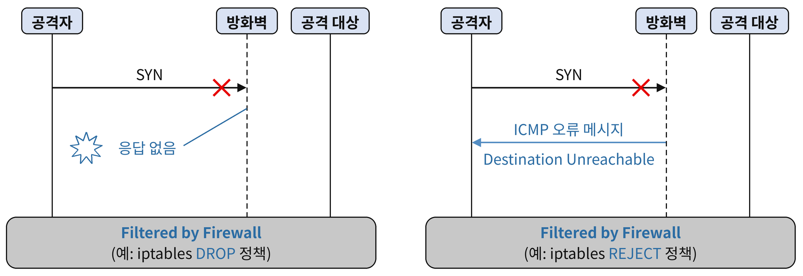
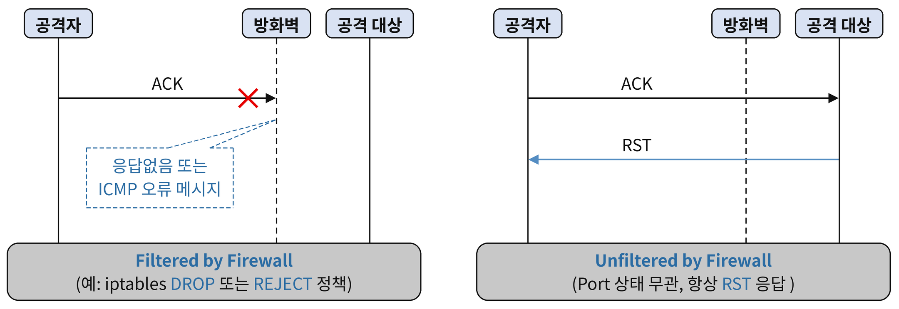
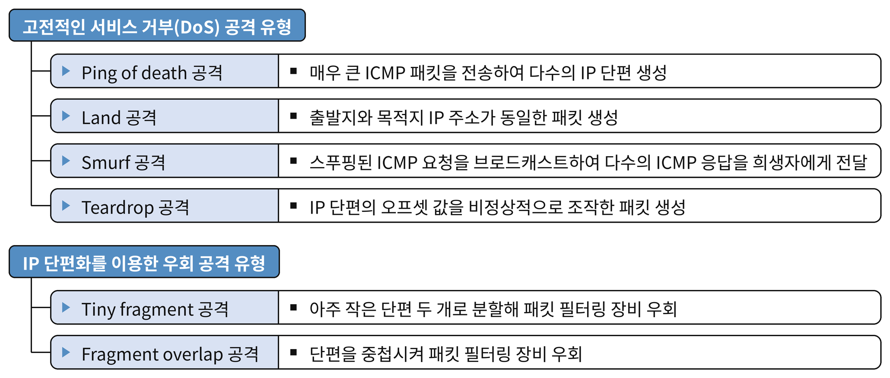
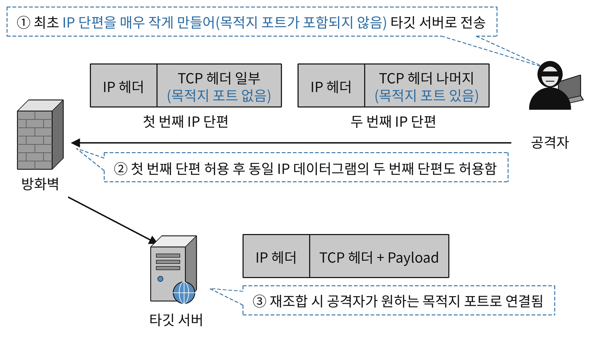
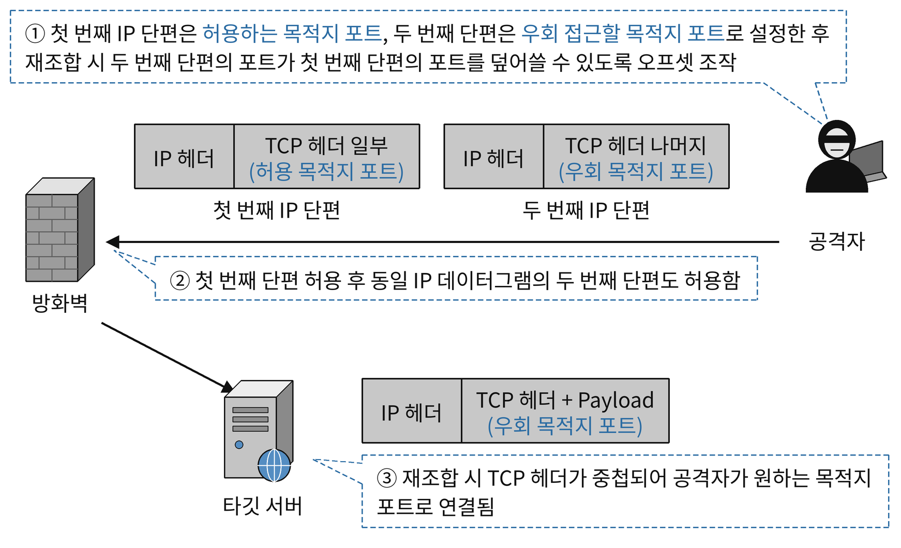
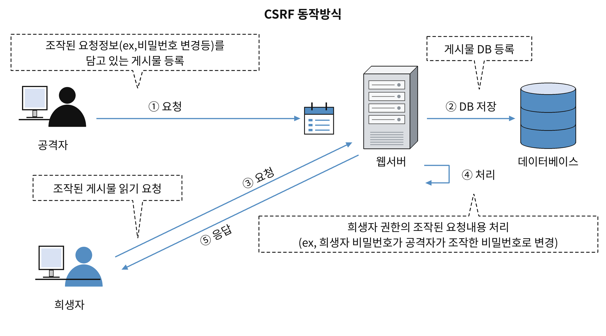

# 시스템 보안

### 윈도우 서버 보안

#### etc/passwd 파일

- 예) root : <strong>x</strong> : 0 : 0 : root : /root: /bin/bash
- 사용자 계정 이름, <strong>패스워드 필드(실제 사용하지 않고 /etc/shadow에 저장)</strong>, UID, GID, 사용자 관련 기타 정보, 홈 디렉터리, 로그인 셸
- 패스워드 필드 : `!`나 `*`이면 로그인이 잠긴 계정이라는 뜻이고, 비어 있으면 패스워드 없이 로그인할 수 있는 위험한 상태

## 시스템 기본 학습

### 시스템 해킹

#### 버퍼 오버플로우 공격

### 레이스 컨디션 공격(Race Condition Attack)

# 네크워크 보안

#### L2 Switch(스위치) 주요 기능 및 동작 방식 - 22.2

- 학습(Learning) 기능
    - 특정 포트로 유입된 프레임의 출발지 MAC 주소를 기반으로 MAC Address Table을 자동으로 갱신하는 기능
- 포워딩(forwarding) 기능
    - MAC Address Table을 검색하여 유입된 프레임의 목적지 MAC 주소 장치가 연결된 프레임 포트로 프레임을 전달하는 기능
- 플러딩(Flooding)기능
    - 장치가 연결된 모든 포트로 프레임을 전달하는 기능.
    - 프레임의 목적지 MAC 주소가 MAC 주소 테이블에 없는 경우나 브로드캐스트 프레임(FF:FF:FF:FF:FF:FF)인 경우 발생.
- 필터링(Filtering) 기능
    - 목적지 포트 외에는 프레임을 전달하지 않는 기능
    - 프레임이 유입된 포트로 다시 프레임을 전달하지 않는 기능(중복 프레임 방지 목적)
- 에이징(Aging) 기능
    - MAC 주소 테이블에 있는 학습한 MAC 주소로 일정 시간 동안 프레임이 유입되지 않으면 MAC 주소를 삭제하는 기능

#### 스니핑

- 허브 환경에서 스니핑
    - 허브에 장치를 연결한 후 NIC의 동작 모드를 무차별 모드(Promiscuous Mode)로 설정.
    - 무차별 모드(Promiscuous Mode) : 유입된 프레임의 목적지 MAC 주소와 상관 없이 모든 프레임을 수신하는 동작 모드.
- 스위치(L2 스위치 환경에서 스니핑)
    - <strong>스위치 재밍(Switch Jamming) = 맥 플러딩(Mac Flooding)</strong>
        - 위조된 출발지 MAC 주소 대량 전송 → MAC 주소 테이블 포화(오버플로우)→ 허브처럼 동작 → 스니핑 가능
    - <strong>ARP 스푸핑 공격 = ARP Cache Poisoning 공격</strong>
        - 공격자가 특정 호스트의 MAC 주소를 자신의 MAC 주소로 위조한 ARP Reply 메세지를 생성하여 희생자의 호스트에 지속해서 전송하면 희생자의 호스트 ARP Cache Table에 특정 호스트의 MAC 주소가 공격자의 MAC 주소로 조작된다. 이를 통해 희생자 호스트가 특정 호스트로 전송하는 프레임이 공격자 쪽으로 전달되도록 하는 스니핑 기법.
        - 지속해서 위조한 ARP Reply 메세지를 전송하는 이유 : 동적 ARP 정보는 일정 시간 후 삭제되므로 조작된 정보를 유지하기 위해
    - 대응 방안
        - 중요 시스템에 대해서는 ARP Cache Table에 MAC 주소 정보를 정적(Static)으로 설정하여 ARP Reply 메세지를 수신해도 ARP 캐시 정보가 갱신되지 않도록 한다.
        - 네트워크 상의 ARP 트래픽을 실시간으로 모니터링하는 프로그램(Arpwatch 등)을 이용하여 IP 주소에 대한 MAC 주소 변경 여부를 감시한다.
    - <strong>ARP 리다이렉트(Redirect) 공격을 이용한 스니핑 기법</strong>
        - ARP 스푸핑 공격과 유사하게 공격자가 자신이 게이트웨이(라우터)인 것처럼 MAC 주소를 위조한 ARP Reply 메세지를 생성하여 지속해서 브로트캐스트하면 로컬 네트워크에 있는 모든 호스트의 ARP Cache Table에 게이트웨이(라우터)의 MAC 주소가 공격자의 MAC 주소로 조작된다. 이를 통해 모든 호스트가 게이트웨이(라우터)로 전송하는 프레임이 공격자로 전달되도록 하는 스니핑 기법이다.
    - <strong>ICMP 리다이렉트(Redirect) 공격을 이용한 스니핑 기법</strong>
        - 라우터로 가장한 공격자가 특정 IP 또는 IP 대역으로 나가는 패킷의 라우팅 경로를 자신에게 라우팅 되도록 위조한 ICMP Redirection 메시지(Type 5)를 전송하여 희생자의 <strong>라우팅 테이블을 조작</strong>하고, 패킷을 경유시켜 스니핑하는 공격.
        - <strong>ICMP Redirection 메시지(Type 5)</strong> : 라우터가 호스트에게 더 적절한 라우팅 경로를 알려주는 메시지.
            - 공격자가 이를 악용하여 특정 IP 또는 IP 대역으로 나가는 패킷의 라우팅 경로를 공격자 주소로 위조한 ICMP Redirection 메시지를 생성한 후 라우터로 가장하여(IP 스푸핑) 희생자 호스트에 전송함으로써 희생자 호스트의 라우팅 테이블을 조작할 수 있다.
            * 라우터로 가장하기 위해 IP 스푸핑을 하는 이유 : ICMP Redirection 메시지는 라우터가 보내는 메시지이므로 라우터가 아닌 호스트가 보낸 메세지는 무시된다. 따라서 공격자는 라우터가 보낸 메세지 처럼 보이도록 출발지 IP 주소를 라우터의 IP 주소로 위조(IP 스푸핑)하여 ICMP Redirection 메시지를 희생자 호스트에 전송한다
        * 대응 방안
            * 운영체제(커널) 설정을 통해 ICMP Redirection 메세지에 의한 라우팅 정보 변경을 허용하지 않도록 설정
            * 방화벽 기능을 통해 ICMP Redirection 메세지를 차단하도록 설정

##### 네트워크 스니핑 공격 대응 방안 

- 22/24.1, 기사
- 네트워크 스니핑을 통해 통신 내용을 알 수 없도록 암호화(보안) 프로토콜 또는 프로그램을 사용하여 통신에 사용되는 모든 데이터를 암호화한다.
- 주요 암호화 기법
    * 웹 환경에서의 HTTPS 사용
    * 이메일 환경에서의 PGP, S/MIME 등 사용
    * 원격 터미널 접속을 위한 SSH 사용
    * 공중망을 통해 사설망 수준의 보안 서비스를 제공하는 VPN(SSL/TLS, IPsec 등) 사용
- 허브(더미 허브) 장비에 비해 상대적으로 네트워크 스니핑 공격에 안전한 스위치(스위칭 허브) 장비를 이용한다.
- 스니핑(스니퍼) 탐지 도구를 이용하여 악의적인 스니핑이 발생하는지 지속해서 점검한다.

#### 포트 스캔(Port Scan) 기법

- 공격자가 침입 전에 대상 호스트에 어떤 포트(서비스)가 활성화 되어있는지 확인하는 기법
- Nmap : 대표적인 포트스캐너

#### TCP FULL OPEN 스캔(TCP Connect 스캔)

- 대상 시스템에 스캔 로그가 남을 수 있다.

#### TCP HALF OPEN 스캔(TCP SYN 스캔)

- RST : 연결 강제 종료 패킷
- 서버에 로그를 남기지 않음
- <strong>스텔스 스캔</strong> : TCP 연결을 생성하지 않고 스캔

#### TCP FIN, NULL, Xmas 스캔

- TCP FIN, NULL, Xmas 스캔에서 사용하는 패킷에 대해 닫힌 포트에서는 RST 패킷으로 응답하고, 열린 포트에서는 응답하지 않는다.
- <strong>스텔스 스캔</strong> : TCP 연결을 생성하지 않고 스캔
- TCP 패킷 헤더의 제어 플래그를 비정상적으로 설정하여 스캔.

#### UDP 스캔

- 닫힌 UDP 포트로 패킷을 전송하면 ICMP 오류 메세지(Type 3 Destination Unreachable, Code 3: Port Unreachable)로 응답하는 특성을 이용.

#### Filtered 상태

- 방화벽에 의해 서비스 포트가 차단된 경우, <strong>방화벽 정책에 따라 응답이 없거나 ICMP 오류 메시지(Destination Unreachable)를 수신</strong>할 수 있다.
- 일반적으로 방화벽은 응답하지 않도록 설정된다.
- iptable 방화벽의 경우
    - DROP 차단 정책 : 패킷을 폐기하고 아무런 응답을 하지 않음
    - REJECT 차단 정책 : 패킷을 폐기한 후 설정된 ICMP 오류 메세지를 응답.

#### TCP ACK 스캔

 - 대상 호스트의 <strong>방화벽 룰셋(필터링 정책)을 파악하기 위한 스캔 방식</strong>
- 대상 호스트의 지정된 포트로 ACK 제어 플래그만 설정한 패킷을 전송.
- 차단된(Filtered) 상태 : 응답이 없거나 ICMP 오류 메세지(Destination Unreachable)을 수신
- 허용된(Unfiltered) 상태 : 대상 호스트로부터 RST 응답을 수신.

#### Decoy 스캔

- 다양한 포트 스캔을 수행할 때 사용할 수 있는 옵션으로 실제 스캐너 주소 외에 여러 개의 가짜 IP 주소를 함께 사용하여 스캔하는 방식.
- 이로 인해 스캔을 당하는 호스트 관리자 입장에서는 스캔을 수행한 실제 스캐너 주소를 식별하기 어려움.

### 서비스 거부(DoS : Denial Of Service) 공격

- 비정상적인 트래픽을 발생시켜 네트워크 대역폭이나 시스템 자원을 고갈시키거나 오류를 유발하여 정상적인 서비스 제공을 방해하는 공격. 서비스 가용성을 저하시켜 정상 사용자의 요청을 처리하지 못하게 함.

#### Ping of death 공격

- ping 명령을 이용하여 매우 큰 ICMP Echo Request 패킷을 전송함으로써 대상 시스템에 과부하나 오류를 유발하는 서비스 거부 공격.
- <strong>공격 원리</strong> : 비정상적으로 큰 ICMP 패킷 전송 → MTU 초과로 IP 단편화 발생 → 다수의 IP 단편을 재조합 과정에서 과부하 또는 버퍼 오류에 의한 서비스 거부 발생 가능
- <strong>대응책</strong> : 비정상적으로 큰 ICMP 패킷 탐지 및 차단, 시스템 패치 적용

### Land 공격

- 출발지 IP 주소와 목적지 IP 주소를 동일하게 위조한 패킷을 전송하여, 대상 시스템이 자기 자신에게 응답하도록 유도해 무한 루프 또는 과도한 자원 소모를 일으키는 서비스 거부 공격.
- IP 스푸핑(Spoofing) 기법을 사용하며, 단일 패킷만으로도 취약한 시스템의 자원을 소모시키거나 마비시킬 수 있는 특징이 있다.
    - IP 스푸핑(IP Spoofing): 공격자가 자신의 IP 주소를 다른 호스트의 IP 주소로 위조하여 신뢰 관계를 악용하거나 공격 출처를 숨기는 공격 기법.
- <strong>대응책</strong> : 출발지와 목적지 IP 주소가 동일한 패킷 탐지 및 차단, 시스템 패치 적용

#### <strong>Smurf 공격</strong>

- 출발지 IP 주소를 공격 대상 IP 주소로 위조하여 증폭 네트워크의 Directed Broadcast 주소로 ICMP Echo Request를 전송하고, 네트워크 내 모든 호스트가 피해자에게 ICMP Echo Reply를 보내도록 유도해 네트워크 대역폭을 소진시키는 서비스 거부 공격.
    - 다이렉트 브로트캐스트 : 특정 원격 네트워크(서브넷)에 속한 모든 호스트에게 동시에 데이터를 전송하는 방식.
- <strong>주요 특징</strong> : IP 스푸핑, Directed Broadcast 및 증폭/반사 네트워크 사용.
- <strong>대응책</strong> : Directed Broadcast 패킷 차단, Directed Broadcast ICMP 응답 비활성화, 비정상적으로 많은 ICMP Echo Reply 패킷 탐지 및 차단

#### Teardrop 공격

- IP 단편의 오프셋 값을 비정상적으로 조작한 패킷을 전송하여, 대상 시스템의 IP 단편 재조합 과정에서 오류를 유발하는 서비스 거부 공격.
- 중첩되거나 비연속적인 오프셋 값을 가진 IP 단편을 전송하여 재조합 모듈에서 버퍼 오버플로우 등 시스템 오류를 발생시킴.
- 대응책 : 비정상 IP 단편 탐지 및 차단, 시스템 패치 적용.

### IP 단편화(Fragmentation) 취약점을 이용한 우회 공격

- IP 단편화 과정에서 발생할 수 있는 취약점을 악용하여 패킷 필터링 장비(방화벽, IDS/IPS 등)를 우회
- 패킷 필터링 장비의 검사기능을 우회하여 원래 허용되지 않는 대상 시스템의 서비스에 접근하기 위한 공격.

#### Tiny fragment 공격(작은 단편 공격)

- TCP/UDP 헤더가 두 개의 IP 단편으로 나뉘도록 첫번째 단편을 매우 작은 크기로 생성하여 패킷필터링 장비를 우회하는 공격.
- <strong>공격 원리</strong>
    - 공격자는 TCP/UDP 헤더가 두 개의 IP 단편으로 나뉘도록 패킷을 아주 작은 단편으로 쪼개어 전송. 두 번째 포트에만 목적지 포트 정보를 포함한다.
    - 취약한 패킷 필터링 장비는 첫 번째 단편에서 검사해야 할 정보(예: 목적지 포트)가 없으므로 이를 허용하고, 두 번째 단편은 이미 첫번째 단편이 허용되었다는 이유로 그대로 통과시킨다.
    - 대상 시스템에서는 두 단편이 재조합되어 결과적으로 공격자가 의도한 포트로 연결이 이루어진다.

#### Fragment overlap 공격(단편 중첩 공격)

- IP 단편의 오프셋 값을 조작하여, 두 번째 단편이 첫 번째 단편의 일부를 덮어쓰도록 만들어 패킷 필터링 장비를 우회하는 공격 기법.
- <strong>공격 원리</strong>
    - 공격자는 두 개의 IP 단편을 생성하여, 첫 번재 단편에는 패킷 필터링 장비가 허용하는 포트 정보(예: 433/tcp)를 포함시킨다.
    - 두 번째 단편에는 공격자가 실제로 접근하려는 차단 대상 포트 번호(예:22/tcp)를 포함시키고, 이 단편이 첫 번째 단편의 목적지 포트 필터를 덮어쓰도록 오프셋 값을 조작한다.
    - 취약한 패킷 필터링 장비는 첫 번째 단편에 포함된 허용 포트 번호(예: 443/tcp)만을 검사하고 허용한 뒤, 같은 흐름의 두 번째 단편 역시 통과시킨다.
    - 대상 시스템에서는 두 단편이 재조합되어 결과적으로 공격자가 의도한 포트(22/tcp)로 연결이 이루어진다.
- <strong>대응책</strong>
    - 패킷 필터링 장비(방화벽, IDS/IPS 등)가 IP 단편을 재조합하여 검사(reassembly based inspection)할 수 있도록 설정하거나, 비정상적으로 단편화된 패킷을 탐지 및 차단할 수 있는 패킷 필터링 장비를 적용한다.

# 애플리케이션 보안

## 웹 애플리케이션 기본 학습

### DNS

### HTTP

- 웹 상에서 클라이언트와 서버 간에 통신을 위해 개발된 프로토콜(80/tcp)
- HTTP 통신은 클라이언트 요청과 서버 응답으로 이루어져있다.
- <strong>비연결형, 무상태(Stateless) 프로토콜</strong>
- 클라이언트 상태정보 유지 기술 : 클라이언트 - 쿠키(Cookie), 서버 - 세션(Session)
- <strong>쿠키(Cookie)</strong> 26-1
    - 개별 클라이언트의 상태 정보를 클라이언트에 저장하고, HTTP 요청·응답 헤더를 통해 전달하는 기술
    - 보안 취약점 : <strong>클라이언트 해킹이나 스니핑 공격에 의한 정보 노출·변조에 취약</strong>
- <strong>세션(Session)</strong> 26-1
    - 개별 클라이언트의 상태 정보를 서버에 저장하는 기술(<strong>쿠키보다 안전하게 상태 정보 유지</strong>)
    - HTTP 세션 하이재킹(Session Hijacking) 공격 : HTTP의 세션 관리 취약점을 이용한 공격으로 인증된 <strong>사용자의 HTTP 세션 ID를 탈취하여 인증된 사용자로 위장</strong>하여 서버에 접근하는 공격
- 중요 정보를 저장할 경우에는 서버에 상태정보를 저장하는 세션 방식이 안전하며, 쿠키를 사용해야할 경우에는 암호화를 적용해야한다.
- <strong>쿠키 관련 보안 속성</strong>
    - HttpOnly : <strong>클라이언트에서 스크립트를 통해 해당 쿠키에 접근하는 것을 차단해주는 속성</strong>.
        - Set-Cookie 응답 헤더에 설정하는 속성.
        - 세션 ID를 저장하고 있는 세션 쿠키를 탈취하기 위한 XSS(Cross Site Script) 공격에 대응하기 위해 사용.
    - secure : <strong>클라이언트에서 HTTPS(SSL/TLS) 통신일 경우에만 해당 쿠키를 전송</strong>하는 속성.
        - Set-Cookie 응답 헤더에 설정하는 속성.
        - 기밀성 보장. 전송 중에 평문 쿠키가 노출되는 것을 방지함.
    - expires : <strong>쿠키의 유효시간을 설정하는 속성.</strong>
        - 유효시간을 최소한으로 설정하여 쿠키 정보가 클라이언트에 지속해서 남아 공격자에게 노출되는 위험을 방지할 수 있음.
- <strong>HTTP 요청 메세드</strong>
    - <strong>HEAD</strong> : GET 메서드와 동일한 요청을 수행하지만, <strong>응답 본문을 제외한 헤더 정보만 반환.</strong>
    - <strong>OPTIONS</strong> : <strong>서버가 지원하는 HTTP 메서드(요청 방식)를 확인.</strong> Allow 응답 헤더를 통해 웹 서버에서 지원하는 메서드 정보를 전달한다.

## 웹 애플리케이션 취약점

#### XSS(Cross Site Script) 취약점

26-1

- 웹 애플리케이션이 사용자 입력값을 제대로 필터링하지 않을 때, <strong>공격자가 입력이 가능한 폼에 악의적인 스크립트를 삽입</strong>하고, <strong>이 스크립트가 다른 사용자(희생자)의 브라우저에서 동작하도록</strong> 하여 악의적인 행위를 수행하는 취약점.
- 공격자는 취약점을 이용하여 사용자의 개인정보 및 쿠키정보 탈취, 악성코드 감염, 웹 페이지 변조 등의 공격을 수행.
- <strong>크로스 사이트 스크립트 유형</strong>
    - <strong>Stored XSS</strong>(저장형 XSS)
    - <strong>Reflected XSS</strong>(반사형(XSS)
    - <strong>Dom based XSS</strong>(DOM 기반 XSS)

##### 취약점 판단 기준

- XSS 취약점이 발생할 수 있는 입력 가능한 폼, URL 파라미터 등에 스크립트를 삽입하여 해당 스크립트가 동작하면 XXS에 취약하다고 판단.
- ``

##### 대응책

26-1

- 클라이언트 측 입력값 검증은 웹 프록시 등을 통해 우회할 수 있으므로 사용자 입력값에 대한 검증은 반드시 서버에서 한다.
    - <strong>웹 프록시(Web Proxy)</strong> : 웹을 이용한 해킹 공격에 가장 활발히 사용되는 도구. 클라이언트와 서버 사이에서 HTTP/HTTPS 요청·응답을 중계하고 분석하는 도구. 요청·응답 데이터를 가로채어 확인 및 수정할 수 있어 클라이언트 측 검증 우회 및 데이터 변조에 악용될 수 있다. 대표적인 도구에는 파로스(Paros),  버프(Burp), 피들러(Fiddler) 등이 있다.
- HTML 코드로 인식될 수 있는 특수 문자를 HTML Entity로 치환하여 일반 문자로 처리한다.
- HTML 태그 허용 시 화이트리스트 방식으로 허용 태그만 사용 가능하도록 한다.

#### CSRF(Cross Site Request Forgery) 취약점

26.1

 - 웹 애플리케이션이 정상적인 요청과 비정상적인 요청을 구분하지 못할 때, 공격자가 스크립트 등을 이용하여 인증된 사용자가 의도하지 않은 요청(회원 정보 변경, 게시판 설정 변경 등)을 전송하도록 유도하는 공격 기법이다.

##### 취약점 판단 기준

- CSRF 취약점이 발생할 수 있는 입력 가능한 폼에 `img` 태그의 `src` 속성을 이용해 조작된 요청을 전송하고, 서버가 별도의 정당성 검증 없이 요청을 처리하는지 확인
- `img src`: 사용자의 별도 클릭 없이 자동으로 HTTP 요청 발생
- ``

##### 대응책

26.1

- 서비스 요청 전 단계에서 임의의 CSRF 토큰을 매번 새롭게 생성하여 발급하고, 요청 시 함께 전달하도록 한 후 발급된 토큰과 사용자 세션에 저장된 토큰을 비교하여 정상 요청과 비정상 요청을 판별한다.
- 중요한 기능에 대해서는 사용자 세션 검증과 더불어 재인증을 유도한다.
- 입력 폼 작성 시 GET 방식보다 POST 방식을 사용하여 직접적인 URL 조작을 방지한다.

#### 파일 업로드(File Upload) 취약점

26.2

- <strong>업로드 파일의 유형이나 확장자를 적절히 검증하지 않아 웹셸 등이 웹 서버에 업로드</strong>되어 서버 명령 실행 또는 사용자 PC 침해가 발생할 수 있는 취약점.
- 이미지 등 <strong>정적 파일이 저장되는 업로드 디렉터리에 PHP, JSP 등의 서버 사이드 스크립트 파일이 존재</strong>하고, <strong>해당 파일에 반복적인 POST 요청 및 응답 크기 변화가 발생</strong>하는 경우 파일 업로드 취약점을 이용한 웹셸 공격을 의심할 수 있음
    - 정적 이미지나 고정된 페이지는 응답 크기가 일정하지만, <strong>요청한 명령에 따라 응답 크기가 달라진다면 동적 응답을 생성한다는 의미로 웹셸의 특징</strong>으로 볼 수 있다.
- <strong> 대응 방안</strong>(26-2)
    - 업로드 파일에 대한 파일 타입 및 확장자 검증(화이트 리스트 정책 활용)을 통해 악성 스크립트 파일(웹셸 등)의 업로드를 차단한다.
    - 업로드 전용 디렉터리를 생성하고 서버 사이드 스크립트 실행 및 직접 URL 접근 차단
        - 서버 사이드 스크립트 : 웹 서버에서 실행되는 프로그램 코드
    - 업로드 디렉터리의 스크립트 실행 권한 및 업로드 된 파일의 실행 속성 제거.
        - 업로드 디렉터리 : 사용자 파일을 올려놓는 저장 공간
    - 업로드 파일을 웹 루트 외부에 저장하여 외부의 직접 접근 제한
        - 웹 루트 내부 : URL을 통해 파일에 접근할 수 있음
        - 웹 루트 외부 : 일반적인 웹 URL로 직접 접근할 수 없음

# 침해사고 분석 및 대응

#### 피들러(Fiddler)

26.1

- 클라이언트와 서버 간의 <strong>HTTP/HTTPS 통신</strong>을 중간에서 가로채어 <strong>요청과 응답을</strong> 캡처하고 <strong>분석</strong>하는 <strong>웹 디버깅 프록시 도구</strong>
- 상황: 요청/응답 본문이 암호화되어있음
- 분석 불가 원인: `Decrypt HTTPS traffic` 기능이 비활성화되어 HTTPS 트래픽을 복호화하지 못하기 때문.
- 해결 방법
    1. HTTPS 옵션에서 `Decrypt HTTPS traffic` 활성화
    2. Fiddler 루트 인증서를 클라이언트에 설치
    3. HTTPS 트래픽 복호화 및 분석

#### TEMPEST(위치 못찾)

24.1

- 템페스트(TEMPEST): 전자기기로부터 누설되는 전자파를 도청(Eavesdropping)하는 기술과 도청에 대해 방어 대책(Countermeasure)을 수립하는 기술 분야
- 템페스트 방어대책
    - 차폐(Shielding): 전자파가 새지 않도록 장비나 공간을 금속 등으로 차단하는 방법
    - Control zone(통제구역) : 전자파가 유출돼도 도청이 불가능한 거리까지를 보호구역으로 정해 통제하는 방법
    - White noise(백색잡음) : 전자파·소리와 비슷한 잡음을 일부러 내보내 도청을 방해하는 방법

#### 악성코드 (아직 분류 못찾음)

- 키로거 : 사용자의 키 입력을 중간에 가로채서 기록하는 형태의 악성코드
- 다운로더(Downloader) : <strong>악성코드에서 지정한 주소에 접속</strong>하여 <strong>추가 악성코드를 다운로드하여 실행</strong>시키는 <strong>악성코드</strong>를 말한다. 드롭퍼와 같이 백신 프로그램을 우회하는 목적으로 사용한다.
- 드롭퍼(Dropper) 16.1
    - 일반적인 다운로더가 아닌 <strong>사용자가 인식하지 못하는 순간에 악성코드를 생성</strong>하며 사용자의 시스템 내부/외부에서 다양한 경로로 악성코드를 감염시킨다.
    - 다운로더와 유사하게 새로운 악성코드를 생성하지만, 자신 내부에 포함된 데이터를 이용하여 악성코드를 생성한다는 차이점이 있다. 내부에 압축된 형태라 백신 탐지가 어렵고, 실행해 보지 않으면 확인이 어려움.
- 인젝터(Injector) 16.1
    - 드롭퍼의 특수한 형태로 파일을 생성하지 않고 자신의 데이터를 이용해 바로 새로운 프로세스를 생성하여 메모리에 상주시키는 형태의 악성코드를 말한다.
    - 드롭퍼와 동작 방식은 같으나 <strong>해당 코드가 메모리 영역에 상주하여 감염</strong>시킨다.

#### 블랙박스(Black Box)/화이트 박스(White Box) 테스트

23.1

- <strong>블랙박스 테스트</strong>
    - 애플리케이션의 <strong>소스코드를 보지 않고</strong>(내부 구조나 알고리즘을 보지 않고) 외부 인터페이스 구조를 분석하여(외부 입력값에 대한 반응을 확인하여) 취약점을 찾아내는 방식
    - 애플리케이션 소스코드가 주어지지 않거나 실행파일(바이너리)을 코드로 변환하기 어려운 경우 사용하는 분석 방식
- <strong>화이트박스 테스트 </strong>
    - 애플리케이션의 <strong>소스코드를 살펴보면서</strong> 코드상의 취약점을 찾아내는 방식
    - 애플리케이션 소스코드가 주어졌을 때 사용하는 분석 방식

## 보안장비 운영

### 네트워크 보안 장비 운영

#### 네트워크 방화벽(Firewall)

21

- <strong>네트워크 방화벽(Firewall)</strong> : 네트워크 계층의 <strong>IP 주소</strong>(출발지 IP, 목적지 IP)와 전송 계층의 <strong>Port 번호</strong>(출발지 Port, 목적지 Port), <strong>프로토콜</strong> 등을 기반으로 <strong>방화벽 룰셋</strong>(필터링 정책)에 따라 <strong>패킷 필터링을 수행</strong>하는 보안 장비
- <strong>상태 검사(Stateful Inspection) 기능</strong> : 방화벽을 통과하는 모든 패킷에 대하여 <strong>네트워크(IP) 및 전송 계층(Port) 정보</strong>만 보는 것이 아니라 <strong>일정 시간 프로토콜별 연결 상태정보를 유지하여 추적</strong>하는 기능.

#### 침입 탐지 시스템(IDS:Instruction Detection System)

- <strong>침입 탐지 시스템</strong>(<strong>IDS</strong>:Instruction Detection System) : 사전에 알려진 공격 패턴(시그니처), 임계치 등에 따라 공격을 탐지하는 보안장비

##### 침입 탐지 방식에 따른 구분

14/19/22/24

- <strong>오탐</strong>(false positive) : 공격 행위가 아닌 것을 공격으로 탐지하는 경우(22.2)
- <strong>미탐</strong>(flase negative) : 공격 행위를 탐지하지 못하는 경우(22.2)
- 오용 탐지(Misuse Detection)
    - 사전에 등록한 알려진 공격 패턴(시그니처)를 기반으로 공격 행위를 탐지.
    - 오탐률↓(false positive rate), 미탐률↑(false negative rate)
- 이상 탐지(Anomaly Detection)
    - 정상적이고 평균적인 상태를 기준으로 이를 벗어난 행위를 공격 행위로 탐지.
    - 오탐률↑(false positive rate), 미탐률↓(false negative rate)

##### 탐지할 데이터 수집원에 따른 구분

13/22.1/24

- <strong>호스트 기반 IDS</strong>(HIDS:Host based IDS)
    - 호스트에 설치되어 호스트 정보(호스트의 자원 사용 실태, 로그 등)를 수집하여 탐지활동을 수행하는 IDS
    - 대표적인 오픈소스 HIDS로 호스트 파일 시스템의 무결성을 검사하는 트립와이어(tripwrie)이 있음.
- <strong> 네트워크 기반 IDS</strong>(NIDS:Network based IDS)
    - 네트워크 트래픽(패킷)을 수집하여 탐지활동을 수행하는 IDS
    - 대표적인 오픈소스 NIDS로 스노트(Snort)와 스노트의 단점을 보완한 수리카타(Suricata)가 있음
    - 수리카타(Suricata) : 기존 스노트의 단일 스레드 방식에서 벗어나 대용량 트래픽을 실시간으로 처리할 수 있도록 멀티 코어/멀티 스레드를 지원. 기존 스노트와도 완벽하게 호환.

## 시스템 점검 도구

### 취약점 점검 도구(nessus/nikto)

### 무결성 점검 도구(tripwire)

### 루트킷 점검 도구(chkrootkit)

- <strong>루트킷(RootKit)</strong> : 지속적으로 자신의 존재가 탐지 되지 않도록 숨기면서 관리자(root) 권한 획득과 백도어(Backdoor) 등의 기능을 수행하는 코드와 프로그램의 집합
    - 공격자는 자신의 공격 행위를 숨기기 위해 정상적인 프로그램을 변조한다.
    - 예) ls 프로그램을 변조하여 ls를 실행시켜도 공격자가 만든 실행파일이 보이지 않도록 함
    - 주로 많이 변조되는 실행 파일 : ls, ps, netstat, login, top, dir, du, ifconfig 등
- <strong>Chkrootkit 실행</strong>
    - 점검 결과로 보여주는 주요 결과 메세지
    - INFECTED : 해당 파일이 변조/감염 되었음
    - not infected : 해당 파일이 변조/감염되지 않았음
    - not tested : 파일 변조/감염 여부를 체크하지 못했음
    - not found : 해당 파일이 존재하지 않음.
- Chkrootkit -q : quite 모드로 변조/감염된 파일 정보만 보여줌.

##### 루트킷의 hidden process(숨겨진 프로세스) 탐지 원리

- 루트킷 탐지 프로그램은 ps 실행 결과와 /proc 디렉터리에 있는 프로세스 정보를 비교하여 /proc 디렉터리에는 프로세스가 있지만 ps

- ps와 같은 중요한 시스템 실행파일을 변조하여 자신의 실행 프로세스를 은닉하는 경우가 발생하는데 이를 탐지하기 위한 다양한 루트킷 탐지 프로그램들이 존재한다. 루트킷 탐지 프로그램들은 ps를 실행하여 보이는 정보와 ( ) 디렉터리에 있는 프로세스 정보를 비교하여 숨겨진 프로세스가 있는지를 검사한다.

## 침해사고 유형별 시나리오

### 리버스 셸(Reverse Shell) 침해 사고 시나리오

### 루트킷(Rootkit) 침해 사고 시나리오

### DBD(Drive By Download) 침해 시나리오

### 악성코드 행위 분석 시나리오

### 워터링 홀(Watering Hole) 침해사고 시나리오

## 주요 취약점

### GNU Bash 취약점(ShellShock)

### SSL/TLS 관련 취약점

#### 하트블리드 취약점

14-1 16-2 19-1 23-2 24-2 26-2

- <strong>하트블리드</strong>(HeartBleed) 취약점
    - CVE-2014-0160으로 식별되는 OpenSSL 라이브러리의 취약점으로, SSL/TLS 확장 모듈인 하트비트(Heartbeat)를 구현하는 과정에서 요청 길이를 검증하지 않는 버그(버퍼 오버리드)가 발생해 서버 프로세스 메모리의 중요 데이터가 노출되는 취약점.
    - 이를 악용하면 한 번의 요청으로 최대 64KB의 메모리 데이터를 탈취할 수 있으며, 반복 요청하면 더 많은 데이터를 수집할 수 있어 SSL/TLS 서버 개인키, 세션키, 쿠키 및 개인정보(ID/PW, 이메일 주소)등이 노출될 수 있다.
- <strong>대응방안</strong>
    - 시스템적으로 조치 : 취약점이 존재하지 않는 OpenSSL 버전으로 업데이트
    - 네트워크 보안 장비 측면 대응방안
        - 취약점 공격 탐지 및 차단 룰/패턴을 적용.
    - 서비스적으로 조치
        - 서버 측 SSL/TLS 개인키가 유출되었을 가능성이 있으므로 인증서를 재발급받는 것을 검토한다.
        -  취약점에 대한 조치가 완료된 후 사용자들의 비밀번호 재생성을 유도하여 탈취된 계정을 악용한 추가 피해를 방지하는 방안을 고려한다.
- snort 탐지
    - content : "|18 03 00|
        - TLS Content Type : Heartbeat(18)
        - TLS 버전 : SSL(3.0), TLS(1.0), (TLS(1.1)
        - 메세지 타입 : Request(01), Response(02)

### NTP 분산 서비스 거부(DDoS) 취약점

### SSDP 분산 서비스 거부(DDoS) 취약점

# 정보보안 일반

# 정보보안 관리 및 법규

#### 위험관리

13/20/23/24.2

- 위험관리의 과정은 크게 위험분석, 위험 평가, 대책수립로 구분된다. 위험분석은/는 조직에 존재하는 위험을 명확하게 인식(확인)하는 단계이다. 대책수립은/는 식별된 위험에 대응하는 데 필요한 대책의 식별 및 선정하는 단계이다.
- 조직의 자산(정보자산)에 대한 위험을 수용가능한 목표 위험수준(DoA: Degree of Assurance)으로 유지하기 위해 자산에 대한 위험을 분석하고 이러한 위험으로부터 자산을 보호하기 위한 비용 대비 효율적인 보호대책(정보보호대책)을 마련하는 일련의 과정
- 위험관리 전략 및 계획 수립, <strong>위험분석, 위험평가, 대책선정</strong>, 정보보호 계획 수립으로 구성.
- 위험관리 전략 및 계획 수립
- <strong>위험 분석</strong>(Risk Analysis) : 자산, 위협, 취약성(취약점), <strong>기존 보호대책 등을 분석하여 위험의 종류와 규모를 결정</strong>하는 단계. 조직에 존재하는 위험을 명확하게 인식하는 단계.
- <strong>위험 평가</strong>(Risk Assessment) : 위험 분석 결과를 이용하여 최종적으로 위험도를 평가하고, 조직에서 <strong>수용 가능한 목표 위험 수준(DoA)</strong>을 정하여 이를 기준으로 이를 초과하는 위험의 대응 여부와 우선순위를 결정하는 단계
- 정보보호 <strong>대책 선정</strong>: 위험평가에 기초하여 위험 대응에 필요한 보호대책을 선정하는 단계
    - 정보보호대책명세서 : 정보보호대책에 대한 선택 여부와 근거를 명시한 문서로 선택하지 않은 통제사항이 있다면 제외 사유를 기술한 문서.
- 정보보호 계획 수립

#### 위험(Risk) 구성요소

##### 위험 구성 요소 간의 관계

#### 위험 관리 전략 및 계획 수립

#### 위험 분석(Risk Analysis)

- 위험분석(상세 위험분석) 절차는 자산분석(자산 식별 및 자산 가치 평가), 위험평가, 취약성(취약점)평가, 기존 보안대책(보호대책) 평가, 위험 평가 단계로 나뉨. (21/25)

##### <strong>자산분석(자산 식별 및 가치 평가) 단계</strong>

13/21/23/25

- <strong>자산 식별</strong>(23) : 위험 분석을 위해 먼저 해야하는 작업으로 보호해야 할 자산을 식별하여 <strong>자산 목록</strong>을 작성. 목록 작성 시 각 자산에 대하여 가능한 많은 정보를 담고 있어야 하며<strong> 중복이나 누락된 자산이 없어야 함</strong>.
- 자산 관리자 지정 : 식별된 자산의 관리자(담당자와 책임자)를 지정하는 단계.
- 자산 가치 평가 : 자산이 식별되면 자산별 기밀성, 무결성, 가용성 측면에서 중요도를 산정하고 중요도에 따라 가치를 평가.
    - <strong>자산 중요도 산정</strong> 이유 : 식별된 자산에 위험 발생 시 영향을 기밀성, 무결성, 가용성 측면에서 파악하여 자산의 가치를 평가하기 위함.
- <strong>자산 그루핑</strong>(13/25) : 자산의 가치가 결정되면 유형, 중요도, 사용용도, 위험 등이 <strong>유사한 자산들을 하나의 그룹으로 만들어 분류</strong>한다. 특히 사용 용도, 피해 규모, 사용환경 등을 포함하여 실시한다.
    - 자산 그루핑을 하는 이유 : 유사한 자산을 그루핑하여 동일한 위험분석 및 평가 작업을 반복하지 않음으로써 시간과 비용을 최소화할 수 있음.

##### 위험 평가 단계

- <strong>위험 식별</strong> : 자산에 대해 기존에 이미 발생한 위협과 발생할 수 있는 위협을 담당자와 협의 또는 실사하여 위협을 목록화
    - 실사 : 실제 현장이나 대상을 직접 확인하고 조사
- <strong>위험 평가</strong> : 식별된 위협이 자산에 미치는 영향을 평가. 위험 발생 가능성(발생 빈도), 영향 정도를 평가

##### 취약성 평가 단계

- <strong>취약성 식별</strong> : 식별된 위협에 대해 자산이 어느 정도 취약한가를 담당자와의 협의 또는 실사하여 취약성을 목록화
- <strong>취약성 평가</strong>(26.2) : 식별된 취약성이 자산에 미치는 영향을 평가. 위험평가 방법 중 IT 시스템의 약점을 식별/검증하는 방법.
- <strong>우려사항(concern) 평가</strong>(22) : <strong>우려사항은 위협과 취약성을 통합하여 정의한 항목</strong>으로 위협과 취약성이 서로 밀접하게 연관되어 있고 구분하기 어려운 경우 우려사항 항목으로 통합하여 정의할 수 있음.

#### 정성적 위험 분석 방법론

(13/17/19/20/22/25)

- <strong>델파이법</strong> : 각 분야의 전문적인 지식을 갖춘 <strong>전문가 집단을 구성하고 토론(또는 설문조사)</strong>를 통해 위험분석 및 평가를 수행. 시간과 비용 절약 but 정확도 낮음.
- <strong>시나리오법</strong> : <strong>어떤 사건도 기대대로 발생하지 않는다는 사실에 근거</strong>해 일정 조건에서 위협에 대한 발생 가능한 결과들을 추정. 적은 정보 가지고 추론 가능 but 이론적인 추측에 불과.
- <strong>순위결정법 </strong>: 비교 우위 순위 결정표에 의해 위험 항목들의 서술적 순위를 결정하는 방법. <strong>각각의 위협을 상호 비교하여 최종 위협 요인의 우선순위를 도출</strong>하는 방식. 위험 분석에 걸리는 시간과 분석해야 하는 자원의 양이 적지만 위험 추정 정확도가 낮음.
- <strong>퍼지행렬법</strong> : 자산,위험, 보안체계 등 위험분석 요소들을 <strong>정성적인 언어로 표현된 값을 사용하여 기대 손실을 평가</strong>하는 방식.

#### 업무 연속성 계획(<strong>BCP: Business Continuity Planning</strong>)

19/22/26.2

- <strong>업무 연속성 계획(BCP:Bisiness Continuity Planning)</strong> : 각종 <strong>장애 및 재해로부터 업무중단이 발생</strong>할 경우 <strong>최대한 빠른 시간 내에 업무를 복구</strong>함으로써 <strong>업무 연속성을 유지</strong>하기 위한 계획(절차)
- 업무 영향 분석(BIA: Business Impact Analysis) : 업무 연속성 계획(BCP)의 핵심 절차. <strong>전체 사업에 존재하는 핵심 업무를 파악</strong>하고 <strong>업무별로 전체 사업에 미치는 영향도를 분석</strong>해 <strong>장애 및 재해 시 복구 우선순위를 결정하는 과정</strong>.

#### 개인정보 안전성 확보 조치 기준(시행:2025.10.31)

##### (제6조의2) 인터넷망의 차단 조치 등

26.2

- (가) 개인정보취급자의 컴퓨터 등에 대한 인터넷망 차단 조치 적용
- (나) 적용 대상
    - 전년도 말 기준 직전 3개월간 그 개인정보가 저장/관리되고 있는 이용자수가 일일평균 100만명 이상인 개인정보처리자
- (다) 적용 범위 - 26.2
    - 개인정보처리시스템에 대한 <strong>접근권한을 설정</strong>할 수 있는 개인정보취급자의 컴퓨터
    - 개인정보처리시스템에서 개인정보를 <strong>다운로드 또는 파기</strong>할 수 있는 개인정보취급자의 컴퓨터
- (라) 예외사항
    - 클라우팅컴퓨팅서비스를 이용하여 개인정보처리시스템을 구성/운영하는 경우, 해당 서비스에 대한 접속 외 인터넷을 차단하는 조치 허용.

##### (제8조) 접속기록의 보관 및 점검

23.1

- (가) 보관 대상
    - 개인정보처리시스템에 접속한 자(단, 정보주체는 제외)의 접속기록
- (나) 보관 항목
    - 개인정보처리시스템에 접속하여 수행한 업무 내역에 대해 식별자, 접속일시, 접속지 정보, 처리한 정보주체 정보, 수행업무 등을 보관
- (다) 보관 기간 - 23.1
    - 개인정보처리자는 개인정보처리시스템에 접속한 자(다만, 정보주체는 제외한다)의 접속기록을 <strong>1년 이상 </strong>보관·관리하여야 한다. 다만, 다음에 해당하는 경우에는 2년 이상 보관·관리하여야 한다.
        - <strong>5만명</strong> 이상의 정보주체에 관한 개인정보를 처리하는 개인정보처리시스템에 해당하는 경우
        - 고유식별정보 또는 <strong>민감정보</strong>을/를 처리하는 개인정보처리시스템에 해당하는 경우
        - 개인정보처리자로서 전기통신사업법 제6조제1항에 따라 등록을 하거나 같은 항 단서에 따라 신고한 기간통신사업자에 해당하는 경우
