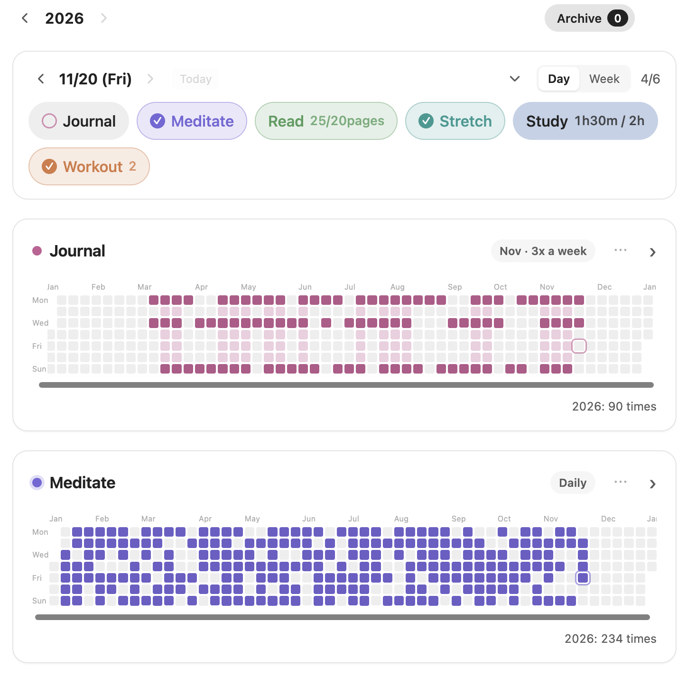

옵시디언에서 습관을 잔디(히트맵)로 보여주는 플러그인 **Habit Grid**를 만들어 커뮤니티 플러그인으로 출시했다. 습관 체크는 Apple 미리 알림에서 하고, 옵시디언에서는 기록을 시각화해서 본다. 미리 알림 없이 마크다운만으로 기록해도 된다.

## 개발 이유

노션 전에 에버노트가 있었다. 노션만큼이나 쓰는 사람이 많았고, 나도 신문 스크랩이랑 메모를 에버노트로 아주 잘 썼다.

그러다 사용이 뜸해지고 한동안 잊고 지내다가 어느 날 보니 내 계정에 여러 나라에서 로그인 시도가 들어와 있었다. 알고 보니 그것도 한두 번이 아니었다. 메일을 잘 안 보던 시기라 몇 달 전부터 내 계정이 남의 놀이터가 된 줄도 모르고 있었다. 하필 거기에 비밀번호를 적어둔 메모까지 있어서, 모든 계정의 비밀번호를 바꿔야 했다.

이 일 말고도 쓰던 소프트웨어가 금방 못 쓰게 되는 일을 여러 번 겪었다. 그 뒤로는 기록을 어디에 남길지 좀 신중하게 정하게 됐다.

그러던 중 잘 쓰던 습관 기록 앱이 유료화를 했다. 그래서 그냥 나만의 기록을 갖기로 했다.

후보가 여러 개였는데, 그중에서 iOS 기본 앱인 미리 알림을 골랐다. 알고리즘이 보여준 유튜브 영상에서 미리 알림을 정말 잘 쓰는 사람을 보고 시작했는데 쓰다 보니 좋은 점이 많았다.

- 아이클라우드에 저장
- iOS 기기끼리 동기화
- 위젯 기능

그런데 미리 알림에는 딱 하나 부족한 게 있었다. 습관을 시각화해서 보여주는 기능이었다. 그래서 옵시디언 플러그인으로 직접 만들기로 했다.

## 개발 과정

### 미리 알림 기록을 어떻게 가져올까

처음 목적은 단순했다. 습관은 미리 알림에 알아서 기록하고, 며칠에 한 번씩 옵시디언에 들어가 보는 것이다. 그래서 iOS 단축어로 매일 밤 11시 55분쯤 그날 치 데이터를 옵시디언으로 넘기게 기획했다.

그런데 당일에 체크를 못 할 수도 있고, 전날 것을 오늘 체크할 수도 있었다. 이러면 데이터에 구멍이 생긴다. 그래서 최근 3일간의 완료 항목을 보내는 단축어로 바꿨고, 같은 기록이 여러 번 들어와도 하나로만 인식하도록 했다. 횟수 카운팅은 미리 알림의 반복 기능으로 하기엔 번거롭고, 중복 제거만큼 얻는 게 없어서 뺐다.

### 습관 앱에서 불편했던 걸 하나씩 넣었다

여러 습관 앱을 쓰면서 불편했던 점이 몇 가지 있었다. 딥하게 찾아보면 되는 앱이 있을지도 모르지만, 아마 유료일 가능성이 높을거다. 하는 김에 그동안 원했던 기능을 다 넣어봤다.
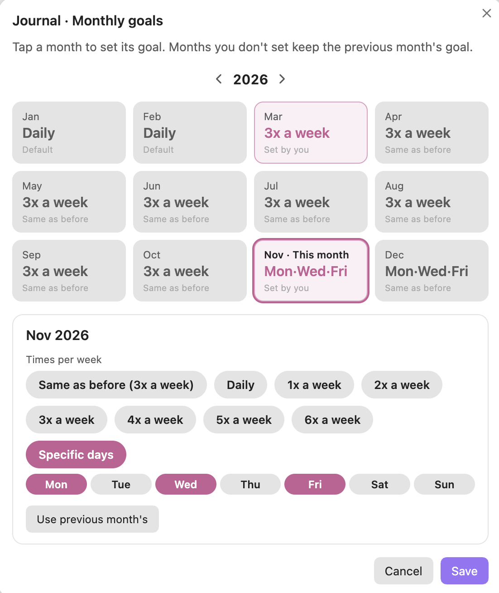

- **달마다 목표 재설정:** 목표를 달마다 새로 정하고, 그 기준에 도달하면 습관을 달성한 것으로 친다. 한 달 해보고 목표를 더 높이거나, 그달 상황에 맞춰 낮출 수 있게 만들었다.
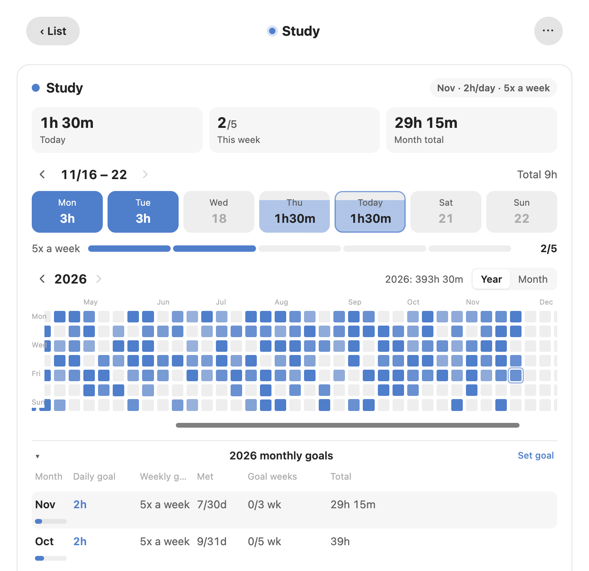

- **양 기록:** 시간, 분, 페이지, km 같은 단위를 기록한다.
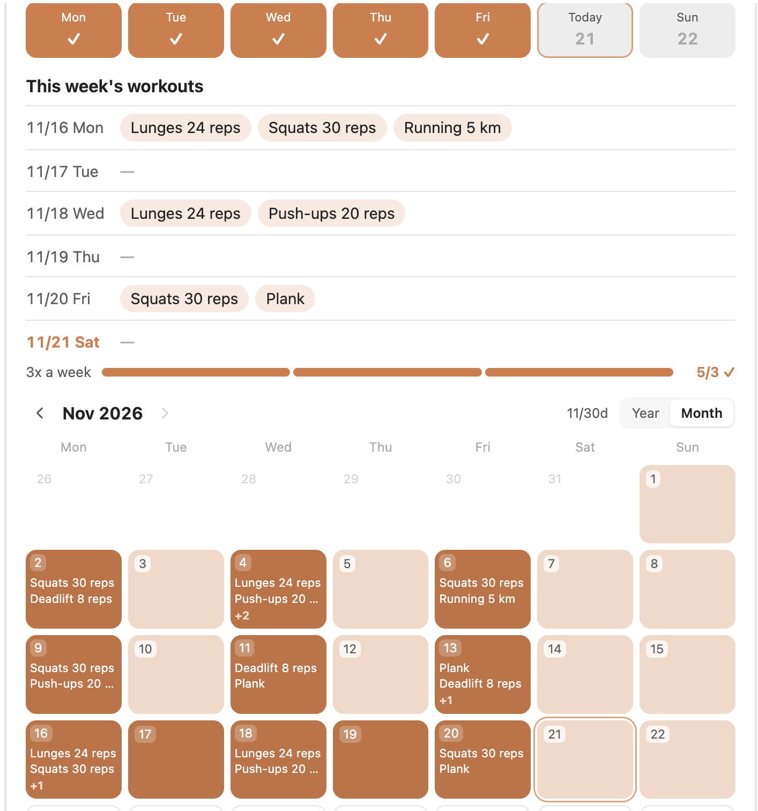

- **목록형 기록:** 운동 같은 습관은 그 밑에 뭘 했는지 적고 싶었다. 만드는 내내 골치가 아팠지만 어찌저찌 넣었다.
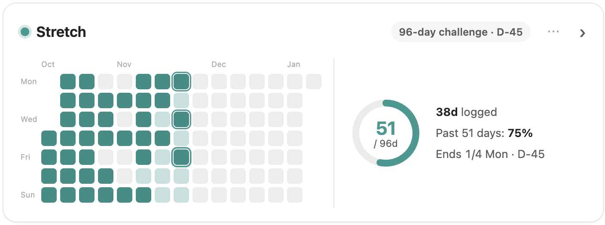

- **챌린지:** 습관이 몸에 익기까지 걸린다는 66일처럼, 원하는 기간만큼만 설정할 수 있다. 기간을 정했는데도 한 달 칸이 쭉 나오거나 1년 칸이 다 생겨버리는 게 싫었다. 습관은 어느 정도 자리를 잡으면 이미 몸에 익은 거라 굳이 기록할 필요가 없으니, 습관을 잡는 기간만 보이게 만들었다.
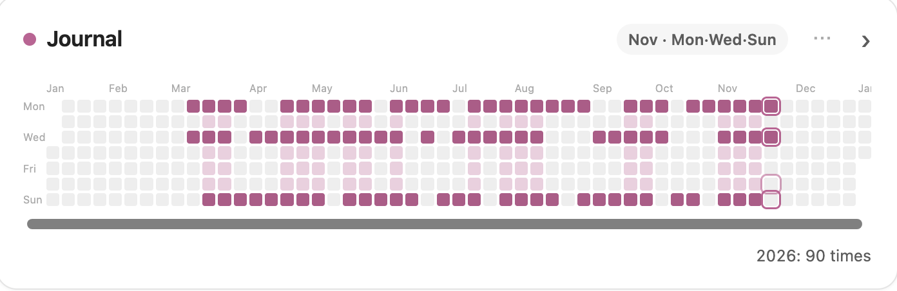

- **칸 표시:** 그 주의 목표를 달성하면 남은 칸을 옅은 색으로 채우고, 월·수·금처럼 요일이 정해진 습관은 해당 요일 칸에 테두리를 둘렀다. 오늘 칸에도 테두리가 있어서, 스크린샷에서는 지정한 요일보다 테두리 칸이 하나 더 많아 보일 수 있다.

목록형이나 양 기록은 기록의 편의를 위해 미리 알림 제목을 이렇게 구성하면 자동으로 기록되도록 했다.

```
습관 이름 n시간
습관 이름 2Km
습관 이름 스쿼트
```

### 단축어와 Mac 동기화, 둘 다 넣었다

다른 플러그인을 둘러보다가 Mac에서는 AppleScript로 미리 알림을 동기화할 수 있다는 걸 알게 됐다. 단축어 방식과 고민을 했다.

솔직히 세팅이 좀 귀찮아서 이걸 누가 쓸까 싶었는데, 생각해보니 내가 쓴다. Mac 없는 사람까지 고려했지만 사실 고려 대상은 나뿐이었다. Mac 동기화를 추가하고, 단축어는 iOS만으로 동기화하고 싶은 사람을 위해 남겨뒀다.

- **단축어(iOS):** 완료한 미리 알림을 최근 3일 기준으로 읽어 마크다운 로그에 적는다. 단축어 앱의 자동화에서 매일 23:55에 실행되게 했다.
- **Mac 동기화:** 설정에서 설치 명령을 만들어 터미널에 붙여넣으면, 백그라운드에서 주기적으로 미리 알림을 읽어온다. 이미 있는 기록은 건너뛰어서 중복이 생기지 않는다.

### 배포는 내가 먹을 음식과 남이 먹을 음식의 차이

내가 생각하는 배포는 이런 느낌이다.

- **내가 먹을 음식:** 위생이 좀 안 좋고 맛이 좀 없어도 된다.
- **남이 먹을 음식:** 공짜라도 위생과 맛을 신경 써야 한다. 에너지가 두 배는 드는 느낌.

배포하지 않으면 편하긴 하다. 그래도 플러그인 탐색에서 바로 꺼내 쓰는 게 편하고, 만든 김에 누군가 한 명이라도 편하게 같이 쓰면 좋겠다는 마음으로 배포했다

## Habit Grid 사용법

### 기능

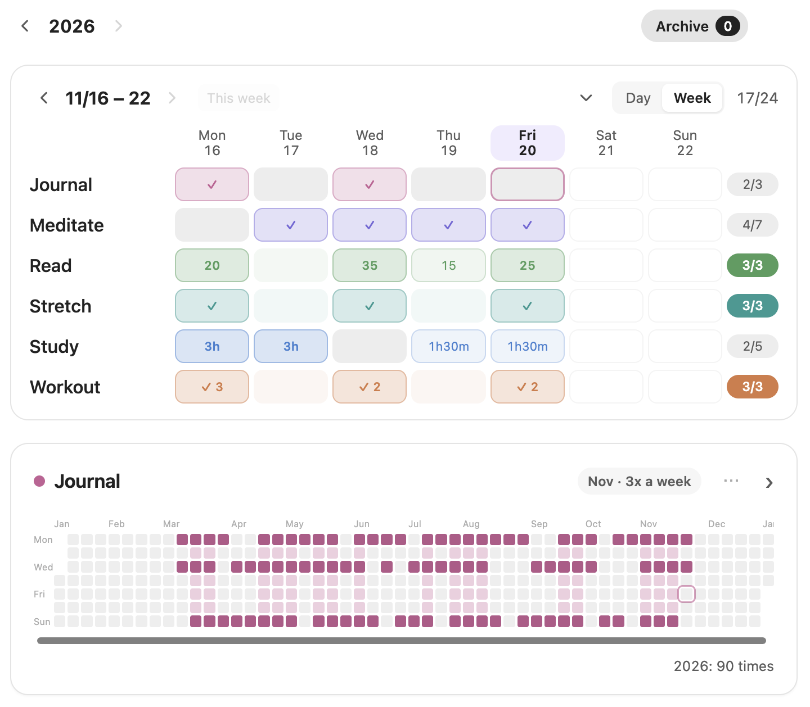

- **대시보드:** `habit` 코드블록이나 'Habits Dashboard' 노트에서 습관별 카드를 1년 또는 반년 격자로 보여준다.
- **습관 유형 3가지:** 단순 체크, 수량 기록(시간·분·페이지·km·직접 입력한 단위), 항목 기록(운동 → 스쿼트, 플랭크).
- **챌린지:** 30/66/100일이나 직접 입력한 기간으로 진행률, 연속 기록, 완료 배너가 있는 카드를 만든다.
- **반복 규칙:** 주 N회 또는 특정 요일을 지정하고, 월별로 다르게 설정할 수 있다. 비워 둔 달은 이전 달 규칙을 따른다.
- **목표:** 수량 습관에 월별 일일 목표를 정하고, 목표를 달성한 주 수를 볼 수 있다.
- **클릭으로 편집:** 칸을 눌러 기록을 추가하거나 삭제하고, 로그 대화상자에서 지난 날짜를 채울 수 있다.
- **오늘 행:** 일(최근 14일)과 주(습관별 행, 요일별 열) 보기를 전환한다.
- **보관:** 끝난 습관은 archive 폴더로 옮기며, 기록은 남고 복원할 수 있다.

### 기록 방식

습관 하나가 마크다운 파일 하나이고, 설정과 기록이 전부 그 안에 들어간다. 기록은 이런 줄이다.

```
- [x] 2026-11-19 Stretching
- [x] 2026-11-18 1h30m
- [x] 2026-11-20 squats 30 reps, plank
```

같은 날짜와 같은 제목의 줄은 한 번만 집계된다. 미리 알림 제목은 이렇게 해석한다.

- `Meditate` → 단순 체크 습관
- `Study 2h`, `Study 45 min` → Study에 시간 기록
- `Read 20 pages` → Read에 20페이지
- `Run 5km` → Run에 5km
- `Workout Squats 30 reps` → Workout 습관의 항목 Squats (30 reps)

항목 기록 습관은 이런 모습이다.
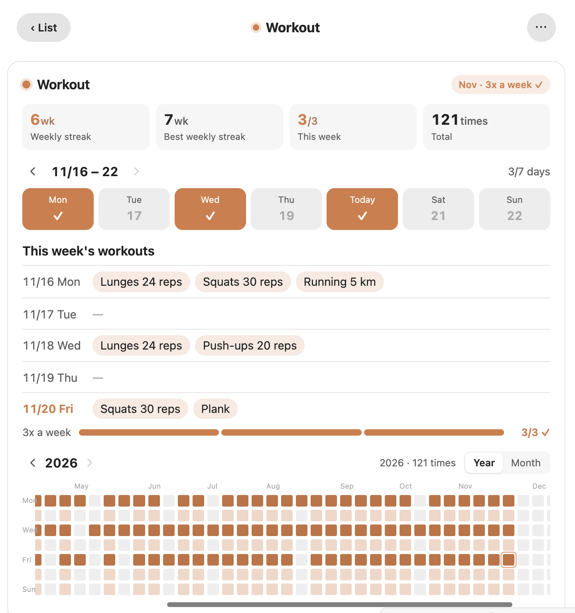
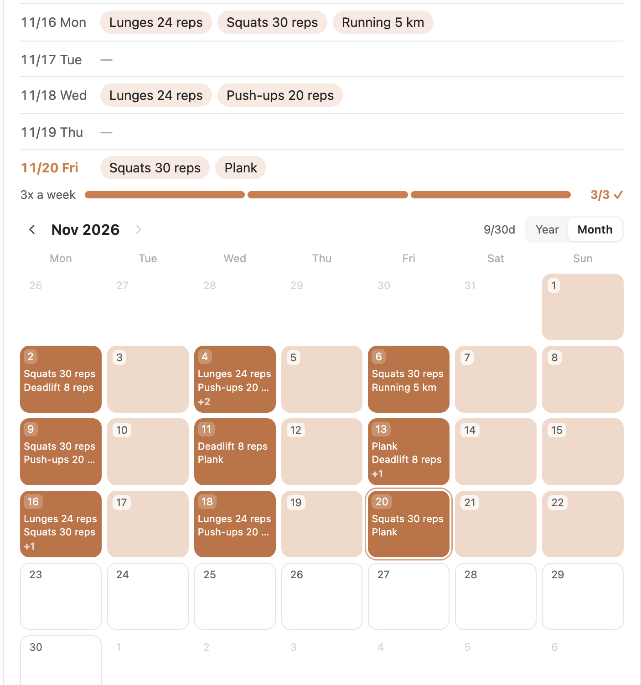

### 다른 노트에 넣어서 보기

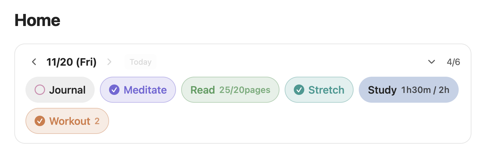
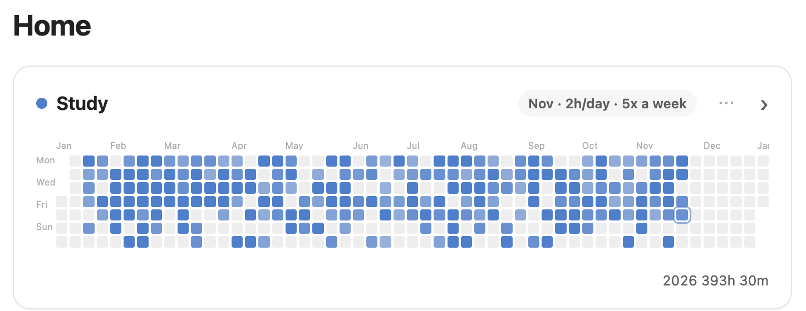
노트에 `habit` 코드블록을 넣으면 대시보드가 표시된다. 옵션으로 보이는 습관과 기간을 고를 수 있다.

````
```habit
habit: Study, Workout
year: this

```
````
`view: today`, `view: day`, `view: week`로 일/주 보기만 따로 넣을 수도 있고, `habit: Study`와 `year: this`를 같이 쓰면 한 습관의 연간 격자만 보여준다.

## 출시

출시는 생각보다 쉬웠다. 릴리스를 발행하고, 옵시디언 사이트에서 GitHub를 연결하고, 레포를 선택해 심사를 받으면 된다. 자동 심사라서 잘못된 게 있으면 고쳐서 다시 올리면 금방 받아준다.

## 후기

어지간하면 마켓을 잘 뒤져서 남이 만든 플러그인을 쓰는 게 제일 좋다. 그래도 남이 만든 게 정말 하나도 없고 진짜 필요하다고 느낄 때 만드는 걸 추천한다.

그래도 내가 원하는 대로 구현해서 딱 맞게 사용하니 약간 아쉬운데? 하는 부분이 없고 그런 부분이 있어도 내가 바로 고칠 수 있다는 점은 좋은 것 같다.
