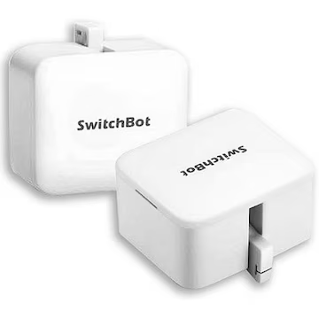
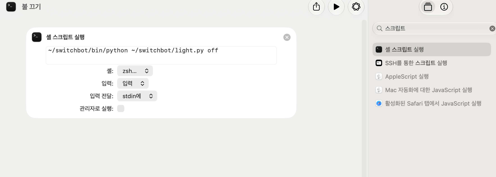

스위치봇을 사용한 지는 3~4년 정도 됐다. 자체 앱으로 스케줄을 등록할 수 있어서 취침 시간과 기상 시간에 맞춰 스케줄을 등록해서 사용했다. 그런데 늦게까지 할 일을 하고 있는데 갑자기 불이 꺼져 버리는 게, 수면 패턴 측면에서는 좋았겠지만 좀 불편하다고 느껴졌다.

그래서 굿락에서 미리 터치해 놓은 순서대로 앱을 조작하는 기능을 활용해서 이렇게 설정해 놨었다.

```
삼성 루틴 → 빅스비 "불 꺼" → 스위치봇 앱 실행 → 앱 화면을 순서대로 터치해서 전원 끄고 켜기
```

그런데 이것저것 업데이트되면서 다시 설정해야 하는 상황이 생기니까 귀찮아서 그냥 다시 설정하지 않았다.

최근 자동화에 관심이 많아지다 보니 다시 생각이 났는데, 갤럭시 루틴은 그렇다 쳐도 단축어에도 기기의 전원을 끄고 켜는 설정이 없을 줄은 몰랐다. 허브가 있으면 가능하기는하나 불 끄기 자동화 하나 하겠다고 허브를 사는 것은 합리적이지 않았다.

그래서 이 부분에 대해서 알아보니 맥북을 허브처럼 사용할 수 있다고 해서 그렇게 설정해 보았다.

## 왜 허브가 필요할까

스위치봇 봇은 블루투스 기기다. 폰 앱으로 가까이에서 조작하는 건 되지만, Siri나 빅스비, SmartThings 같은 곳에서 부르려면 스위치봇 클라우드를 거쳐야 하고, 블루투스 기기를 클라우드에 올려 주는 게 바로 스위치봇 허브(허브 미니 등)다.

그런데 맥북에도 블루투스가 있다. 맥북이 직접 봇에 명령을 보내면 허브가 하는 일을 대신할 수 있다.

## 전체 구조

최종적으로 만든 흐름은 이렇다.

```
아이폰 단축어 ("시리야, 불 꺼")
  → 집 와이파이로 맥에 SSH 접속 (키 인증)
  → 맥의 단축어 앱 실행
  → 파이썬 스크립트(pySwitchbot)
  → 블루투스로 스위치봇 봇 제어
  → 불 꺼짐
```

중간에 맥 단축어 앱을 한 번 거치는 이유와 SSH를 키 인증으로만 받게 한 이유는 뒤에서 설명한다.

미리 말해 두면 이 방식에는 한계가 있다.

- 맥이 깨어 있어야 한다.
- 아이폰과 맥이 같은 와이파이에 있어야 한다. 나는 방에서만 쓸 거라 상관없었다.
- 빅스비나 SmartThings에는 연결이 안 된다. 이 둘은 스위치봇 클라우드를 거치기 때문에 결국 실물 허브가 필요하다.

## 0. 맥북을 계속 깨어 있게 하기

맥북은 뚜껑을 닫으면 잠자기에 들어가고, 그러면 블루투스도 SSH도 다 끊긴다. 방법은 두 가지였다.

- **클램쉘 모드:** 전원과 외장 모니터를 연결하면 뚜껑을 닫아도 안 잔다. 대신 모니터가 계속 연결돼 있어야 한다.
- **뚜껑은 열어 두고 화면만 끄기:** 맥북 하나로 해결된다.

허브 용도로 모니터까지 계속 켜 두는 건 아까워서 두 번째 방법을 골랐다.

1. 시스템 설정 → 배터리 → 옵션 → "전원 어댑터 사용 시 디스플레이가 꺼져 있을 때 자동으로 잠자기 방지" 켜기
2. 시스템 설정 → 잠금 화면 → "전원 어댑터 사용 시 디스플레이 끄기"를 짧게 설정
3. 자리를 비울 때는 `Ctrl + Cmd + Q`로 화면 잠금. 잠가도 스크립트는 계속 돈다.

충전기를 계속 꽂아 두게 되니까 배터리 설정의 "최적화된 배터리 충전"도 켜 두는 게 좋다.

## 1. 파이썬 환경 만들기

스위치봇을 블루투스로 제어하는 파이썬 라이브러리 `pySwitchbot`을 썼다. 내부적으로 `bleak`라는 블루투스 라이브러리를 쓰는데, 맥에서는 이게 `pyobjc`를 통해 macOS 블루투스(CoreBluetooth)에 접근한다.

처음에는 맥에 기본으로 깔린 `python3`로 가상환경을 만들었는데 설치하다가 이런 에러가 났다.

```
error: default initialization of an object of type 'const vector_float4' ...
  [-Werror,-Wdefault-const-init-var-unsafe]
ERROR: Failed building wheel for pyobjc-core
```

기본 파이썬이 오래돼서 미리 빌드된 `pyobjc-core`를 못 받아 오고, 소스에서 직접 빌드하려다가 최신 컴파일러 경고에 막힌 거였다. 고칠 방법은 여러 가지인데, Homebrew로 파이썬 3.12를 깔고 처음부터 다시 만드는 게 제일 깔끔했다.

```bash
rm -rf ~/switchbot   # 기존 가상환경 삭제

brew install python@3.12
/opt/homebrew/bin/python3.12 -m venv ~/switchbot
~/switchbot/bin/pip install --upgrade pip
~/switchbot/bin/pip install pySwitchbot
```

이번에는 문제없이 설치됐다.

## 2. 켜기 / 끄기 스크립트

스위치봇은 위아래로 눌러서 켜고 끄는 양방향 스위치다. 그래서 그냥 한 번 누르는 걸로는 안 되고, 켜기와 끄기를 확실히 구분해야 했다.

스위치봇에는 모드가 두 가지 있다.

- **누르기 모드:** 팔을 내렸다가 바로 올린다.
- **스위치 모드:** 켜기면 팔을 내리고, 끄기면 팔을 올린다. 상자에 들어 있는 끈 달린 부착물을 붙이면 팔이 올라갈 때 스위치 반대쪽을 당겨 준다.

스위치봇 앱에서 봇을 스위치 모드로 바꾸고, 켜기와 끄기 방향이 반대로 움직이면 설정에서 "반전"을 켜면 된다. 설정이 끝나면 앱은 완전히 종료해 두는 게 좋다. 폰이 봇에 붙어 있으면 맥이 연결을 못 할 때가 있다.

스크립트는 `on` / `off` 인자를 받게 만들었다.

```bash
cat > ~/switchbot/light.py << 'EOF'
import asyncio, sys
from switchbot import GetSwitchbotDevices, Switchbot

async def main(action):
    bots = await GetSwitchbotDevices().get_bots()
    if not bots:
        print("봇을 못 찾았어요")
        return
    bot = Switchbot(next(iter(bots.values())).device)
    ok = await (bot.turn_on() if action == "on" else bot.turn_off())
    print(("켰어요" if action == "on" else "껐어요") if ok else "실패")

if len(sys.argv) != 2 or sys.argv[1] not in ("on", "off"):
    print("사용법: light.py on 또는 light.py off")
else:
    asyncio.run(main(sys.argv[1]))
EOF
```

방에 봇이 하나뿐이라 주변을 스캔해서 처음 찾은 봇을 제어하게 했다. 봇이 여러 개라면 주소로 골라야 한다.

터미널에서 먼저 테스트했다.

```bash
~/switchbot/bin/python ~/switchbot/light.py off
~/switchbot/bin/python ~/switchbot/light.py on
```

블루투스 권한 창이 뜨면 허용하면 된다.

## 3. 맥 단축어 만들기

맥 단축어 앱에서 단축어를 두 개 만들었다.

|단축어 이름|셸 스크립트 실행 내용|
|---|---|
|불 끄기|`~/switchbot/bin/python ~/switchbot/light.py off`|
|불 켜기|`~/switchbot/bin/python ~/switchbot/light.py on`|

동작 검색에서 "스크립트"를 치면 비슷한 게 여러 개 나오는데, **셸 스크립트 실행**을 고르면 된다. "SSH를 통한 스크립트 실행"은 아이폰 쪽에서 쓸 동작이다.



처음 실행하면 스크립트 실행이 막혀 있을 수 있다. 그럴 땐 단축어 앱 → 설정 → 고급 → "스크립트 실행 허용"을 켜 주면 된다. 블루투스 권한도 여기서 한 번 허용해 준다.

만들다 보면 "셸 스크립트 실행 동작은 Mac에서만 실행할 수 있다"는 안내가 뜬다. 단축어가 iCloud로 아이폰과 동기화되니까 미리 알려 주는 것뿐이고, 어차피 이 단축어는 맥에서만 돌릴 거라 신경 쓰지 않아도 된다.

여기까지 하고 ▶를 누르니 불이 꺼졌다.

## 4. 아이폰에서 맥 부르기

### 맥: 원격 로그인 켜기

시스템 설정 → 일반 → 공유 → **원격 로그인**을 켠다. 옆의 ⓘ를 누르면 `ssh 사용자이름@주소` 형태로 접속 정보가 나온다. 접속 가능한 사용자도 여기서 내 계정 하나로 제한해 뒀다.

### 아이폰: SSH 단축어 만들기

아이폰 단축어 앱에서 "SSH를 통해 스크립트 실행" 동작을 추가하고 이렇게 채웠다.

- 호스트: 맥 주소 (`xxx.local` 또는 맥의 IP)
- 포트: 22
- 사용자: 맥 계정 이름
- 인증: 처음엔 암호로 테스트하고, 뒤에서 SSH 키로 바꿨다.

아이폰 단축어 이름은 맥 단축어와 헷갈리지 않게 **불 꺼**, **불 켜**로 정했다. 이러면 "시리야, 불 꺼"로 바로 부를 수 있다.

## 트러블슈팅: SSH로 실행하면 블루투스가 막힌다

스크립트 칸에 처음에는 `shortcuts run "불 끄기"`를 넣었다. 그런데 맥에서 직접 실행할 때는 잘 되던 게 아이폰에서 SSH로 부르니까 이런 에러가 났다.

```
bleak.exc.BleakBluetoothNotAvailableError:
('Bluetooth is not authorized for an unknown reason. Check macOS privacy settings.',
 <BleakBluetoothNotAvailableReason.DENIED_BY_UNKNOWN: 6>)
```

macOS는 블루투스 같은 권한을 "누가 실행했는가"를 기준으로 준다. 맥에서 단축어를 누르면 권한 주체가 단축어 앱이라 통과하지만, SSH로 들어오면 주체가 SSH 쪽이 된다. `shortcuts run` 명령도 결국 SSH 세션 안에서 돌기 때문에 똑같이 막혔다.

해결 방법은 두 가지가 있었다.

**방법 1. SSH는 신호만 보내고 실행은 단축어 앱이 하게 하기**

`shortcuts run` 대신 단축어 URL을 `open`으로 연다. 그러면 SSH 세션이 직접 실행하는 게 아니라, 이미 로그인돼 있는 내 맥 화면 쪽 단축어 앱이 실행하게 된다.

```
# 불 꺼
open "shortcuts://run-shortcut?name=%EB%B6%88%20%EB%81%84%EA%B8%B0"

# 불 켜
open "shortcuts://run-shortcut?name=%EB%B6%88%20%EC%BC%9C%EA%B8%B0"
```

`%EB%B6%88...`은 "불 끄기", "불 켜기"를 URL 인코딩한 값이다. 실행하면 맥에서 단축어 앱이 잠깐 뜨지만 화면이 꺼져 있어도 잘 동작한다.

**방법 2. SSH에 블루투스 권한 주기**

시스템 설정 → 개인정보 보호 및 보안 → Bluetooth에 `/usr/libexec/sshd-keygen-wrapper`를 추가하는 방법도 있다. 이러면 `shortcuts run`을 그대로 써도 된다.

다만 이건 불 끄기 스크립트 하나가 아니라 SSH로 들어오는 모든 접속에 블루투스 권한을 주는 거다. 누가 SSH로 들어오면 주변 블루투스 기기를 스캔하거나 암호 없는 기기를 마음대로 조작할 수 있다. 같은 결과를 권한을 덜 열고 얻을 수 있으니 나는 방법 1로 했다.

## 5. SSH를 키 인증으로만 받기

### 왜 했나

원격 로그인을 켜 둔다는 건 같은 네트워크에서 내 맥에 접속할 문이 하나 열린다는 뜻이다. 집 와이파이는 비밀번호가 걸려 있으니 그나마 괜찮은데, 문제는 맥북을 들고 카페 같은 곳에 나갈 때다. 같은 와이파이에 모르는 사람들이 있고, 맥 이름이 네트워크에 보이니 계정 이름도 짐작하기 쉽다. 그러면 남는 방어선은 맥 로그인 암호 하나뿐이다.

원격 로그인 설정에서 접속 가능한 사용자를 내 계정으로 제한해 두긴 했지만, 이건 이 맥에 있는 다른 계정으로 들어오는 걸 막는 거지 밖에서 들어오는 사람을 막는 설정이 아니다.

처음엔 장소에 따라 원격 로그인을 자동으로 켜고 끄는 방법을 생각했다. macOS Tahoe부터는 맥 단축어에도 자동화가 생겨서, 와이파이에 연결될 때 네트워크 이름을 보고 집이면 켜고 아니면 끄게 만들 수 있다. 그런데 이걸 하려면 원격 로그인을 켜고 끄는 명령을 암호 없이 실행할 수 있게 sudo 예외를 만들어야 하고, macOS 버전에 따라서는 단축어 앱에 전체 디스크 접근 권한까지 줘야 한다. 원격 로그인을 지키려고 다른 권한을 새로 여는 셈이라 앞뒤가 안 맞았다. 유선이나 테더링처럼 트리거가 안 걸리는 상황에서는 그대로 열려 있다는 것도 마음에 걸렸다.

그래서 SSH 키 인증 방식을 택했다. SSH를 키 인증으로만 받고 암호 로그인을 끄면, 키를 가진 내 아이폰 말고는 원격 로그인이 켜져 있어도 들어올 방법이 없다. 실제로 서버 SSH 설정에서도 이게 기본이다.

참고로 이 설정은 SSH(원격 로그인)에만 적용된다. 맥 로그인 화면, 잠금 해제, Touch ID, 터미널의 `sudo` 암호 입력은 전부 그대로다.

### 아이폰에서 키 만들기

아이폰 단축어의 SSH 동작에서 인증을 **SSH 키**로 바꾸면 키가 자동으로 만들어진다. 바로 아래의 **공개 키 공유**로 공개 키를 복사해서 맥으로 옮겼다. `ssh-ed25519 AAAA...`로 시작하는 한 줄이다. "불 켜" 단축어도 같은 키를 쓰도록 인증을 바꿔 줬다.

### 맥에 공개 키 등록하기

공개 키를 맥 클립보드에 복사해 둔 상태로 터미널에서 실행했다.

```bash
mkdir -p ~/.ssh && chmod 700 ~/.ssh
pbpaste >> ~/.ssh/authorized_keys
chmod 600 ~/.ssh/authorized_keys
cat ~/.ssh/authorized_keys
```

### 암호 로그인 끄기

키로 접속되는 걸 확인한 다음에 암호 로그인을 껐다. 순서가 반대면 키도 안 되고 암호도 안 되는 상태가 될 수 있다. 물론 맥 앞에서 터미널로 되돌리면 되니까 잠길 일은 없다.

```bash
sudo tee /etc/ssh/sshd_config.d/000-nopassword.conf << 'EOF'
PasswordAuthentication no
KbdInteractiveAuthentication no
EOF
```

파일 이름을 `000-`으로 시작한 데는 이유가 있다. macOS의 SSH 설정은 `sshd_config.d` 폴더의 파일을 이름순으로 읽고, 같은 항목이 여러 번 나오면 먼저 읽힌 값이 적용된다. 그래서 기본 설정 파일보다 먼저 읽히게 했다.

설정을 적용하려면 시스템 설정 → 일반 → 공유에서 원격 로그인을 껐다가 다시 켜야 한다.

### 확인

암호로만 접속을 시도해 봤다.

```bash
ssh -o PubkeyAuthentication=no localhost
```

처음 접속하는 호스트라서 `Are you sure you want to continue connecting (yes/no/[fingerprint])?`라고 물어보는데, 에러가 아니라 이 서버를 믿을지 묻는 거다. `localhost`는 내 맥이니 `yes`를 입력하면 된다. 그다음 `Permission denied (publickey)`가 나오면 암호 로그인이 제대로 막힌 거다.

나중에 되돌리고 싶으면 파일을 지우고 원격 로그인을 껐다 켜면 된다.

```bash
sudo rm /etc/ssh/sshd_config.d/000-nopassword.conf
```

아이폰을 잃어버리면 그 키로 접속할 수 있으니, 그때는 맥의 `~/.ssh/authorized_keys`에서 해당 줄을 지우면 된다.

## 마무리

기존에 갤럭시에 설정했던 것보다도 속도가 느리긴한데, 시리야 좋은 아침 하나로 수면 기록, 불 켜기 등등을 한 번에 실행 할 수 있게 돼서 만족한다.
